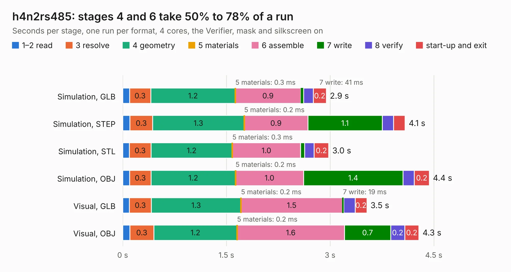

# 1668. h4n2rs485

Board 1,668 of the 3,100 of [Corpus Testing](../Corpus-Testing.md), on [Corpus Page 16](../CorpusTestingPages/Corpus-Testing-16.md#1668-h4n2rs485).

| Mode and format | 1–2 read | 3 resolve | 4 geometry | 5 materials | 6 assemble | 7 write | 8 verify | start-up and exit | Total |
|---|---:|---:|---:|---:|---:|---:|---:|---:|---:|
| Simulation, GLB | 98&nbsp;ms | 0.3 | 1.2 | 0.3&nbsp;ms | 0.9 | 41&nbsp;ms | 0.1 | 0.2 | 2.9 |
| Simulation, STEP | 0.1 | 0.3 | 1.3 | 0.2&nbsp;ms | 0.9 | 1.1 | 0.2 | 0.2 | 4.1 |
| Simulation, STL | 97&nbsp;ms | 0.3 | 1.2 | 0.3&nbsp;ms | 1.0 | 61&nbsp;ms | 0.1 | 0.2 | 3.0 |
| Simulation, OBJ | 0.1 | 0.3 | 1.2 | 0.2&nbsp;ms | 1.0 | 1.4 | 0.2 | 0.2 | 4.4 |
| Visual, GLB | 97&nbsp;ms | 0.3 | 1.3 | 0.2&nbsp;ms | 1.5 | 19&nbsp;ms | 0.2 | 0.2 | 3.5 |
| Visual, OBJ | 0.1 | 0.3 | 1.2 | 0.2&nbsp;ms | 1.6 | 0.7 | 0.2 | 0.2 | 4.3 |

<table align="center"><tr><td valign="top">

| Board | Repo: [mwwhited/embeddedbakery](https://github.com/mwwhited/embeddedbakery) Board: `h4n2rs485.kicad_pcb` |
|---|---|
| Folder | circuits / h4n2rs485 |
| Complexity | 58&nbsp;/&nbsp;1000 (size&nbsp;48, features&nbsp;10) |
| KESE&nbsp;features | rounded, trapezoid or chamfered pads |
| Tested | 9th November 2026 |
| Copper&nbsp;layers | 2 |
| File&nbsp;format | KiCad 5 (20171130) |
| Parts,&nbsp;tracks,&nbsp;vias | 17, 0, 0 |
| Triangles,&nbsp;simulation | 277,192 in 40 parts |
| Verifier | PASS in all six runs |

</td><td valign="top">

<table>
<tr><th>File type</th><th>File size</th><th>Peak memory used</th></tr>
<tr><th colspan="3" align="left">Simulation</th></tr>
<tr><td>GLB</td><td align="right">9.4&nbsp;MB</td><td align="right">226&nbsp;MB</td></tr>
<tr><td>STEP</td><td align="right">41&nbsp;MB</td><td align="right">250&nbsp;MB</td></tr>
<tr><td>STL</td><td align="right">14&nbsp;MB</td><td align="right">228&nbsp;MB</td></tr>
<tr><td>OBJ</td><td align="right">28&nbsp;MB</td><td align="right">245&nbsp;MB</td></tr>
<tr><th colspan="3" align="left">Visual</th></tr>
<tr><td>GLB</td><td align="right">4.4&nbsp;MB</td><td align="right">206&nbsp;MB</td></tr>
<tr><td>OBJ</td><td align="right">13&nbsp;MB</td><td align="right">199&nbsp;MB</td></tr>
</table>

</td></tr></table>

| Previous | Next |
|:---|---:|
| [1667. PROM](b1667b_embeddedbakery_PROM.md) | [1669. Analog Controller](b1669b_embeddedbakery_Analog-Controller.md) |
