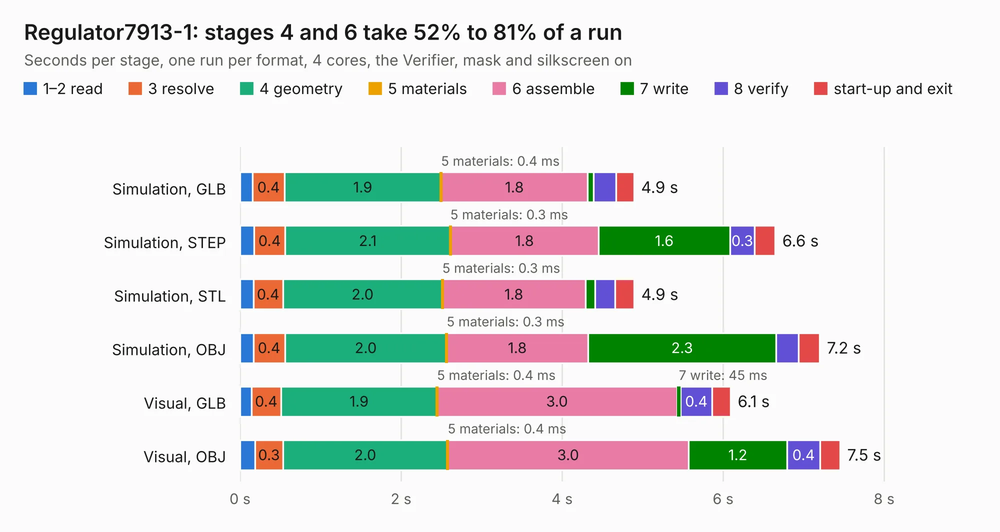

# 1669. Regulator7913-1

Board 1,669 of the 3,105 of [Corpus Testing](../Corpus-Testing.md), on [Corpus Page 16](../CorpusTestingPages/Corpus-Testing-16.md#1669-regulator7913-1).

| Mode and format | 1–2 read | 3 resolve | 4 geometry | 5 materials | 6 assemble | 7 write | 8 verify | start-up and exit | Total |
|---|---:|---:|---:|---:|---:|---:|---:|---:|---:|
| Simulation, GLB | 0.2 | 0.4 | 1.9 | 0.4&nbsp;ms | 1.8 | 76&nbsp;ms | 0.3 | 0.2 | 4.9 |
| Simulation, STEP | 0.2 | 0.4 | 2.1 | 0.3&nbsp;ms | 1.8 | 1.6 | 0.3 | 0.3 | 6.6 |
| Simulation, STL | 0.2 | 0.4 | 2.0 | 0.3&nbsp;ms | 1.8 | 0.1 | 0.2 | 0.2 | 4.9 |
| Simulation, OBJ | 0.2 | 0.4 | 2.0 | 0.3&nbsp;ms | 1.8 | 2.3 | 0.3 | 0.3 | 7.2 |
| Visual, GLB | 0.1 | 0.4 | 1.9 | 0.4&nbsp;ms | 3.0 | 45&nbsp;ms | 0.4 | 0.2 | 6.1 |
| Visual, OBJ | 0.2 | 0.3 | 2.0 | 0.4&nbsp;ms | 3.0 | 1.2 | 0.4 | 0.2 | 7.5 |

<table align="center"><tr><td valign="top">

| Board | Repo: [mwwhited/embeddedbakery](https://github.com/mwwhited/embeddedbakery) Board: `Regulator7913-1.kicad_pcb` |
|---|---|
| Folder | circuits / ComdynaGP6 / Regulator7913-1 |
| Complexity | 160&nbsp;/&nbsp;1000 (size&nbsp;145, features&nbsp;15) |
| KESE&nbsp;features | through vias |
| Tested | 9th November 2026 |
| Copper&nbsp;layers | 2 |
| File&nbsp;format | KiCad 7 (20221018) |
| Parts,&nbsp;tracks,&nbsp;vias | 34, 242, 1 |
| Triangles,&nbsp;simulation | 497,452 in 48 parts |
| Verifier | PASS in all six runs |

</td><td valign="top">

<table>
<tr><th>File type</th><th>File size</th><th>Peak memory used</th></tr>
<tr><th colspan="3" align="left">Simulation</th></tr>
<tr><td>GLB</td><td align="right">16&nbsp;MB</td><td align="right">275&nbsp;MB</td></tr>
<tr><td>STEP</td><td align="right">64&nbsp;MB</td><td align="right">337&nbsp;MB</td></tr>
<tr><td>STL</td><td align="right">25&nbsp;MB</td><td align="right">282&nbsp;MB</td></tr>
<tr><td>OBJ</td><td align="right">49&nbsp;MB</td><td align="right">376&nbsp;MB</td></tr>
<tr><th colspan="3" align="left">Visual</th></tr>
<tr><td>GLB</td><td align="right">9.0&nbsp;MB</td><td align="right">311&nbsp;MB</td></tr>
<tr><td>OBJ</td><td align="right">27&nbsp;MB</td><td align="right">316&nbsp;MB</td></tr>
</table>

</td></tr></table>

| Previous | Next |
|:---|---:|
| [1668. Simple OpAmp](b1668b_embeddedbakery_Simple-OpAmp.md) | [1670. Digital Logic Board](b1670b_embeddedbakery_Digital-Logic-Board.md) |
