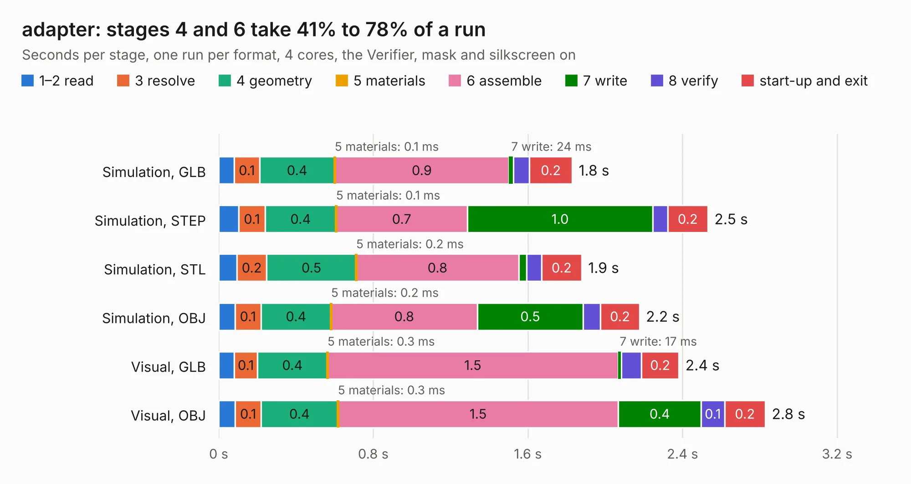

# 1670. adapter

Board 1,670 of the 3,139 of [Corpus Testing](../Corpus-Testing.md), on [Corpus Page 16](../CorpusTestingPages/Corpus-Testing-16.md#1670-adapter).

| Mode and format | 1–2 read | 3 resolve | 4 geometry | 5 materials | 6 assemble | 7 write | 8 verify | start-up and exit | Total |
|---|---:|---:|---:|---:|---:|---:|---:|---:|---:|
| Simulation, GLB | 80&nbsp;ms | 0.1 | 0.4 | 0.1&nbsp;ms | 0.9 | 24&nbsp;ms | 82&nbsp;ms | 0.2 | 1.8 |
| Simulation, STEP | 0.1 | 0.1 | 0.4 | 0.1&nbsp;ms | 0.7 | 1.0 | 76&nbsp;ms | 0.2 | 2.5 |
| Simulation, STL | 94&nbsp;ms | 0.2 | 0.5 | 0.2&nbsp;ms | 0.8 | 41&nbsp;ms | 77&nbsp;ms | 0.2 | 1.9 |
| Simulation, OBJ | 84&nbsp;ms | 0.1 | 0.4 | 0.2&nbsp;ms | 0.8 | 0.5 | 89&nbsp;ms | 0.2 | 2.2 |
| Visual, GLB | 81&nbsp;ms | 0.1 | 0.4 | 0.3&nbsp;ms | 1.5 | 17&nbsp;ms | 0.1 | 0.2 | 2.4 |
| Visual, OBJ | 85&nbsp;ms | 0.1 | 0.4 | 0.3&nbsp;ms | 1.5 | 0.4 | 0.1 | 0.2 | 2.8 |

<table align="center"><tr><td valign="top">

| Board | Repo: [Modos-Labs/Glider](https://github.com/Modos-Labs/Glider) Board: `adapter.kicad_pcb` |
|---|---|
| Folder | pcb / 34p-adapter-b |
| Complexity | 189&nbsp;/&nbsp;1000 (size&nbsp;124, features&nbsp;65) |
| KESE&nbsp;features | through vias, filled zones, stack-up, dielectric εr and tanδ |
| Tested | 9th November 2026 |
| Copper&nbsp;layers | 2 |
| File&nbsp;format | KiCad 8 (20240108) |
| Parts,&nbsp;tracks,&nbsp;vias | 2, 216, 40 |
| Triangles,&nbsp;simulation | 123,848 in 47 parts |
| Verifier | PASS in all six runs |

</td><td valign="top">

<table>
<tr><th>File type</th><th>File size</th><th>Peak memory used</th></tr>
<tr><th colspan="3" align="left">Simulation</th></tr>
<tr><td>GLB</td><td align="right">4.3&nbsp;MB</td><td align="right">199&nbsp;MB</td></tr>
<tr><td>STEP</td><td align="right">21&nbsp;MB</td><td align="right">207&nbsp;MB</td></tr>
<tr><td>STL</td><td align="right">6.2&nbsp;MB</td><td align="right">201&nbsp;MB</td></tr>
<tr><td>OBJ</td><td align="right">12&nbsp;MB</td><td align="right">199&nbsp;MB</td></tr>
<tr><th colspan="3" align="left">Visual</th></tr>
<tr><td>GLB</td><td align="right">3.5&nbsp;MB</td><td align="right">173&nbsp;MB</td></tr>
<tr><td>OBJ</td><td align="right">10&nbsp;MB</td><td align="right">171&nbsp;MB</td></tr>
</table>

</td></tr></table>

| Previous | Next |
|:---|---:|
| [1669. adapter](b1669b_Glider_pcb-34p-adapter-a_adapter.md) | [1671. adapter](b1671b_Glider_pcb-35p-adapter-a_adapter.md) |
