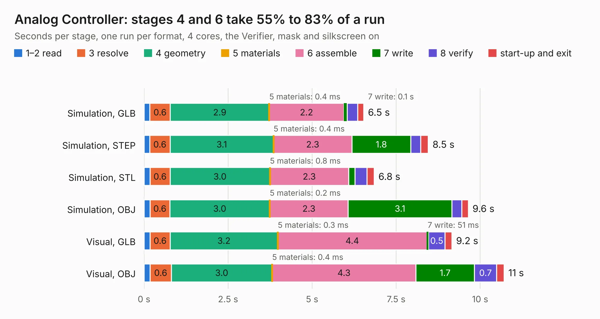

# 1673. Analog Controller

Board 1,673 of the 3,104 of [Corpus Testing](../Corpus-Testing.md), on [Corpus Page 16](../CorpusTestingPages/Corpus-Testing-16.md#1673-analog-controller).

| Mode and format | 1–2 read | 3 resolve | 4 geometry | 5 materials | 6 assemble | 7 write | 8 verify | start-up and exit | Total |
|---|---:|---:|---:|---:|---:|---:|---:|---:|---:|
| Simulation, GLB | 0.2 | 0.6 | 2.9 | 0.4&nbsp;ms | 2.2 | 0.1 | 0.3 | 0.2 | 6.5 |
| Simulation, STEP | 0.2 | 0.6 | 3.1 | 0.4&nbsp;ms | 2.3 | 1.8 | 0.3 | 0.2 | 8.5 |
| Simulation, STL | 0.2 | 0.6 | 3.0 | 0.8&nbsp;ms | 2.3 | 0.2 | 0.4 | 0.2 | 6.8 |
| Simulation, OBJ | 0.2 | 0.6 | 3.0 | 0.2&nbsp;ms | 2.3 | 3.1 | 0.3 | 0.2 | 9.6 |
| Visual, GLB | 0.2 | 0.6 | 3.2 | 0.3&nbsp;ms | 4.4 | 51&nbsp;ms | 0.5 | 0.2 | 9.2 |
| Visual, OBJ | 0.2 | 0.6 | 3.0 | 0.4&nbsp;ms | 4.3 | 1.7 | 0.7 | 0.2 | 10.7 |

<table align="center"><tr><td valign="top">

| Board | Repo: [mwwhited/embeddedbakery](https://github.com/mwwhited/embeddedbakery) Board: `Analog Controller.kicad_pcb` |
|---|---|
| Folder | circuits / HelperBoards / Controller / Analog Controller |
| Complexity | 179&nbsp;/&nbsp;1000 (size&nbsp;154, features&nbsp;25) |
| KESE&nbsp;features | through vias, rounded, trapezoid or chamfered pads |
| Tested | 9th November 2026 |
| Copper&nbsp;layers | 2 |
| File&nbsp;format | KiCad 9 (20241229) |
| Parts,&nbsp;tracks,&nbsp;vias | 42, 313, 13 |
| Triangles,&nbsp;simulation | 784,554 in 68 parts |
| Verifier | PASS in all six runs |

</td><td valign="top">

<table>
<tr><th>File type</th><th>File size</th><th>Peak memory used</th></tr>
<tr><th colspan="3" align="left">Simulation</th></tr>
<tr><td>GLB</td><td align="right">26&nbsp;MB</td><td align="right">374&nbsp;MB</td></tr>
<tr><td>STEP</td><td align="right">108&nbsp;MB</td><td align="right">452&nbsp;MB</td></tr>
<tr><td>STL</td><td align="right">39&nbsp;MB</td><td align="right">369&nbsp;MB</td></tr>
<tr><td>OBJ</td><td align="right">78&nbsp;MB</td><td align="right">560&nbsp;MB</td></tr>
<tr><th colspan="3" align="left">Visual</th></tr>
<tr><td>GLB</td><td align="right">15&nbsp;MB</td><td align="right">452&nbsp;MB</td></tr>
<tr><td>OBJ</td><td align="right">46&nbsp;MB</td><td align="right">452&nbsp;MB</td></tr>
</table>

</td></tr></table>

| Previous | Next |
|:---|---:|
| [1672. h4n2rs485](b1672b_embeddedbakery_h4n2rs485.md) | [1674. Analog Converter Backplane](b1674b_embeddedbakery_Analog-Converter-Backplane.md) |
