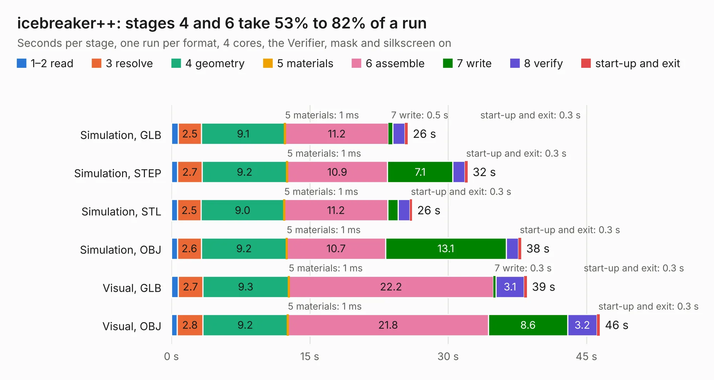

# 1674. icebreaker++

Board 1,674 of the 3,121 of [Corpus Testing](../Corpus-Testing.md), on [Corpus Page 16](../CorpusTestingPages/Corpus-Testing-16.md#1674-icebreaker).

| Mode and format | 1–2 read | 3 resolve | 4 geometry | 5 materials | 6 assemble | 7 write | 8 verify | start-up and exit | Total |
|---|---:|---:|---:|---:|---:|---:|---:|---:|---:|
| Simulation, GLB | 0.7 | 2.5 | 9.1 | 1&nbsp;ms | 11.2 | 0.5 | 1.3 | 0.3 | 25.6 |
| Simulation, STEP | 0.7 | 2.7 | 9.2 | 1&nbsp;ms | 10.9 | 7.1 | 1.3 | 0.3 | 32.1 |
| Simulation, STL | 0.7 | 2.5 | 9.0 | 1&nbsp;ms | 11.2 | 1.1 | 1.3 | 0.3 | 26.1 |
| Simulation, OBJ | 0.7 | 2.6 | 9.2 | 1&nbsp;ms | 10.7 | 13.1 | 1.3 | 0.3 | 37.9 |
| Visual, GLB | 0.7 | 2.7 | 9.3 | 1&nbsp;ms | 22.2 | 0.3 | 3.1 | 0.3 | 38.5 |
| Visual, OBJ | 0.6 | 2.8 | 9.2 | 1&nbsp;ms | 21.8 | 8.6 | 3.2 | 0.3 | 46.4 |

<table align="center"><tr><td valign="top">

| Board | Repo: [mwelling/icecrusher](https://github.com/mwelling/icecrusher) Board: `icebreaker++.kicad_pcb` |
|---|---|
| Folder | kicad-src |
| Complexity | 369&nbsp;/&nbsp;1000 (size&nbsp;269, features&nbsp;100) |
| KESE&nbsp;features | through vias, slotted holes, rounded, trapezoid or chamfered pads, filled zones, curved board outline, stack-up, dielectric εr and tanδ, mask and silkscreen colours |
| Tested | 9th November 2026 |
| Copper&nbsp;layers | 4 |
| File&nbsp;format | KiCad 6 (20201116) |
| Parts,&nbsp;tracks,&nbsp;vias | 99, 2,201, 284 |
| Triangles,&nbsp;simulation | 2,479,698 in 300 parts |
| Verifier | PASS in all six runs |

</td><td valign="top">

<table>
<tr><th>File type</th><th>File size</th><th>Peak memory used</th></tr>
<tr><th colspan="3" align="left">Simulation</th></tr>
<tr><td>GLB</td><td align="right">83&nbsp;MB</td><td align="right">864&nbsp;MB</td></tr>
<tr><td>STEP</td><td align="right">381&nbsp;MB</td><td align="right">1.1&nbsp;GB</td></tr>
<tr><td>STL</td><td align="right">124&nbsp;MB</td><td align="right">854&nbsp;MB</td></tr>
<tr><td>OBJ</td><td align="right">260&nbsp;MB</td><td align="right">1.7&nbsp;GB</td></tr>
<tr><th colspan="3" align="left">Visual</th></tr>
<tr><td>GLB</td><td align="right">55&nbsp;MB</td><td align="right">1.1&nbsp;GB</td></tr>
<tr><td>OBJ</td><td align="right">172&nbsp;MB</td><td align="right">1.2&nbsp;GB</td></tr>
</table>

</td></tr></table>

| Previous | Next |
|:---|---:|
| [1673. beagle-wire](b1673b_beagle-wire_beagle-wire.md) | [1675. lofive](b1675b_lofive_lofive.md) |
