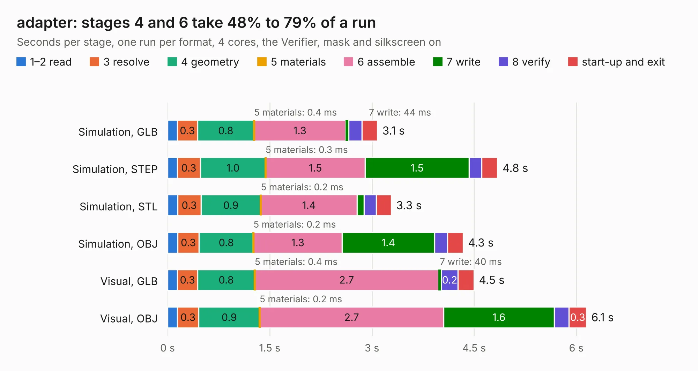

# 1675. adapter

Board 1,675 of the 3,132 of [Corpus Testing](../Corpus-Testing.md), on [Corpus Page 16](../CorpusTestingPages/Corpus-Testing-16.md#1675-adapter).

| Mode and format | 1–2 read | 3 resolve | 4 geometry | 5 materials | 6 assemble | 7 write | 8 verify | start-up and exit | Total |
|---|---:|---:|---:|---:|---:|---:|---:|---:|---:|
| Simulation, GLB | 0.1 | 0.3 | 0.8 | 0.4&nbsp;ms | 1.3 | 44&nbsp;ms | 0.2 | 0.2 | 3.1 |
| Simulation, STEP | 0.1 | 0.3 | 1.0 | 0.3&nbsp;ms | 1.5 | 1.5 | 0.2 | 0.2 | 4.8 |
| Simulation, STL | 0.1 | 0.3 | 0.9 | 0.2&nbsp;ms | 1.4 | 0.1 | 0.2 | 0.2 | 3.3 |
| Simulation, OBJ | 0.1 | 0.3 | 0.8 | 0.2&nbsp;ms | 1.3 | 1.4 | 0.2 | 0.2 | 4.3 |
| Visual, GLB | 0.1 | 0.3 | 0.8 | 0.4&nbsp;ms | 2.7 | 40&nbsp;ms | 0.2 | 0.2 | 4.5 |
| Visual, OBJ | 0.1 | 0.3 | 0.9 | 0.2&nbsp;ms | 2.7 | 1.6 | 0.2 | 0.3 | 6.1 |

<table align="center"><tr><td valign="top">

| Board | Repo: [Modos-Labs/Glider](https://github.com/Modos-Labs/Glider) Board: `adapter.kicad_pcb` |
|---|---|
| Folder | pcb / u133_adapter |
| Complexity | 229&nbsp;/&nbsp;1000 (size&nbsp;144, features&nbsp;85) |
| KESE&nbsp;features | through vias, rounded, trapezoid or chamfered pads, filled zones, curved board outline, stack-up, dielectric εr and tanδ |
| Tested | 9th November 2026 |
| Copper&nbsp;layers | 2 |
| File&nbsp;format | KiCad 8 (20240108) |
| Parts,&nbsp;tracks,&nbsp;vias | 7, 340, 86 |
| Triangles,&nbsp;simulation | 229,622 in 70 parts |
| Verifier | PASS in all six runs |

</td><td valign="top">

<table>
<tr><th>File type</th><th>File size</th><th>Peak memory used</th></tr>
<tr><th colspan="3" align="left">Simulation</th></tr>
<tr><td>GLB</td><td align="right">8.0&nbsp;MB</td><td align="right">234&nbsp;MB</td></tr>
<tr><td>STEP</td><td align="right">35&nbsp;MB</td><td align="right">260&nbsp;MB</td></tr>
<tr><td>STL</td><td align="right">11&nbsp;MB</td><td align="right">233&nbsp;MB</td></tr>
<tr><td>OBJ</td><td align="right">23&nbsp;MB</td><td align="right">234&nbsp;MB</td></tr>
<tr><th colspan="3" align="left">Visual</th></tr>
<tr><td>GLB</td><td align="right">6.6&nbsp;MB</td><td align="right">243&nbsp;MB</td></tr>
<tr><td>OBJ</td><td align="right">20&nbsp;MB</td><td align="right">240&nbsp;MB</td></tr>
</table>

</td></tr></table>

| Previous | Next |
|:---|---:|
| [1674. adapter](b1674b_Glider_pcb-mega-adapter_adapter.md) | [1676. pcb](b1676b_Lancer_pcb-epdc-poc-board_pcb.md) |
