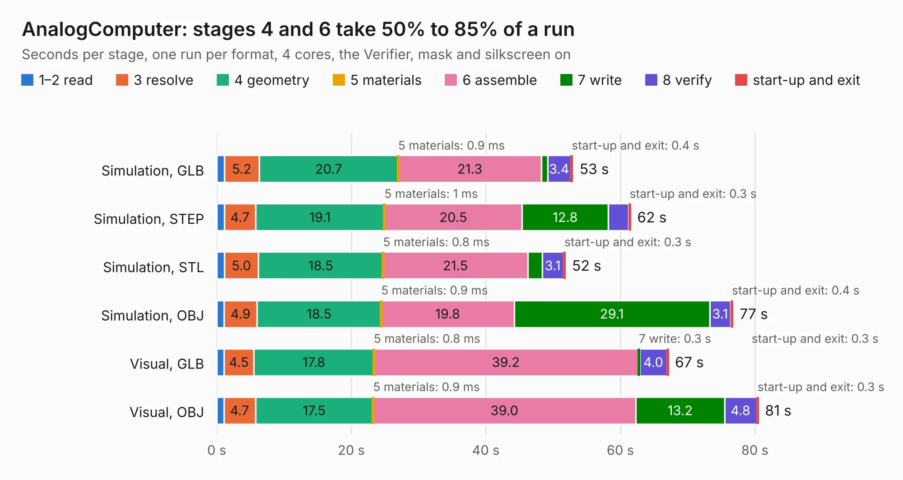

# 1675. AnalogComputer

Board 1,675 of the 3,117 of [Corpus Testing](../Corpus-Testing.md), on [Corpus Page 16](../CorpusTestingPages/Corpus-Testing-16.md#1675-analogcomputer).

| Mode and format | 1–2 read | 3 resolve | 4 geometry | 5 materials | 6 assemble | 7 write | 8 verify | start-up and exit | Total |
|---|---:|---:|---:|---:|---:|---:|---:|---:|---:|
| Simulation, GLB | 1.1 | 5.2 | 20.7 | 0.9&nbsp;ms | 21.3 | 0.9 | 3.4 | 0.4 | 53.0 |
| Simulation, STEP | 1.1 | 4.7 | 19.1 | 1&nbsp;ms | 20.5 | 12.8 | 3.0 | 0.3 | 61.5 |
| Simulation, STL | 1.1 | 5.0 | 18.5 | 0.8&nbsp;ms | 21.5 | 2.2 | 3.1 | 0.3 | 51.9 |
| Simulation, OBJ | 1.1 | 4.9 | 18.5 | 0.9&nbsp;ms | 19.8 | 29.1 | 3.1 | 0.4 | 76.8 |
| Visual, GLB | 1.0 | 4.5 | 17.8 | 0.8&nbsp;ms | 39.2 | 0.3 | 4.0 | 0.3 | 67.2 |
| Visual, OBJ | 1.0 | 4.7 | 17.5 | 0.9&nbsp;ms | 39.0 | 13.2 | 4.8 | 0.3 | 80.5 |

<table align="center"><tr><td valign="top">

| Board | Repo: [mwwhited/embeddedbakery](https://github.com/mwwhited/embeddedbakery) Board: `AnalogComputer.kicad_pcb` |
|---|---|
| Folder | circuits / AnalogCalculator / AnalogComputer |
| Complexity | 285&nbsp;/&nbsp;1000 (size&nbsp;210, features&nbsp;75) |
| KESE&nbsp;features | through vias, rounded, trapezoid or chamfered pads, filled zones, stack-up, dielectric εr and tanδ |
| Tested | 9th November 2026 |
| Copper&nbsp;layers | 4 |
| File&nbsp;format | KiCad 7 (20221018) |
| Parts,&nbsp;tracks,&nbsp;vias | 113, 2,006, 31 |
| Triangles,&nbsp;simulation | 4,617,684 in 226 parts |
| Verifier | PASS in all six runs |

</td><td valign="top">

<table>
<tr><th>File type</th><th>File size</th><th>Peak memory used</th></tr>
<tr><th colspan="3" align="left">Simulation</th></tr>
<tr><td>GLB</td><td align="right">159&nbsp;MB</td><td align="right">1.2&nbsp;GB</td></tr>
<tr><td>STEP</td><td align="right">681&nbsp;MB</td><td align="right">1.6&nbsp;GB</td></tr>
<tr><td>STL</td><td align="right">231&nbsp;MB</td><td align="right">1.2&nbsp;GB</td></tr>
<tr><td>OBJ</td><td align="right">495&nbsp;MB</td><td align="right">3.0&nbsp;GB</td></tr>
<tr><th colspan="3" align="left">Visual</th></tr>
<tr><td>GLB</td><td align="right">73&nbsp;MB</td><td align="right">1.7&nbsp;GB</td></tr>
<tr><td>OBJ</td><td align="right">228&nbsp;MB</td><td align="right">1.5&nbsp;GB</td></tr>
</table>

</td></tr></table>

| Previous | Next |
|:---|---:|
| [1674. OpenCAPI-to-PCIe_for_MNV303212A_RevA2](b1674b_opencapi-to-pcie-for-mnv303212a-reva2_OpenCAPI-to-PCIe-for-MNV303212A-RevA2.md) | [1676. Diode Function](b1676b_embeddedbakery_Diode-Function.md) |
