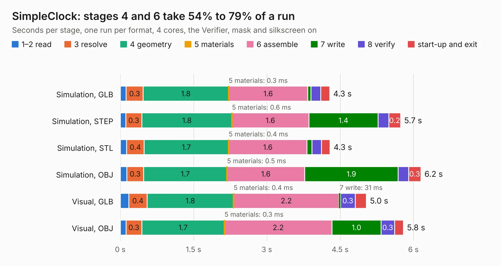

# 1675. SimpleClock

Board 1,675 of the 3,100 of [Corpus Testing](../Corpus-Testing.md), on [Corpus Page 16](../CorpusTestingPages/Corpus-Testing-16.md#1675-simpleclock).

| Mode and format | 1–2 read | 3 resolve | 4 geometry | 5 materials | 6 assemble | 7 write | 8 verify | start-up and exit | Total |
|---|---:|---:|---:|---:|---:|---:|---:|---:|---:|
| Simulation, GLB | 0.1 | 0.3 | 1.8 | 0.3&nbsp;ms | 1.6 | 63&nbsp;ms | 0.2 | 0.2 | 4.3 |
| Simulation, STEP | 0.1 | 0.3 | 1.8 | 0.6&nbsp;ms | 1.6 | 1.4 | 0.2 | 0.2 | 5.7 |
| Simulation, STL | 0.1 | 0.4 | 1.7 | 0.4&nbsp;ms | 1.6 | 0.1 | 0.2 | 0.2 | 4.3 |
| Simulation, OBJ | 0.1 | 0.3 | 1.7 | 0.5&nbsp;ms | 1.6 | 1.9 | 0.2 | 0.3 | 6.2 |
| Visual, GLB | 0.2 | 0.4 | 1.8 | 0.4&nbsp;ms | 2.2 | 31&nbsp;ms | 0.3 | 0.2 | 5.0 |
| Visual, OBJ | 0.1 | 0.3 | 1.7 | 0.3&nbsp;ms | 2.2 | 1.0 | 0.3 | 0.2 | 5.8 |

<table align="center"><tr><td valign="top">

| Board | Repo: [mwwhited/embeddedbakery](https://github.com/mwwhited/embeddedbakery) Board: `SimpleClock.kicad_pcb` |
|---|---|
| Folder | circuits / SimpleClock / SimpleClock |
| Complexity | 54&nbsp;/&nbsp;1000 (size&nbsp;54, features&nbsp;0) |
| Tested | 9th November 2026 |
| Copper&nbsp;layers | 2 |
| File&nbsp;format | KiCad 6 (20211014) |
| Parts,&nbsp;tracks,&nbsp;vias | 31, 0, 0 |
| Triangles,&nbsp;simulation | 454,624 in 46 parts |
| Verifier | PASS in all six runs |

</td><td valign="top">

<table>
<tr><th>File type</th><th>File size</th><th>Peak memory used</th></tr>
<tr><th colspan="3" align="left">Simulation</th></tr>
<tr><td>GLB</td><td align="right">14&nbsp;MB</td><td align="right">264&nbsp;MB</td></tr>
<tr><td>STEP</td><td align="right">46&nbsp;MB</td><td align="right">309&nbsp;MB</td></tr>
<tr><td>STL</td><td align="right">23&nbsp;MB</td><td align="right">264&nbsp;MB</td></tr>
<tr><td>OBJ</td><td align="right">45&nbsp;MB</td><td align="right">351&nbsp;MB</td></tr>
<tr><th colspan="3" align="left">Visual</th></tr>
<tr><td>GLB</td><td align="right">8.4&nbsp;MB</td><td align="right">305&nbsp;MB</td></tr>
<tr><td>OBJ</td><td align="right">25&nbsp;MB</td><td align="right">304&nbsp;MB</td></tr>
</table>

</td></tr></table>

| Previous | Next |
|:---|---:|
| [1674. 16bit Banked Switches](b1674b_embeddedbakery_16bit-Banked-Switches.md) | [1676. LimeSDR_Sony](b1676b_front-end-modules_LimeSDR-Sony.md) |
