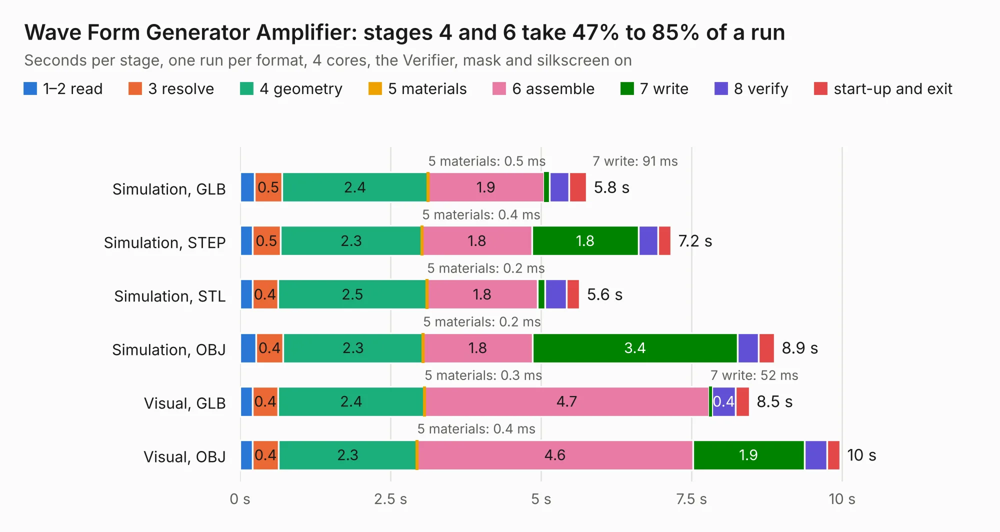

# 1676. Wave Form Generator Amplifier

Board 1,676 of the 3,104 of [Corpus Testing](../Corpus-Testing.md), on [Corpus Page 16](../CorpusTestingPages/Corpus-Testing-16.md#1676-wave-form-generator-amplifier).

| Mode and format | 1–2 read | 3 resolve | 4 geometry | 5 materials | 6 assemble | 7 write | 8 verify | start-up and exit | Total |
|---|---:|---:|---:|---:|---:|---:|---:|---:|---:|
| Simulation, GLB | 0.2 | 0.5 | 2.4 | 0.5&nbsp;ms | 1.9 | 91&nbsp;ms | 0.3 | 0.3 | 5.8 |
| Simulation, STEP | 0.2 | 0.5 | 2.3 | 0.4&nbsp;ms | 1.8 | 1.8 | 0.3 | 0.2 | 7.2 |
| Simulation, STL | 0.2 | 0.4 | 2.5 | 0.2&nbsp;ms | 1.8 | 0.1 | 0.4 | 0.2 | 5.6 |
| Simulation, OBJ | 0.3 | 0.4 | 2.3 | 0.2&nbsp;ms | 1.8 | 3.4 | 0.3 | 0.3 | 8.9 |
| Visual, GLB | 0.2 | 0.4 | 2.4 | 0.3&nbsp;ms | 4.7 | 52&nbsp;ms | 0.4 | 0.2 | 8.5 |
| Visual, OBJ | 0.2 | 0.4 | 2.3 | 0.4&nbsp;ms | 4.6 | 1.9 | 0.4 | 0.2 | 10.0 |

<table align="center"><tr><td valign="top">

| Board | Repo: [mwwhited/embeddedbakery](https://github.com/mwwhited/embeddedbakery) Board: `Wave Form Generator Amplifier.kicad_pcb` |
|---|---|
| Folder | circuits / HelperBoards / Wave Form Generator Amplifier |
| Complexity | 169&nbsp;/&nbsp;1000 (size&nbsp;139, features&nbsp;30) |
| KESE&nbsp;features | rounded, trapezoid or chamfered pads, filled zones |
| Tested | 9th November 2026 |
| Copper&nbsp;layers | 2 |
| File&nbsp;format | KiCad 7 (20221018) |
| Parts,&nbsp;tracks,&nbsp;vias | 22, 223, 0 |
| Triangles,&nbsp;simulation | 532,854 in 33 parts |
| Verifier | PASS in all six runs |

</td><td valign="top">

<table>
<tr><th>File type</th><th>File size</th><th>Peak memory used</th></tr>
<tr><th colspan="3" align="left">Simulation</th></tr>
<tr><td>GLB</td><td align="right">18&nbsp;MB</td><td align="right">330&nbsp;MB</td></tr>
<tr><td>STEP</td><td align="right">86&nbsp;MB</td><td align="right">354&nbsp;MB</td></tr>
<tr><td>STL</td><td align="right">27&nbsp;MB</td><td align="right">344&nbsp;MB</td></tr>
<tr><td>OBJ</td><td align="right">53&nbsp;MB</td><td align="right">393&nbsp;MB</td></tr>
<tr><th colspan="3" align="left">Visual</th></tr>
<tr><td>GLB</td><td align="right">11&nbsp;MB</td><td align="right">355&nbsp;MB</td></tr>
<tr><td>OBJ</td><td align="right">32&nbsp;MB</td><td align="right">354&nbsp;MB</td></tr>
</table>

</td></tr></table>

| Previous | Next |
|:---|---:|
| [1675. Analog Converter](b1675b_embeddedbakery_Analog-Converter.md) | [1677. MyIOShield](b1677b_embeddedbakery_MyIOShield.md) |
