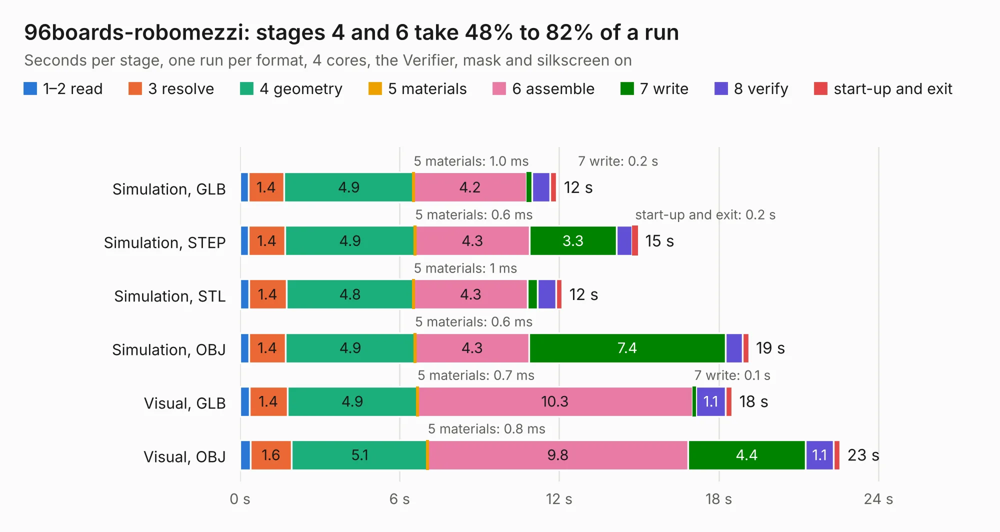

# 1678. 96boards-robomezzi

Board 1,678 of the 3,130 of [Corpus Testing](../Corpus-Testing.md), on [Corpus Page 16](../CorpusTestingPages/Corpus-Testing-16.md#1678-96boards-robomezzi).

| Mode and format | 1–2 read | 3 resolve | 4 geometry | 5 materials | 6 assemble | 7 write | 8 verify | start-up and exit | Total |
|---|---:|---:|---:|---:|---:|---:|---:|---:|---:|
| Simulation, GLB | 0.3 | 1.4 | 4.9 | 1.0&nbsp;ms | 4.2 | 0.2 | 0.7 | 0.3 | 11.9 |
| Simulation, STEP | 0.3 | 1.4 | 4.9 | 0.6&nbsp;ms | 4.3 | 3.3 | 0.6 | 0.2 | 15.0 |
| Simulation, STL | 0.3 | 1.4 | 4.8 | 1&nbsp;ms | 4.3 | 0.4 | 0.7 | 0.2 | 12.1 |
| Simulation, OBJ | 0.3 | 1.4 | 4.9 | 0.6&nbsp;ms | 4.3 | 7.4 | 0.6 | 0.2 | 19.1 |
| Visual, GLB | 0.3 | 1.4 | 4.9 | 0.7&nbsp;ms | 10.3 | 0.1 | 1.1 | 0.3 | 18.5 |
| Visual, OBJ | 0.4 | 1.6 | 5.1 | 0.8&nbsp;ms | 9.8 | 4.4 | 1.1 | 0.2 | 22.6 |

<table align="center"><tr><td valign="top">

| Board | Repo: [mwelling/96boards-robomezzi](https://github.com/mwelling/96boards-robomezzi) Board: `96boards-robomezzi.kicad_pcb` |
|---|---|
| Complexity | 247&nbsp;/&nbsp;1000 (size&nbsp;202, features&nbsp;45) |
| KESE&nbsp;features | through vias, slotted holes, filled zones |
| Tested | 9th November 2026 |
| Copper&nbsp;layers | 4 |
| File&nbsp;format | KiCad 4 (4) |
| Parts,&nbsp;tracks,&nbsp;vias | 112, 968, 113 |
| Triangles,&nbsp;simulation | 1,414,434 in 142 parts |
| Verifier | PASS in all six runs |

</td><td valign="top">

<table>
<tr><th>File type</th><th>File size</th><th>Peak memory used</th></tr>
<tr><th colspan="3" align="left">Simulation</th></tr>
<tr><td>GLB</td><td align="right">48&nbsp;MB</td><td align="right">532&nbsp;MB</td></tr>
<tr><td>STEP</td><td align="right">195&nbsp;MB</td><td align="right">598&nbsp;MB</td></tr>
<tr><td>STL</td><td align="right">71&nbsp;MB</td><td align="right">490&nbsp;MB</td></tr>
<tr><td>OBJ</td><td align="right">147&nbsp;MB</td><td align="right">982&nbsp;MB</td></tr>
<tr><th colspan="3" align="left">Visual</th></tr>
<tr><td>GLB</td><td align="right">28&nbsp;MB</td><td align="right">712&nbsp;MB</td></tr>
<tr><td>OBJ</td><td align="right">86&nbsp;MB</td><td align="right">693&nbsp;MB</td></tr>
</table>

</td></tr></table>

| Previous | Next |
|:---|---:|
| [1677. Project NuXT](b1677b_NuXT_Project-NuXT.md) | [1679. beagle-wire](b1679b_beagle-wire_beagle-wire.md) |
