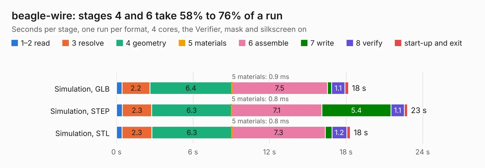

# 1678. beagle-wire

Board 1,678 of the 3,129 of [Corpus Testing](../Corpus-Testing.md), on [Corpus Page 16](../CorpusTestingPages/Corpus-Testing-16.md#1678-beagle-wire).

| Mode and format | 1–2 read | 3 resolve | 4 geometry | 5 materials | 6 assemble | 7 write | 8 verify | start-up and exit | Total |
|---|---:|---:|---:|---:|---:|---:|---:|---:|---:|
| Simulation, GLB | 0.4 | 2.2 | 6.4 | 0.9&nbsp;ms | 7.5 | 0.3 | 1.1 | 0.3 | 18.2 |
| Simulation, STEP | 0.5 | 2.3 | 6.3 | 0.8&nbsp;ms | 7.1 | 5.4 | 1.1 | 0.2 | 22.8 |
| Simulation, STL | 0.4 | 2.3 | 6.3 | 0.8&nbsp;ms | 7.3 | 0.5 | 1.2 | 0.3 | 18.3 |
| Simulation, OBJ | 0.4 | 2.4 | 6.7 | 0.9&nbsp;ms | 7.4 | 10.6 | 1.0 | 0.3 | 28.9 |
| Visual, GLB | 0.5 | 2.2 | 6.2 | 0.9&nbsp;ms | 14.8 | 0.2 | 1.5 | 0.2 | 25.7 |
| Visual, OBJ | 0.4 | 2.3 | 6.3 | 0.9&nbsp;ms | 15.3 | 7.1 | 1.7 | 0.2 | 33.3 |

<table align="center"><tr><td valign="top">

| Board | Repo: [mwelling/beagle-wire](https://github.com/mwelling/beagle-wire) Board: `beagle-wire.kicad_pcb` |
|---|---|
| Complexity | 316&nbsp;/&nbsp;1000 (size&nbsp;261, features&nbsp;55) |
| KESE&nbsp;features | through vias, rounded, trapezoid or chamfered pads, filled zones, curved board outline |
| Tested | 9th November 2026 |
| Copper&nbsp;layers | 4 |
| File&nbsp;format | KiCad 5 (20171130) |
| Parts,&nbsp;tracks,&nbsp;vias | 104, 2,019, 289 |
| Triangles,&nbsp;simulation | 2,045,158 in 200 parts |
| Verifier | PASS in all six runs |

</td><td valign="top">

<table>
<tr><th>File type</th><th>File size</th><th>Peak memory used</th></tr>
<tr><th colspan="3" align="left">Simulation</th></tr>
<tr><td>GLB</td><td align="right">70&nbsp;MB</td><td align="right">691&nbsp;MB</td></tr>
<tr><td>STEP</td><td align="right">302&nbsp;MB</td><td align="right">893&nbsp;MB</td></tr>
<tr><td>STL</td><td align="right">102&nbsp;MB</td><td align="right">668&nbsp;MB</td></tr>
<tr><td>OBJ</td><td align="right">216&nbsp;MB</td><td align="right">1.4&nbsp;GB</td></tr>
<tr><th colspan="3" align="left">Visual</th></tr>
<tr><td>GLB</td><td align="right">46&nbsp;MB</td><td align="right">875&nbsp;MB</td></tr>
<tr><td>OBJ</td><td align="right">145&nbsp;MB</td><td align="right">1.0&nbsp;GB</td></tr>
</table>

</td></tr></table>

| Previous | Next |
|:---|---:|
| [1677. 96boards-robomezzi](b1677b_96boards-robomezzi_96boards-robomezzi.md) | [1679. icebreaker++](b1679b_icecrusher_icebreaker.md) |
