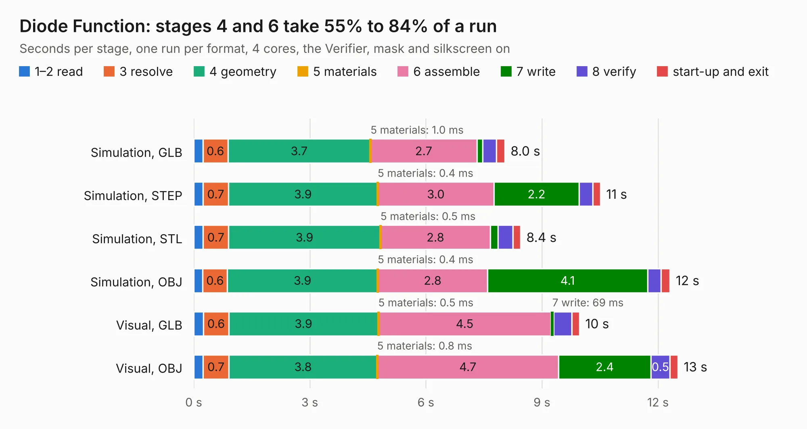

# 1679. Diode Function

Board 1,679 of the 3,121 of [Corpus Testing](../Corpus-Testing.md), on [Corpus Page 16](../CorpusTestingPages/Corpus-Testing-16.md#1679-diode-function).

| Mode and format | 1–2 read | 3 resolve | 4 geometry | 5 materials | 6 assemble | 7 write | 8 verify | start-up and exit | Total |
|---|---:|---:|---:|---:|---:|---:|---:|---:|---:|
| Simulation, GLB | 0.2 | 0.6 | 3.7 | 1.0&nbsp;ms | 2.7 | 0.1 | 0.4 | 0.2 | 8.0 |
| Simulation, STEP | 0.2 | 0.7 | 3.9 | 0.4&nbsp;ms | 3.0 | 2.2 | 0.4 | 0.2 | 10.5 |
| Simulation, STL | 0.2 | 0.7 | 3.9 | 0.5&nbsp;ms | 2.8 | 0.2 | 0.4 | 0.2 | 8.4 |
| Simulation, OBJ | 0.2 | 0.6 | 3.9 | 0.4&nbsp;ms | 2.8 | 4.1 | 0.3 | 0.2 | 12.3 |
| Visual, GLB | 0.3 | 0.6 | 3.9 | 0.5&nbsp;ms | 4.5 | 69&nbsp;ms | 0.5 | 0.2 | 10.0 |
| Visual, OBJ | 0.2 | 0.7 | 3.8 | 0.8&nbsp;ms | 4.7 | 2.4 | 0.5 | 0.2 | 12.5 |

<table align="center"><tr><td valign="top">

| Board | Repo: [mwwhited/embeddedbakery](https://github.com/mwwhited/embeddedbakery) Board: `Diode Function.kicad_pcb` |
|---|---|
| Folder | circuits / AnalogCalculator / Diode Function / Diode Function |
| Complexity | 173&nbsp;/&nbsp;1000 (size&nbsp;158, features&nbsp;15) |
| KESE&nbsp;features | through vias |
| Tested | 9th November 2026 |
| Copper&nbsp;layers | 2 |
| File&nbsp;format | KiCad 9 (20241229) |
| Parts,&nbsp;tracks,&nbsp;vias | 69, 320, 7 |
| Triangles,&nbsp;simulation | 845,732 in 56 parts |
| Verifier | PASS in all six runs |

</td><td valign="top">

<table>
<tr><th>File type</th><th>File size</th><th>Peak memory used</th></tr>
<tr><th colspan="3" align="left">Simulation</th></tr>
<tr><td>GLB</td><td align="right">28&nbsp;MB</td><td align="right">392&nbsp;MB</td></tr>
<tr><td>STEP</td><td align="right">109&nbsp;MB</td><td align="right">462&nbsp;MB</td></tr>
<tr><td>STL</td><td align="right">42&nbsp;MB</td><td align="right">375&nbsp;MB</td></tr>
<tr><td>OBJ</td><td align="right">84&nbsp;MB</td><td align="right">592&nbsp;MB</td></tr>
<tr><th colspan="3" align="left">Visual</th></tr>
<tr><td>GLB</td><td align="right">16&nbsp;MB</td><td align="right">464&nbsp;MB</td></tr>
<tr><td>OBJ</td><td align="right">48&nbsp;MB</td><td align="right">497&nbsp;MB</td></tr>
</table>

</td></tr></table>

| Previous | Next |
|:---|---:|
| [1678. AnalogComputer](b1678b_embeddedbakery_AnalogComputer.md) | [1680. OperationalAmplifierExamples](b1680b_embeddedbakery_OperationalAmplifierExamples.md) |
