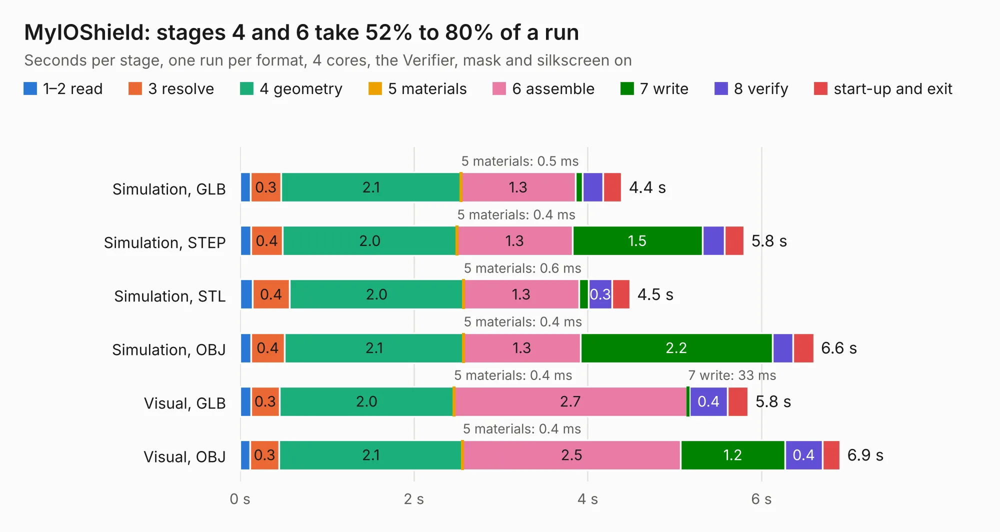

# 1679. MyIOShield

Board 1,679 of the 3,106 of [Corpus Testing](../Corpus-Testing.md), on [Corpus Page 16](../CorpusTestingPages/Corpus-Testing-16.md#1679-myioshield).

| Mode and format | 1–2 read | 3 resolve | 4 geometry | 5 materials | 6 assemble | 7 write | 8 verify | start-up and exit | Total |
|---|---:|---:|---:|---:|---:|---:|---:|---:|---:|
| Simulation, GLB | 0.1 | 0.3 | 2.1 | 0.5&nbsp;ms | 1.3 | 81&nbsp;ms | 0.2 | 0.2 | 4.4 |
| Simulation, STEP | 0.1 | 0.4 | 2.0 | 0.4&nbsp;ms | 1.3 | 1.5 | 0.3 | 0.2 | 5.8 |
| Simulation, STL | 0.1 | 0.4 | 2.0 | 0.6&nbsp;ms | 1.3 | 0.1 | 0.3 | 0.2 | 4.5 |
| Simulation, OBJ | 0.1 | 0.4 | 2.1 | 0.4&nbsp;ms | 1.3 | 2.2 | 0.2 | 0.2 | 6.6 |
| Visual, GLB | 0.1 | 0.3 | 2.0 | 0.4&nbsp;ms | 2.7 | 33&nbsp;ms | 0.4 | 0.2 | 5.8 |
| Visual, OBJ | 0.1 | 0.3 | 2.1 | 0.4&nbsp;ms | 2.5 | 1.2 | 0.4 | 0.2 | 6.9 |

<table align="center"><tr><td valign="top">

| Board | Repo: [mwwhited/embeddedbakery](https://github.com/mwwhited/embeddedbakery) Board: `MyIOShield.kicad_pcb` |
|---|---|
| Folder | circuits / MyIOShield |
| Complexity | 52&nbsp;/&nbsp;1000 (size&nbsp;52, features&nbsp;0) |
| Tested | 9th November 2026 |
| Copper&nbsp;layers | 2 |
| File&nbsp;format | KiCad 7 (20221018) |
| Parts,&nbsp;tracks,&nbsp;vias | 24, 0, 0 |
| Triangles,&nbsp;simulation | 442,126 in 47 parts |
| Verifier | PASS in all six runs |

</td><td valign="top">

<table>
<tr><th>File type</th><th>File size</th><th>Peak memory used</th></tr>
<tr><th colspan="3" align="left">Simulation</th></tr>
<tr><td>GLB</td><td align="right">14&nbsp;MB</td><td align="right">260&nbsp;MB</td></tr>
<tr><td>STEP</td><td align="right">58&nbsp;MB</td><td align="right">306&nbsp;MB</td></tr>
<tr><td>STL</td><td align="right">22&nbsp;MB</td><td align="right">260&nbsp;MB</td></tr>
<tr><td>OBJ</td><td align="right">45&nbsp;MB</td><td align="right">352&nbsp;MB</td></tr>
<tr><th colspan="3" align="left">Visual</th></tr>
<tr><td>GLB</td><td align="right">7.8&nbsp;MB</td><td align="right">292&nbsp;MB</td></tr>
<tr><td>OBJ</td><td align="right">23&nbsp;MB</td><td align="right">315&nbsp;MB</td></tr>
</table>

</td></tr></table>

| Previous | Next |
|:---|---:|
| [1678. Wave Form Generator Amplifier](b1678b_embeddedbakery_Wave-Form-Generator-Amplifier.md) | [1680. 16bit Banked Switches](b1680b_embeddedbakery_16bit-Banked-Switches.md) |
