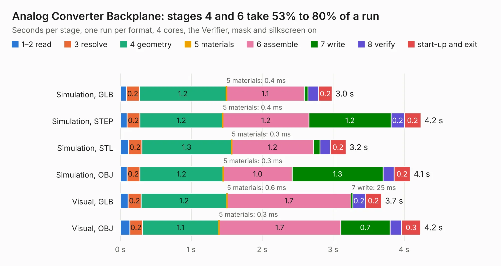

# 1680. Analog Converter Backplane

Board 1,680 of the 3,110 of [Corpus Testing](../Corpus-Testing.md), on [Corpus Page 16](../CorpusTestingPages/Corpus-Testing-16.md#1680-analog-converter-backplane).

| Mode and format | 1–2 read | 3 resolve | 4 geometry | 5 materials | 6 assemble | 7 write | 8 verify | start-up and exit | Total |
|---|---:|---:|---:|---:|---:|---:|---:|---:|---:|
| Simulation, GLB | 85&nbsp;ms | 0.2 | 1.2 | 0.4&nbsp;ms | 1.1 | 55&nbsp;ms | 0.2 | 0.2 | 3.0 |
| Simulation, STEP | 95&nbsp;ms | 0.2 | 1.2 | 0.4&nbsp;ms | 1.2 | 1.2 | 0.2 | 0.2 | 4.2 |
| Simulation, STL | 0.1 | 0.2 | 1.3 | 0.3&nbsp;ms | 1.2 | 91&nbsp;ms | 0.1 | 0.2 | 3.2 |
| Simulation, OBJ | 94&nbsp;ms | 0.2 | 1.2 | 0.3&nbsp;ms | 1.0 | 1.3 | 0.2 | 0.2 | 4.1 |
| Visual, GLB | 0.1 | 0.2 | 1.2 | 0.6&nbsp;ms | 1.7 | 25&nbsp;ms | 0.2 | 0.2 | 3.7 |
| Visual, OBJ | 0.1 | 0.2 | 1.1 | 0.3&nbsp;ms | 1.7 | 0.7 | 0.2 | 0.3 | 4.2 |

<table align="center"><tr><td valign="top">

| Board | Repo: [mwwhited/embeddedbakery](https://github.com/mwwhited/embeddedbakery) Board: `Analog Converter Backplane.kicad_pcb` |
|---|---|
| Folder | circuits / HelperBoards / Controller / Analog Converter Backplane / Analog Converter Backplane |
| Complexity | 138&nbsp;/&nbsp;1000 (size&nbsp;123, features&nbsp;15) |
| KESE&nbsp;features | through vias |
| Tested | 9th November 2026 |
| Copper&nbsp;layers | 2 |
| File&nbsp;format | KiCad 9 (20241229) |
| Parts,&nbsp;tracks,&nbsp;vias | 8, 144, 3 |
| Triangles,&nbsp;simulation | 276,700 in 35 parts |
| Verifier | PASS in all six runs |

</td><td valign="top">

<table>
<tr><th>File type</th><th>File size</th><th>Peak memory used</th></tr>
<tr><th colspan="3" align="left">Simulation</th></tr>
<tr><td>GLB</td><td align="right">8.9&nbsp;MB</td><td align="right">220&nbsp;MB</td></tr>
<tr><td>STEP</td><td align="right">34&nbsp;MB</td><td align="right">253&nbsp;MB</td></tr>
<tr><td>STL</td><td align="right">14&nbsp;MB</td><td align="right">221&nbsp;MB</td></tr>
<tr><td>OBJ</td><td align="right">27&nbsp;MB</td><td align="right">235&nbsp;MB</td></tr>
<tr><th colspan="3" align="left">Visual</th></tr>
<tr><td>GLB</td><td align="right">5.0&nbsp;MB</td><td align="right">226&nbsp;MB</td></tr>
<tr><td>OBJ</td><td align="right">15&nbsp;MB</td><td align="right">226&nbsp;MB</td></tr>
</table>

</td></tr></table>

| Previous | Next |
|:---|---:|
| [1679. Analog Controller](b1679b_embeddedbakery_Analog-Controller.md) | [1681. Analog Converter](b1681b_embeddedbakery_Analog-Converter.md) |
