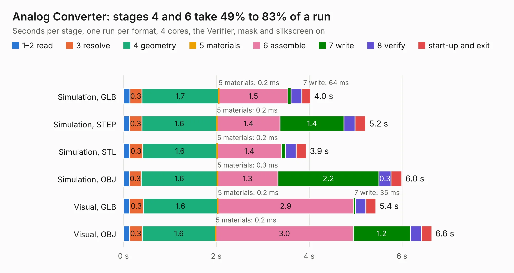

# 1681. Analog Converter

Board 1,681 of the 3,110 of [Corpus Testing](../Corpus-Testing.md), on [Corpus Page 16](../CorpusTestingPages/Corpus-Testing-16.md#1681-analog-converter).

| Mode and format | 1–2 read | 3 resolve | 4 geometry | 5 materials | 6 assemble | 7 write | 8 verify | start-up and exit | Total |
|---|---:|---:|---:|---:|---:|---:|---:|---:|---:|
| Simulation, GLB | 0.1 | 0.3 | 1.7 | 0.2&nbsp;ms | 1.5 | 64&nbsp;ms | 0.2 | 0.2 | 4.0 |
| Simulation, STEP | 0.1 | 0.3 | 1.6 | 0.2&nbsp;ms | 1.4 | 1.4 | 0.2 | 0.2 | 5.2 |
| Simulation, STL | 0.1 | 0.3 | 1.6 | 0.2&nbsp;ms | 1.4 | 88&nbsp;ms | 0.2 | 0.2 | 3.9 |
| Simulation, OBJ | 0.1 | 0.3 | 1.6 | 0.3&nbsp;ms | 1.3 | 2.2 | 0.3 | 0.2 | 6.0 |
| Visual, GLB | 0.1 | 0.3 | 1.6 | 0.2&nbsp;ms | 2.9 | 35&nbsp;ms | 0.2 | 0.2 | 5.4 |
| Visual, OBJ | 0.1 | 0.3 | 1.6 | 0.2&nbsp;ms | 3.0 | 1.2 | 0.2 | 0.2 | 6.6 |

<table align="center"><tr><td valign="top">

| Board | Repo: [mwwhited/embeddedbakery](https://github.com/mwwhited/embeddedbakery) Board: `Analog Converter.kicad_pcb` |
|---|---|
| Folder | circuits / HelperBoards / Controller / Analog Converter / Analog Converter |
| Complexity | 161&nbsp;/&nbsp;1000 (size&nbsp;131, features&nbsp;30) |
| KESE&nbsp;features | rounded, trapezoid or chamfered pads, filled zones |
| Tested | 9th November 2026 |
| Copper&nbsp;layers | 2 |
| File&nbsp;format | KiCad 9 (20241229) |
| Parts,&nbsp;tracks,&nbsp;vias | 17, 161, 0 |
| Triangles,&nbsp;simulation | 402,410 in 34 parts |
| Verifier | PASS in all six runs |

</td><td valign="top">

<table>
<tr><th>File type</th><th>File size</th><th>Peak memory used</th></tr>
<tr><th colspan="3" align="left">Simulation</th></tr>
<tr><td>GLB</td><td align="right">13&nbsp;MB</td><td align="right">257&nbsp;MB</td></tr>
<tr><td>STEP</td><td align="right">59&nbsp;MB</td><td align="right">304&nbsp;MB</td></tr>
<tr><td>STL</td><td align="right">20&nbsp;MB</td><td align="right">264&nbsp;MB</td></tr>
<tr><td>OBJ</td><td align="right">40&nbsp;MB</td><td align="right">310&nbsp;MB</td></tr>
<tr><th colspan="3" align="left">Visual</th></tr>
<tr><td>GLB</td><td align="right">7.9&nbsp;MB</td><td align="right">278&nbsp;MB</td></tr>
<tr><td>OBJ</td><td align="right">23&nbsp;MB</td><td align="right">280&nbsp;MB</td></tr>
</table>

</td></tr></table>

| Previous | Next |
|:---|---:|
| [1680. Analog Converter Backplane](b1680b_embeddedbakery_Analog-Converter-Backplane.md) | [1682. Wave Form Generator Amplifier](b1682b_embeddedbakery_Wave-Form-Generator-Amplifier.md) |
