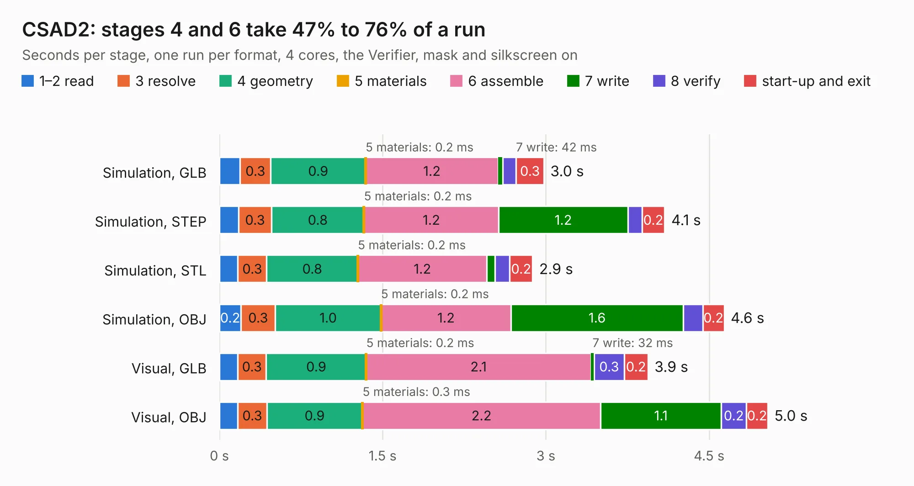

# 1681. CSAD2

Board 1,681 of the 3,101 of [Corpus Testing](../Corpus-Testing.md), on [Corpus Page 16](../CorpusTestingPages/Corpus-Testing-16.md#1681-csad2).

| Mode and format | 1–2 read | 3 resolve | 4 geometry | 5 materials | 6 assemble | 7 write | 8 verify | start-up and exit | Total |
|---|---:|---:|---:|---:|---:|---:|---:|---:|---:|
| Simulation, GLB | 0.2 | 0.3 | 0.9 | 0.2&nbsp;ms | 1.2 | 42&nbsp;ms | 0.1 | 0.3 | 3.0 |
| Simulation, STEP | 0.2 | 0.3 | 0.8 | 0.2&nbsp;ms | 1.2 | 1.2 | 0.1 | 0.2 | 4.1 |
| Simulation, STL | 0.2 | 0.3 | 0.8 | 0.2&nbsp;ms | 1.2 | 74&nbsp;ms | 0.1 | 0.2 | 2.9 |
| Simulation, OBJ | 0.2 | 0.3 | 1.0 | 0.2&nbsp;ms | 1.2 | 1.6 | 0.2 | 0.2 | 4.6 |
| Visual, GLB | 0.2 | 0.3 | 0.9 | 0.2&nbsp;ms | 2.1 | 32&nbsp;ms | 0.3 | 0.2 | 3.9 |
| Visual, OBJ | 0.2 | 0.3 | 0.9 | 0.3&nbsp;ms | 2.2 | 1.1 | 0.2 | 0.2 | 5.0 |

<table align="center"><tr><td valign="top">

| Board | Repo: [myriadrf/lc-clock](https://github.com/myriadrf/lc-clock) Board: `CSAD2.kicad_pcb` |
|---|---|
| Folder | csad2 |
| Complexity | 278&nbsp;/&nbsp;1000 (size&nbsp;163, features&nbsp;115) |
| KESE&nbsp;features | through vias, custom pads, rounded, trapezoid or chamfered pads, arc tracks, filled zones, copper drawings, stack-up, dielectric εr and tanδ |
| Tested | 9th November 2026 |
| Copper&nbsp;layers | 4 |
| File&nbsp;format | KiCad 7 (20221018) |
| Parts,&nbsp;tracks,&nbsp;vias | 37, 121, 43 |
| Triangles,&nbsp;simulation | 293,046 in 44 parts |
| Verifier | PASS in all six runs |

</td><td valign="top">

<table>
<tr><th>File type</th><th>File size</th><th>Peak memory used</th></tr>
<tr><th colspan="3" align="left">Simulation</th></tr>
<tr><td>GLB</td><td align="right">10&nbsp;MB</td><td align="right">245&nbsp;MB</td></tr>
<tr><td>STEP</td><td align="right">44&nbsp;MB</td><td align="right">284&nbsp;MB</td></tr>
<tr><td>STL</td><td align="right">15&nbsp;MB</td><td align="right">242&nbsp;MB</td></tr>
<tr><td>OBJ</td><td align="right">29&nbsp;MB</td><td align="right">261&nbsp;MB</td></tr>
<tr><th colspan="3" align="left">Visual</th></tr>
<tr><td>GLB</td><td align="right">7.4&nbsp;MB</td><td align="right">258&nbsp;MB</td></tr>
<tr><td>OBJ</td><td align="right">22&nbsp;MB</td><td align="right">252&nbsp;MB</td></tr>
</table>

</td></tr></table>

| Previous | Next |
|:---|---:|
| [1680. CSAD10](b1680b_lc-clock_CSAD10.md) | [1682. B3LPD](b1682b_lc-filters_B3LPD.md) |
