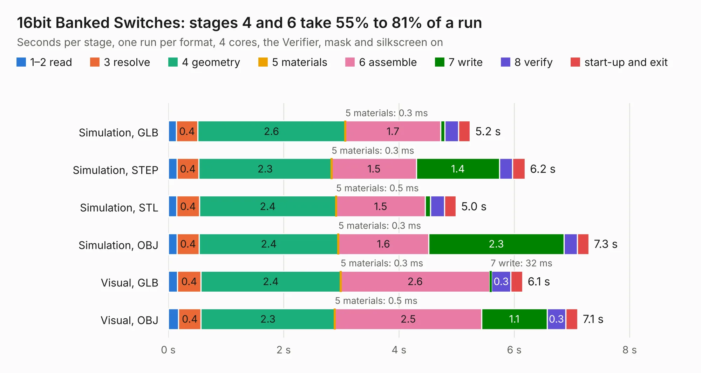

# 1682. 16bit Banked Switches

Board 1,682 of the 3,108 of [Corpus Testing](../Corpus-Testing.md), on [Corpus Page 16](../CorpusTestingPages/Corpus-Testing-16.md#1682-16bit-banked-switches).

| Mode and format | 1–2 read | 3 resolve | 4 geometry | 5 materials | 6 assemble | 7 write | 8 verify | start-up and exit | Total |
|---|---:|---:|---:|---:|---:|---:|---:|---:|---:|
| Simulation, GLB | 0.1 | 0.4 | 2.6 | 0.3&nbsp;ms | 1.7 | 76&nbsp;ms | 0.2 | 0.2 | 5.2 |
| Simulation, STEP | 0.1 | 0.4 | 2.3 | 0.3&nbsp;ms | 1.5 | 1.4 | 0.2 | 0.2 | 6.2 |
| Simulation, STL | 0.1 | 0.4 | 2.4 | 0.5&nbsp;ms | 1.5 | 95&nbsp;ms | 0.2 | 0.2 | 5.0 |
| Simulation, OBJ | 0.1 | 0.4 | 2.4 | 0.3&nbsp;ms | 1.6 | 2.3 | 0.2 | 0.2 | 7.3 |
| Visual, GLB | 0.2 | 0.4 | 2.4 | 0.3&nbsp;ms | 2.6 | 32&nbsp;ms | 0.3 | 0.2 | 6.1 |
| Visual, OBJ | 0.2 | 0.4 | 2.3 | 0.5&nbsp;ms | 2.5 | 1.1 | 0.3 | 0.2 | 7.1 |

<table align="center"><tr><td valign="top">

| Board | Repo: [mwwhited/embeddedbakery](https://github.com/mwwhited/embeddedbakery) Board: `16bit Banked Switches.kicad_pcb` |
|---|---|
| Folder | circuits / Pmod16bitBanked |
| Complexity | 147&nbsp;/&nbsp;1000 (size&nbsp;137, features&nbsp;10) |
| KESE&nbsp;features | rounded, trapezoid or chamfered pads |
| Tested | 9th November 2026 |
| Copper&nbsp;layers | 2 |
| File&nbsp;format | KiCad 7 (20221018) |
| Parts,&nbsp;tracks,&nbsp;vias | 24, 182, 0 |
| Triangles,&nbsp;simulation | 448,056 in 40 parts |
| Verifier | PASS in all six runs |

</td><td valign="top">

<table>
<tr><th>File type</th><th>File size</th><th>Peak memory used</th></tr>
<tr><th colspan="3" align="left">Simulation</th></tr>
<tr><td>GLB</td><td align="right">16&nbsp;MB</td><td align="right">266&nbsp;MB</td></tr>
<tr><td>STEP</td><td align="right">70&nbsp;MB</td><td align="right">310&nbsp;MB</td></tr>
<tr><td>STL</td><td align="right">22&nbsp;MB</td><td align="right">287&nbsp;MB</td></tr>
<tr><td>OBJ</td><td align="right">46&nbsp;MB</td><td align="right">362&nbsp;MB</td></tr>
<tr><th colspan="3" align="left">Visual</th></tr>
<tr><td>GLB</td><td align="right">7.7&nbsp;MB</td><td align="right">267&nbsp;MB</td></tr>
<tr><td>OBJ</td><td align="right">23&nbsp;MB</td><td align="right">278&nbsp;MB</td></tr>
</table>

</td></tr></table>

| Previous | Next |
|:---|---:|
| [1681. MyIOShield](b1681b_embeddedbakery_MyIOShield.md) | [1683. SimpleClock](b1683b_embeddedbakery_SimpleClock.md) |
