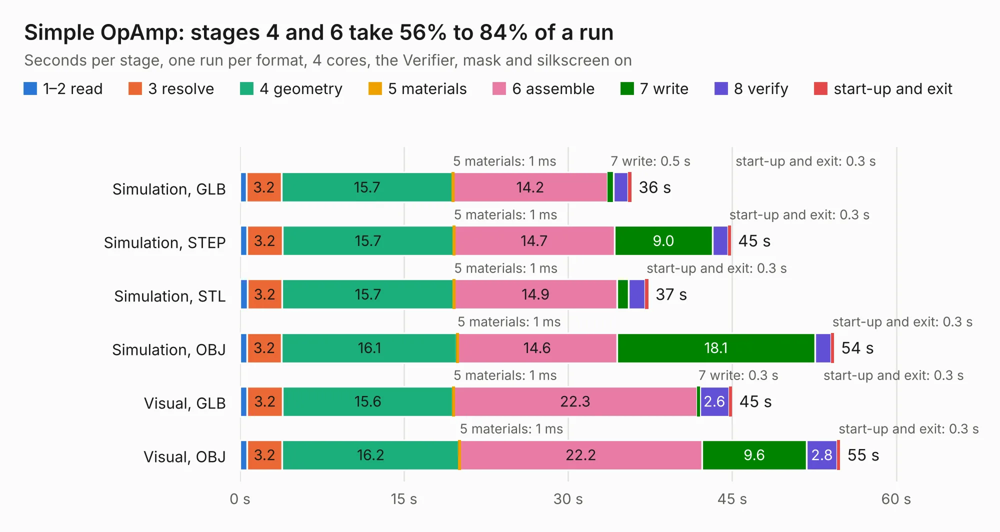

# 1682. Simple OpAmp

Board 1,682 of the 3,120 of [Corpus Testing](../Corpus-Testing.md), on [Corpus Page 16](../CorpusTestingPages/Corpus-Testing-16.md#1682-simple-opamp).

| Mode and format | 1–2 read | 3 resolve | 4 geometry | 5 materials | 6 assemble | 7 write | 8 verify | start-up and exit | Total |
|---|---:|---:|---:|---:|---:|---:|---:|---:|---:|
| Simulation, GLB | 0.6 | 3.2 | 15.7 | 1&nbsp;ms | 14.2 | 0.5 | 1.3 | 0.3 | 35.8 |
| Simulation, STEP | 0.6 | 3.2 | 15.7 | 1&nbsp;ms | 14.7 | 9.0 | 1.4 | 0.3 | 44.9 |
| Simulation, STL | 0.7 | 3.2 | 15.7 | 1&nbsp;ms | 14.9 | 1.1 | 1.5 | 0.3 | 37.3 |
| Simulation, OBJ | 0.6 | 3.2 | 16.1 | 1&nbsp;ms | 14.6 | 18.1 | 1.5 | 0.3 | 54.3 |
| Visual, GLB | 0.7 | 3.2 | 15.6 | 1&nbsp;ms | 22.3 | 0.3 | 2.6 | 0.3 | 45.0 |
| Visual, OBJ | 0.7 | 3.2 | 16.2 | 1&nbsp;ms | 22.2 | 9.6 | 2.8 | 0.3 | 54.9 |

<table align="center"><tr><td valign="top">

| Board | Repo: [mwwhited/embeddedbakery](https://github.com/mwwhited/embeddedbakery) Board: `Simple OpAmp.kicad_pcb` |
|---|---|
| Folder | circuits / AnalogCalculator / SimpleOpAmp / Simple OpAmp |
| Complexity | 83&nbsp;/&nbsp;1000 (size&nbsp;73, features&nbsp;10) |
| KESE&nbsp;features | rounded, trapezoid or chamfered pads |
| Tested | 9th November 2026 |
| Copper&nbsp;layers | 2 |
| File&nbsp;format | KiCad 9 (20241229) |
| Parts,&nbsp;tracks,&nbsp;vias | 174, 0, 0 |
| Triangles,&nbsp;simulation | 3,102,728 in 334 parts |
| Note | mostly unrouted |
| Verifier | PASS in all six runs |

</td><td valign="top">

<table>
<tr><th>File type</th><th>File size</th><th>Peak memory used</th></tr>
<tr><th colspan="3" align="left">Simulation</th></tr>
<tr><td>GLB</td><td align="right">98&nbsp;MB</td><td align="right">895&nbsp;MB</td></tr>
<tr><td>STEP</td><td align="right">366&nbsp;MB</td><td align="right">1.2&nbsp;GB</td></tr>
<tr><td>STL</td><td align="right">155&nbsp;MB</td><td align="right">904&nbsp;MB</td></tr>
<tr><td>OBJ</td><td align="right">330&nbsp;MB</td><td align="right">2.0&nbsp;GB</td></tr>
<tr><th colspan="3" align="left">Visual</th></tr>
<tr><td>GLB</td><td align="right">57&nbsp;MB</td><td align="right">1.1&nbsp;GB</td></tr>
<tr><td>OBJ</td><td align="right">178&nbsp;MB</td><td align="right">1.3&nbsp;GB</td></tr>
</table>

</td></tr></table>

| Previous | Next |
|:---|---:|
| [1681. Connectors](b1681b_embeddedbakery_Connectors.md) | [1683. Regulator7913-1](b1683b_embeddedbakery_Regulator7913-1.md) |
