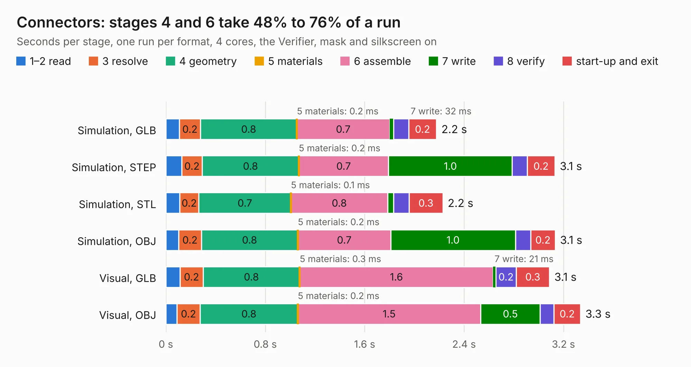

# 1683. Connectors

Board 1,683 of the 3,123 of [Corpus Testing](../Corpus-Testing.md), on [Corpus Page 16](../CorpusTestingPages/Corpus-Testing-16.md#1683-connectors).

| Mode and format | 1–2 read | 3 resolve | 4 geometry | 5 materials | 6 assemble | 7 write | 8 verify | start-up and exit | Total |
|---|---:|---:|---:|---:|---:|---:|---:|---:|---:|
| Simulation, GLB | 0.1 | 0.2 | 0.8 | 0.2&nbsp;ms | 0.7 | 32&nbsp;ms | 0.1 | 0.2 | 2.2 |
| Simulation, STEP | 0.1 | 0.2 | 0.8 | 0.2&nbsp;ms | 0.7 | 1.0 | 0.1 | 0.2 | 3.1 |
| Simulation, STL | 0.1 | 0.2 | 0.7 | 0.1&nbsp;ms | 0.8 | 46&nbsp;ms | 0.1 | 0.3 | 2.2 |
| Simulation, OBJ | 0.1 | 0.2 | 0.8 | 0.2&nbsp;ms | 0.7 | 1.0 | 0.1 | 0.2 | 3.1 |
| Visual, GLB | 0.1 | 0.2 | 0.8 | 0.3&nbsp;ms | 1.6 | 21&nbsp;ms | 0.2 | 0.3 | 3.1 |
| Visual, OBJ | 89&nbsp;ms | 0.2 | 0.8 | 0.2&nbsp;ms | 1.5 | 0.5 | 0.1 | 0.2 | 3.3 |

<table align="center"><tr><td valign="top">

| Board | Repo: [mwwhited/embeddedbakery](https://github.com/mwwhited/embeddedbakery) Board: `Connectors.kicad_pcb` |
|---|---|
| Folder | circuits / AnalogCalculator / SimpleOpAmp / Connectors / Connectors |
| Complexity | 120&nbsp;/&nbsp;1000 (size&nbsp;105, features&nbsp;15) |
| KESE&nbsp;features | through vias |
| Tested | 9th November 2026 |
| Copper&nbsp;layers | 2 |
| File&nbsp;format | KiCad 9 (20241229) |
| Parts,&nbsp;tracks,&nbsp;vias | 1, 122, 4 |
| Triangles,&nbsp;simulation | 231,562 in 30 parts |
| Verifier | PASS in all six runs |

</td><td valign="top">

<table>
<tr><th>File type</th><th>File size</th><th>Peak memory used</th></tr>
<tr><th colspan="3" align="left">Simulation</th></tr>
<tr><td>GLB</td><td align="right">7.7&nbsp;MB</td><td align="right">216&nbsp;MB</td></tr>
<tr><td>STEP</td><td align="right">28&nbsp;MB</td><td align="right">229&nbsp;MB</td></tr>
<tr><td>STL</td><td align="right">12&nbsp;MB</td><td align="right">221&nbsp;MB</td></tr>
<tr><td>OBJ</td><td align="right">22&nbsp;MB</td><td align="right">213&nbsp;MB</td></tr>
<tr><th colspan="3" align="left">Visual</th></tr>
<tr><td>GLB</td><td align="right">4.3&nbsp;MB</td><td align="right">203&nbsp;MB</td></tr>
<tr><td>OBJ</td><td align="right">12&nbsp;MB</td><td align="right">200&nbsp;MB</td></tr>
</table>

</td></tr></table>

| Previous | Next |
|:---|---:|
| [1682. OperationalAmplifierExamples](b1682b_embeddedbakery_OperationalAmplifierExamples.md) | [1684. Simple OpAmp](b1684b_embeddedbakery_Simple-OpAmp.md) |
