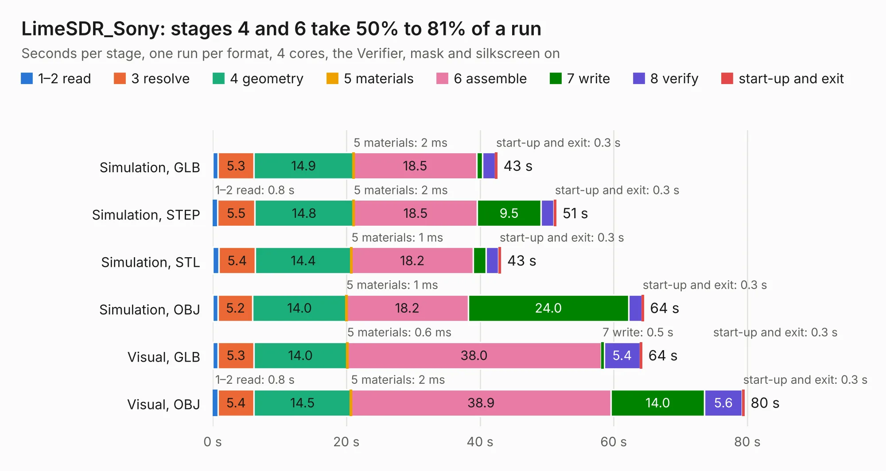

# 1683. LimeSDR_Sony

Board 1,683 of the 3,107 of [Corpus Testing](../Corpus-Testing.md), on [Corpus Page 16](../CorpusTestingPages/Corpus-Testing-16.md#1683-limesdr_sony).

| Mode and format | 1–2 read | 3 resolve | 4 geometry | 5 materials | 6 assemble | 7 write | 8 verify | start-up and exit | Total |
|---|---:|---:|---:|---:|---:|---:|---:|---:|---:|
| Simulation, GLB | 0.8 | 5.3 | 14.9 | 2&nbsp;ms | 18.5 | 0.8 | 1.9 | 0.3 | 42.5 |
| Simulation, STEP | 0.8 | 5.5 | 14.8 | 2&nbsp;ms | 18.5 | 9.5 | 1.9 | 0.3 | 51.4 |
| Simulation, STL | 1.0 | 5.4 | 14.4 | 1&nbsp;ms | 18.2 | 1.9 | 1.9 | 0.3 | 43.1 |
| Simulation, OBJ | 0.8 | 5.2 | 14.0 | 1&nbsp;ms | 18.2 | 24.0 | 2.0 | 0.3 | 64.5 |
| Visual, GLB | 0.8 | 5.3 | 14.0 | 0.6&nbsp;ms | 38.0 | 0.5 | 5.4 | 0.3 | 64.2 |
| Visual, OBJ | 0.8 | 5.4 | 14.5 | 2&nbsp;ms | 38.9 | 14.0 | 5.6 | 0.3 | 79.5 |

<table align="center"><tr><td valign="top">

| Board | Repo: [myriadrf/front-end-modules](https://github.com/myriadrf/front-end-modules) Board: `LimeSDR_Sony.kicad_pcb` |
|---|---|
| Folder | LimeSDR_PA_LNA / hardware / v1r3 / KiCAD |
| Complexity | 319&nbsp;/&nbsp;1000 (size&nbsp;274, features&nbsp;45) |
| KESE&nbsp;features | through vias, slotted holes, filled zones |
| Tested | 9th November 2026 |
| Copper&nbsp;layers | 6 |
| File&nbsp;format | KiCad 4 (4) |
| Parts,&nbsp;tracks,&nbsp;vias | 244, 2,265, 237 |
| Triangles,&nbsp;simulation | 4,502,856 in 159 parts |
| Verifier | PASS in all six runs |

</td><td valign="top">

<table>
<tr><th>File type</th><th>File size</th><th>Peak memory used</th></tr>
<tr><th colspan="3" align="left">Simulation</th></tr>
<tr><td>GLB</td><td align="right">155&nbsp;MB</td><td align="right">1.2&nbsp;GB</td></tr>
<tr><td>STEP</td><td align="right">559&nbsp;MB</td><td align="right">1.7&nbsp;GB</td></tr>
<tr><td>STL</td><td align="right">225&nbsp;MB</td><td align="right">1.2&nbsp;GB</td></tr>
<tr><td>OBJ</td><td align="right">487&nbsp;MB</td><td align="right">2.9&nbsp;GB</td></tr>
<tr><th colspan="3" align="left">Visual</th></tr>
<tr><td>GLB</td><td align="right">89&nbsp;MB</td><td align="right">1.5&nbsp;GB</td></tr>
<tr><td>OBJ</td><td align="right">282&nbsp;MB</td><td align="right">1.9&nbsp;GB</td></tr>
</table>

</td></tr></table>

| Previous | Next |
|:---|---:|
| [1682. SimpleClock](b1682b_embeddedbakery_SimpleClock.md) | [1684. lc-b3-mpa](b1684b_lc-b3-mpa_hardware-0v1_lc-b3-mpa.md) |
