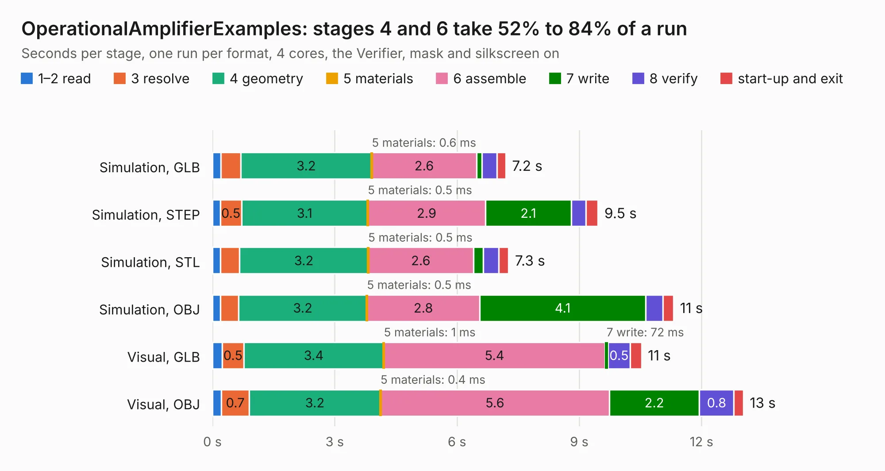

# 1684. OperationalAmplifierExamples

Board 1,684 of the 3,126 of [Corpus Testing](../Corpus-Testing.md), on [Corpus Page 16](../CorpusTestingPages/Corpus-Testing-16.md#1684-operationalamplifierexamples).

| Mode and format | 1–2 read | 3 resolve | 4 geometry | 5 materials | 6 assemble | 7 write | 8 verify | start-up and exit | Total |
|---|---:|---:|---:|---:|---:|---:|---:|---:|---:|
| Simulation, GLB | 0.2 | 0.5 | 3.2 | 0.6&nbsp;ms | 2.6 | 0.1 | 0.4 | 0.2 | 7.2 |
| Simulation, STEP | 0.2 | 0.5 | 3.1 | 0.5&nbsp;ms | 2.9 | 2.1 | 0.4 | 0.3 | 9.5 |
| Simulation, STL | 0.2 | 0.5 | 3.2 | 0.5&nbsp;ms | 2.6 | 0.2 | 0.4 | 0.2 | 7.3 |
| Simulation, OBJ | 0.2 | 0.4 | 3.2 | 0.5&nbsp;ms | 2.8 | 4.1 | 0.4 | 0.3 | 11.3 |
| Visual, GLB | 0.2 | 0.5 | 3.4 | 1&nbsp;ms | 5.4 | 72&nbsp;ms | 0.5 | 0.3 | 10.5 |
| Visual, OBJ | 0.2 | 0.7 | 3.2 | 0.4&nbsp;ms | 5.6 | 2.2 | 0.8 | 0.2 | 13.0 |

<table align="center"><tr><td valign="top">

| Board | Repo: [mwwhited/embeddedbakery](https://github.com/mwwhited/embeddedbakery) Board: `OperationalAmplifierExamples.kicad_pcb` |
|---|---|
| Folder | circuits / AnalogCalculator / OperationalAmplifierExamples / OperationalAmplifierExamples |
| Complexity | 175&nbsp;/&nbsp;1000 (size&nbsp;145, features&nbsp;30) |
| KESE&nbsp;features | rounded, trapezoid or chamfered pads, filled zones |
| Tested | 9th November 2026 |
| Copper&nbsp;layers | 2 |
| File&nbsp;format | KiCad 9 (20241229) |
| Parts,&nbsp;tracks,&nbsp;vias | 48, 195, 0 |
| Triangles,&nbsp;simulation | 846,610 in 53 parts |
| Verifier | PASS in all six runs |

</td><td valign="top">

<table>
<tr><th>File type</th><th>File size</th><th>Peak memory used</th></tr>
<tr><th colspan="3" align="left">Simulation</th></tr>
<tr><td>GLB</td><td align="right">28&nbsp;MB</td><td align="right">409&nbsp;MB</td></tr>
<tr><td>STEP</td><td align="right">117&nbsp;MB</td><td align="right">469&nbsp;MB</td></tr>
<tr><td>STL</td><td align="right">42&nbsp;MB</td><td align="right">392&nbsp;MB</td></tr>
<tr><td>OBJ</td><td align="right">84&nbsp;MB</td><td align="right">589&nbsp;MB</td></tr>
<tr><th colspan="3" align="left">Visual</th></tr>
<tr><td>GLB</td><td align="right">17&nbsp;MB</td><td align="right">498&nbsp;MB</td></tr>
<tr><td>OBJ</td><td align="right">50&nbsp;MB</td><td align="right">466&nbsp;MB</td></tr>
</table>

</td></tr></table>

| Previous | Next |
|:---|---:|
| [1683. Diode Function](b1683b_embeddedbakery_Diode-Function.md) | [1685. Connectors](b1685b_embeddedbakery_Connectors.md) |
