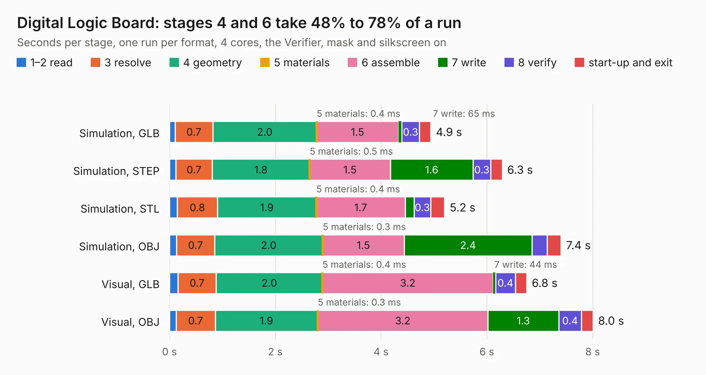

# 1688. Digital Logic Board

Board 1,688 of the 3,126 of [Corpus Testing](../Corpus-Testing.md), on [Corpus Page 16](../CorpusTestingPages/Corpus-Testing-16.md#1688-digital-logic-board).

| Mode and format | 1–2 read | 3 resolve | 4 geometry | 5 materials | 6 assemble | 7 write | 8 verify | start-up and exit | Total |
|---|---:|---:|---:|---:|---:|---:|---:|---:|---:|
| Simulation, GLB | 0.1 | 0.7 | 2.0 | 0.4&nbsp;ms | 1.5 | 65&nbsp;ms | 0.3 | 0.2 | 4.9 |
| Simulation, STEP | 0.1 | 0.7 | 1.8 | 0.5&nbsp;ms | 1.5 | 1.6 | 0.3 | 0.2 | 6.3 |
| Simulation, STL | 0.1 | 0.8 | 1.9 | 0.4&nbsp;ms | 1.7 | 0.2 | 0.3 | 0.3 | 5.2 |
| Simulation, OBJ | 0.1 | 0.7 | 2.0 | 0.3&nbsp;ms | 1.5 | 2.4 | 0.3 | 0.3 | 7.4 |
| Visual, GLB | 0.2 | 0.7 | 2.0 | 0.4&nbsp;ms | 3.2 | 44&nbsp;ms | 0.4 | 0.2 | 6.8 |
| Visual, OBJ | 0.1 | 0.7 | 1.9 | 0.3&nbsp;ms | 3.2 | 1.3 | 0.4 | 0.2 | 8.0 |

<table align="center"><tr><td valign="top">

| Board | Repo: [mwwhited/embeddedbakery](https://github.com/mwwhited/embeddedbakery) Board: `Digital Logic Board.kicad_pcb` |
|---|---|
| Folder | circuits / Digital Tools / Digital Logic Board |
| Complexity | 176&nbsp;/&nbsp;1000 (size&nbsp;131, features&nbsp;45) |
| KESE&nbsp;features | through vias, rounded, trapezoid or chamfered pads, filled zones |
| Tested | 9th November 2026 |
| Copper&nbsp;layers | 2 |
| File&nbsp;format | KiCad 9 (20241229) |
| Parts,&nbsp;tracks,&nbsp;vias | 10, 194, 8 |
| Triangles,&nbsp;simulation | 509,302 in 44 parts |
| Verifier | PASS in all six runs |

</td><td valign="top">

<table>
<tr><th>File type</th><th>File size</th><th>Peak memory used</th></tr>
<tr><th colspan="3" align="left">Simulation</th></tr>
<tr><td>GLB</td><td align="right">17&nbsp;MB</td><td align="right">284&nbsp;MB</td></tr>
<tr><td>STEP</td><td align="right">82&nbsp;MB</td><td align="right">349&nbsp;MB</td></tr>
<tr><td>STL</td><td align="right">25&nbsp;MB</td><td align="right">296&nbsp;MB</td></tr>
<tr><td>OBJ</td><td align="right">51&nbsp;MB</td><td align="right">384&nbsp;MB</td></tr>
<tr><th colspan="3" align="left">Visual</th></tr>
<tr><td>GLB</td><td align="right">9.7&nbsp;MB</td><td align="right">328&nbsp;MB</td></tr>
<tr><td>OBJ</td><td align="right">29&nbsp;MB</td><td align="right">332&nbsp;MB</td></tr>
</table>

</td></tr></table>

| Previous | Next |
|:---|---:|
| [1687. Regulator7913-1](b1687b_embeddedbakery_Regulator7913-1.md) | [1689. Examples](b1689b_embeddedbakery_Examples.md) |
