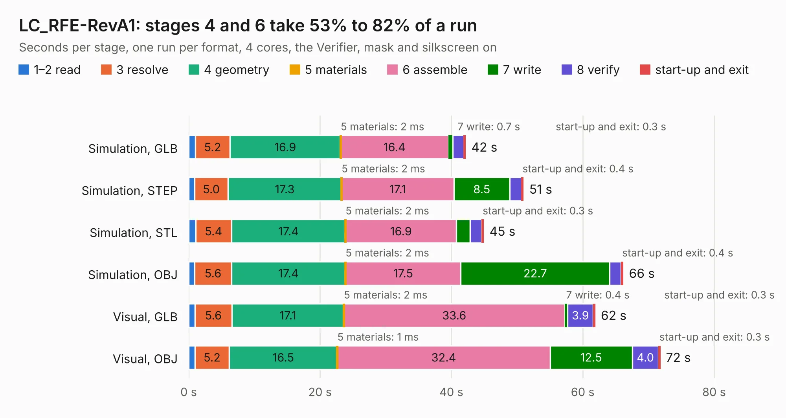

# 1688. LC_RFE-RevA1

Board 1,688 of the 3,106 of [Corpus Testing](../Corpus-Testing.md), on [Corpus Page 16](../CorpusTestingPages/Corpus-Testing-16.md#1688-lc_rfe-reva1).

| Mode and format | 1–2 read | 3 resolve | 4 geometry | 5 materials | 6 assemble | 7 write | 8 verify | start-up and exit | Total |
|---|---:|---:|---:|---:|---:|---:|---:|---:|---:|
| Simulation, GLB | 1.0 | 5.2 | 16.9 | 2&nbsp;ms | 16.4 | 0.7 | 1.6 | 0.3 | 42.2 |
| Simulation, STEP | 0.9 | 5.0 | 17.3 | 2&nbsp;ms | 17.1 | 8.5 | 1.8 | 0.4 | 51.0 |
| Simulation, STL | 1.1 | 5.4 | 17.4 | 2&nbsp;ms | 16.9 | 2.1 | 1.8 | 0.3 | 44.9 |
| Simulation, OBJ | 0.9 | 5.6 | 17.4 | 2&nbsp;ms | 17.5 | 22.7 | 1.7 | 0.4 | 66.2 |
| Visual, GLB | 0.9 | 5.6 | 17.1 | 2&nbsp;ms | 33.6 | 0.4 | 3.9 | 0.3 | 61.9 |
| Visual, OBJ | 0.9 | 5.2 | 16.5 | 1&nbsp;ms | 32.4 | 12.5 | 4.0 | 0.3 | 71.8 |

<table align="center"><tr><td valign="top">

| Board | Repo: [myriadrf/lc-rfe](https://github.com/myriadrf/lc-rfe) Board: `LC_RFE-RevA1.kicad_pcb` |
|---|---|
| Folder | revisions / LC_RFE-RevA1 |
| Complexity | 399&nbsp;/&nbsp;1000 (size&nbsp;284, features&nbsp;115) |
| KESE&nbsp;features | through vias, rounded, trapezoid or chamfered pads, arc tracks, filled zones, curved board outline, TrueType text, stack-up, dielectric εr and tanδ |
| Tested | 9th November 2026 |
| Copper&nbsp;layers | 4 |
| File&nbsp;format | KiCad 8 (20240108) |
| Parts,&nbsp;tracks,&nbsp;vias | 228, 1,247, 1,393 |
| Triangles,&nbsp;simulation | 4,623,948 in 206 parts |
| Verifier | PASS in all six runs |

</td><td valign="top">

<table>
<tr><th>File type</th><th>File size</th><th>Peak memory used</th></tr>
<tr><th colspan="3" align="left">Simulation</th></tr>
<tr><td>GLB</td><td align="right">154&nbsp;MB</td><td align="right">1.6&nbsp;GB</td></tr>
<tr><td>STEP</td><td align="right">422&nbsp;MB</td><td align="right">1.9&nbsp;GB</td></tr>
<tr><td>STL</td><td align="right">231&nbsp;MB</td><td align="right">1.7&nbsp;GB</td></tr>
<tr><td>OBJ</td><td align="right">482&nbsp;MB</td><td align="right">3.0&nbsp;GB</td></tr>
<tr><th colspan="3" align="left">Visual</th></tr>
<tr><td>GLB</td><td align="right">89&nbsp;MB</td><td align="right">1.6&nbsp;GB</td></tr>
<tr><td>OBJ</td><td align="right">283&nbsp;MB</td><td align="right">1.9&nbsp;GB</td></tr>
</table>

</td></tr></table>

| Previous | Next |
|:---|---:|
| [1687. B3LPD](b1687b_lc-filters_B3LPD.md) | [1689. LC_RFE-RevA2](b1689b_lc-rfe_LC-RFE-RevA2.md) |
