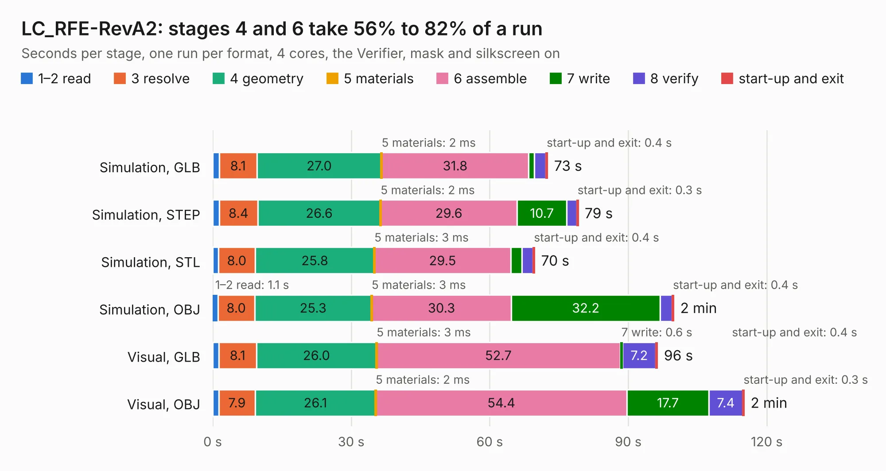

# 1688. LC_RFE-RevA2

Board 1,688 of the 3,105 of [Corpus Testing](../Corpus-Testing.md), on [Corpus Page 16](../CorpusTestingPages/Corpus-Testing-16.md#1688-lc_rfe-reva2).

| Mode and format | 1–2 read | 3 resolve | 4 geometry | 5 materials | 6 assemble | 7 write | 8 verify | start-up and exit | Total |
|---|---:|---:|---:|---:|---:|---:|---:|---:|---:|
| Simulation, GLB | 1.4 | 8.1 | 27.0 | 2&nbsp;ms | 31.8 | 1.2 | 2.5 | 0.4 | 72.6 |
| Simulation, STEP | 1.4 | 8.4 | 26.6 | 2&nbsp;ms | 29.6 | 10.7 | 2.2 | 0.3 | 79.2 |
| Simulation, STL | 1.2 | 8.0 | 25.8 | 3&nbsp;ms | 29.5 | 2.4 | 2.5 | 0.4 | 69.8 |
| Simulation, OBJ | 1.1 | 8.0 | 25.3 | 3&nbsp;ms | 30.3 | 32.2 | 2.6 | 0.4 | 99.9 |
| Visual, GLB | 1.3 | 8.1 | 26.0 | 3&nbsp;ms | 52.7 | 0.6 | 7.2 | 0.4 | 96.4 |
| Visual, OBJ | 1.3 | 7.9 | 26.1 | 2&nbsp;ms | 54.4 | 17.7 | 7.4 | 0.3 | 115.1 |

<table align="center"><tr><td valign="top">

| Board | Repo: [myriadrf/lc-rfe](https://github.com/myriadrf/lc-rfe) Board: `LC_RFE-RevA2.kicad_pcb` |
|---|---|
| Folder | revisions / LC_RFE-RevA2 |
| Complexity | 406&nbsp;/&nbsp;1000 (size&nbsp;291, features&nbsp;115) |
| KESE&nbsp;features | through vias, rounded, trapezoid or chamfered pads, arc tracks, filled zones, curved board outline, TrueType text, stack-up, dielectric εr and tanδ |
| Tested | 9th November 2026 |
| Copper&nbsp;layers | 4 |
| File&nbsp;format | KiCad 9 (20241229) |
| Parts,&nbsp;tracks,&nbsp;vias | 256, 1,307, 2,201 |
| Triangles,&nbsp;simulation | 6,245,326 in 210 parts |
| Verifier | PASS in all six runs |

</td><td valign="top">

<table>
<tr><th>File type</th><th>File size</th><th>Peak memory used</th></tr>
<tr><th colspan="3" align="left">Simulation</th></tr>
<tr><td>GLB</td><td align="right">208&nbsp;MB</td><td align="right">2.0&nbsp;GB</td></tr>
<tr><td>STEP</td><td align="right">521&nbsp;MB</td><td align="right">2.7&nbsp;GB</td></tr>
<tr><td>STL</td><td align="right">312&nbsp;MB</td><td align="right">2.0&nbsp;GB</td></tr>
<tr><td>OBJ</td><td align="right">653&nbsp;MB</td><td align="right">3.9&nbsp;GB</td></tr>
<tr><th colspan="3" align="left">Visual</th></tr>
<tr><td>GLB</td><td align="right">122&nbsp;MB</td><td align="right">2.1&nbsp;GB</td></tr>
<tr><td>OBJ</td><td align="right">391&nbsp;MB</td><td align="right">2.5&nbsp;GB</td></tr>
</table>

</td></tr></table>

| Previous | Next |
|:---|---:|
| [1687. LC_RFE-RevA1](b1687b_lc-rfe_LC-RFE-RevA1.md) | [1689. LC-RFE-Mini-RevA1](b1689b_lc-rfe-mini_LC-RFE-Mini-RevA1.md) |
