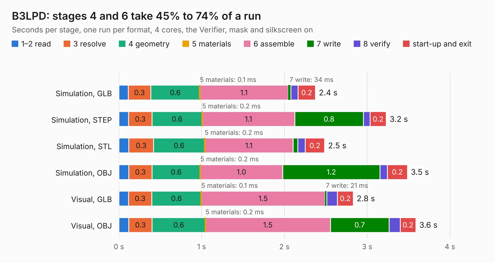

# 1690. B3LPD

Board 1,690 of the 3,109 of [Corpus Testing](../Corpus-Testing.md), on [Corpus Page 16](../CorpusTestingPages/Corpus-Testing-16.md#1690-b3lpd).

| Mode and format | 1–2 read | 3 resolve | 4 geometry | 5 materials | 6 assemble | 7 write | 8 verify | start-up and exit | Total |
|---|---:|---:|---:|---:|---:|---:|---:|---:|---:|
| Simulation, GLB | 0.1 | 0.3 | 0.6 | 0.1&nbsp;ms | 1.1 | 34&nbsp;ms | 86&nbsp;ms | 0.2 | 2.4 |
| Simulation, STEP | 0.1 | 0.3 | 0.6 | 0.2&nbsp;ms | 1.1 | 0.8 | 82&nbsp;ms | 0.2 | 3.2 |
| Simulation, STL | 0.1 | 0.3 | 0.6 | 0.2&nbsp;ms | 1.1 | 58&nbsp;ms | 89&nbsp;ms | 0.2 | 2.5 |
| Simulation, OBJ | 0.1 | 0.3 | 0.6 | 0.2&nbsp;ms | 1.0 | 1.2 | 89&nbsp;ms | 0.2 | 3.5 |
| Visual, GLB | 0.1 | 0.3 | 0.6 | 0.1&nbsp;ms | 1.5 | 21&nbsp;ms | 0.1 | 0.2 | 2.8 |
| Visual, OBJ | 0.1 | 0.3 | 0.6 | 0.2&nbsp;ms | 1.5 | 0.7 | 0.1 | 0.2 | 3.6 |

<table align="center"><tr><td valign="top">

| Board | Repo: [myriadrf/lc-filters](https://github.com/myriadrf/lc-filters) Board: `B3LPD.kicad_pcb` |
|---|---|
| Folder | b3lpd |
| Complexity | 240&nbsp;/&nbsp;1000 (size&nbsp;150, features&nbsp;90) |
| KESE&nbsp;features | through vias, rounded, trapezoid or chamfered pads, arc tracks, filled zones, stack-up, dielectric εr and tanδ |
| Tested | 9th November 2026 |
| Copper&nbsp;layers | 4 |
| File&nbsp;format | KiCad 7 (20221018) |
| Parts,&nbsp;tracks,&nbsp;vias | 7, 22, 96 |
| Triangles,&nbsp;simulation | 214,242 in 20 parts |
| Verifier | PASS in all six runs |

</td><td valign="top">

<table>
<tr><th>File type</th><th>File size</th><th>Peak memory used</th></tr>
<tr><th colspan="3" align="left">Simulation</th></tr>
<tr><td>GLB</td><td align="right">7.2&nbsp;MB</td><td align="right">233&nbsp;MB</td></tr>
<tr><td>STEP</td><td align="right">13&nbsp;MB</td><td align="right">246&nbsp;MB</td></tr>
<tr><td>STL</td><td align="right">11&nbsp;MB</td><td align="right">233&nbsp;MB</td></tr>
<tr><td>OBJ</td><td align="right">21&nbsp;MB</td><td align="right">233&nbsp;MB</td></tr>
<tr><th colspan="3" align="left">Visual</th></tr>
<tr><td>GLB</td><td align="right">4.3&nbsp;MB</td><td align="right">192&nbsp;MB</td></tr>
<tr><td>OBJ</td><td align="right">12&nbsp;MB</td><td align="right">191&nbsp;MB</td></tr>
</table>

</td></tr></table>

| Previous | Next |
|:---|---:|
| [1689. CSAD2](b1689b_lc-clock_CSAD2.md) | [1691. LC_RFE-RevA1](b1691b_lc-rfe_LC-RFE-RevA1.md) |
