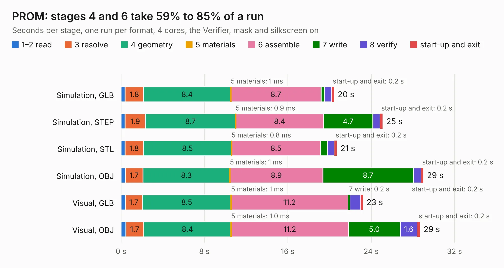

# 1691. PROM

Board 1,691 of the 3,129 of [Corpus Testing](../Corpus-Testing.md), on [Corpus Page 16](../CorpusTestingPages/Corpus-Testing-16.md#1691-prom).

| Mode and format | 1–2 read | 3 resolve | 4 geometry | 5 materials | 6 assemble | 7 write | 8 verify | start-up and exit | Total |
|---|---:|---:|---:|---:|---:|---:|---:|---:|---:|
| Simulation, GLB | 0.4 | 1.8 | 8.4 | 1&nbsp;ms | 8.7 | 0.3 | 0.7 | 0.2 | 20.5 |
| Simulation, STEP | 0.4 | 1.9 | 8.7 | 0.9&nbsp;ms | 8.4 | 4.7 | 0.7 | 0.2 | 25.1 |
| Simulation, STL | 0.4 | 1.8 | 8.5 | 0.8&nbsp;ms | 8.5 | 0.7 | 0.7 | 0.2 | 20.7 |
| Simulation, OBJ | 0.4 | 1.7 | 8.3 | 1&nbsp;ms | 8.9 | 8.7 | 0.7 | 0.2 | 29.0 |
| Visual, GLB | 0.4 | 1.7 | 8.5 | 1&nbsp;ms | 11.2 | 0.2 | 1.0 | 0.2 | 23.2 |
| Visual, OBJ | 0.5 | 1.7 | 8.4 | 1.0&nbsp;ms | 11.2 | 5.0 | 1.6 | 0.2 | 28.7 |

<table align="center"><tr><td valign="top">

| Board | Repo: [mwwhited/embeddedbakery](https://github.com/mwwhited/embeddedbakery) Board: `PROM.kicad_pcb` |
|---|---|
| Folder | circuits / DiodeLogicBoards / PROM |
| Complexity | 71&nbsp;/&nbsp;1000 (size&nbsp;71, features&nbsp;0) |
| Tested | 9th November 2026 |
| Copper&nbsp;layers | 2 |
| File&nbsp;format | KiCad 7 (20221018) |
| Parts,&nbsp;tracks,&nbsp;vias | 145, 0, 0 |
| Triangles,&nbsp;simulation | 2,224,624 in 179 parts |
| Note | mostly unrouted |
| Verifier | PASS in all six runs |

</td><td valign="top">

<table>
<tr><th>File type</th><th>File size</th><th>Peak memory used</th></tr>
<tr><th colspan="3" align="left">Simulation</th></tr>
<tr><td>GLB</td><td align="right">65&nbsp;MB</td><td align="right">720&nbsp;MB</td></tr>
<tr><td>STEP</td><td align="right">243&nbsp;MB</td><td align="right">920&nbsp;MB</td></tr>
<tr><td>STL</td><td align="right">111&nbsp;MB</td><td align="right">713&nbsp;MB</td></tr>
<tr><td>OBJ</td><td align="right">232&nbsp;MB</td><td align="right">1.5&nbsp;GB</td></tr>
<tr><th colspan="3" align="left">Visual</th></tr>
<tr><td>GLB</td><td align="right">41&nbsp;MB</td><td align="right">1.1&nbsp;GB</td></tr>
<tr><td>OBJ</td><td align="right">123&nbsp;MB</td><td align="right">1.1&nbsp;GB</td></tr>
</table>

</td></tr></table>

| Previous | Next |
|:---|---:|
| [1690. Examples](b1690b_embeddedbakery_Examples.md) | [1692. h4n2rs485](b1692b_embeddedbakery_h4n2rs485.md) |
