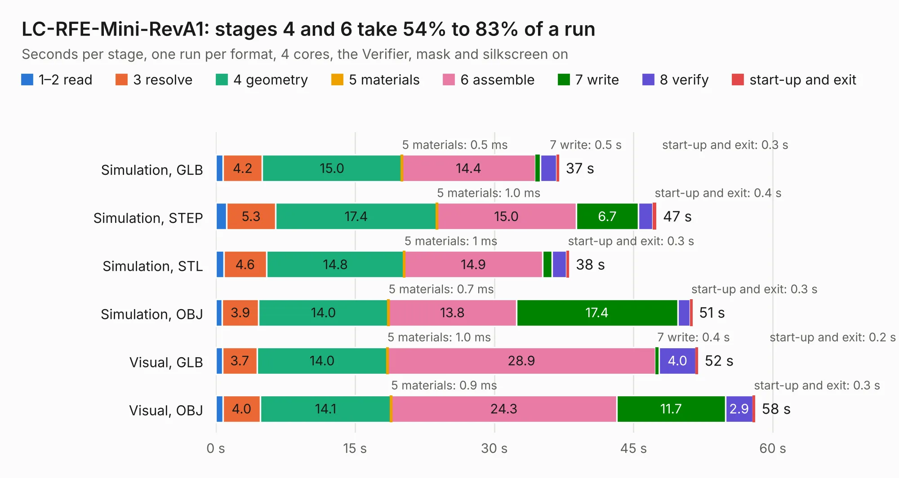

# 1692. LC-RFE-Mini-RevA1

Board 1,692 of the 3,108 of [Corpus Testing](../Corpus-Testing.md), on [Corpus Page 16](../CorpusTestingPages/Corpus-Testing-16.md#1692-lc-rfe-mini-reva1).

| Mode and format | 1–2 read | 3 resolve | 4 geometry | 5 materials | 6 assemble | 7 write | 8 verify | start-up and exit | Total |
|---|---:|---:|---:|---:|---:|---:|---:|---:|---:|
| Simulation, GLB | 0.8 | 4.2 | 15.0 | 0.5&nbsp;ms | 14.4 | 0.5 | 1.7 | 0.3 | 37.0 |
| Simulation, STEP | 1.1 | 5.3 | 17.4 | 1.0&nbsp;ms | 15.0 | 6.7 | 1.6 | 0.4 | 47.5 |
| Simulation, STL | 0.8 | 4.6 | 14.8 | 1&nbsp;ms | 14.9 | 1.0 | 1.6 | 0.3 | 38.1 |
| Simulation, OBJ | 0.7 | 3.9 | 14.0 | 0.7&nbsp;ms | 13.8 | 17.4 | 1.3 | 0.3 | 51.3 |
| Visual, GLB | 0.7 | 3.7 | 14.0 | 1.0&nbsp;ms | 28.9 | 0.4 | 4.0 | 0.2 | 52.0 |
| Visual, OBJ | 0.8 | 4.0 | 14.1 | 0.9&nbsp;ms | 24.3 | 11.7 | 2.9 | 0.3 | 58.1 |

<table align="center"><tr><td valign="top">

| Board | Repo: [myriadrf/lc-rfe-mini](https://github.com/myriadrf/lc-rfe-mini) Board: `LC-RFE-Mini-RevA1.kicad_pcb` |
|---|---|
| Folder | revisions / LC-RFE-Mini-RevA1 |
| Complexity | 370&nbsp;/&nbsp;1000 (size&nbsp;255, features&nbsp;115) |
| KESE&nbsp;features | through vias, rounded, trapezoid or chamfered pads, arc tracks, filled zones, curved board outline, stack-up, dielectric εr and tanδ, copper finish |
| Tested | 9th November 2026 |
| Copper&nbsp;layers | 4 |
| File&nbsp;format | KiCad 9 (20241229) |
| Parts,&nbsp;tracks,&nbsp;vias | 98, 458, 910 |
| Triangles,&nbsp;simulation | 3,268,520 in 110 parts |
| Verifier | PASS in all six runs |

</td><td valign="top">

<table>
<tr><th>File type</th><th>File size</th><th>Peak memory used</th></tr>
<tr><th colspan="3" align="left">Simulation</th></tr>
<tr><td>GLB</td><td align="right">110&nbsp;MB</td><td align="right">1.3&nbsp;GB</td></tr>
<tr><td>STEP</td><td align="right">319&nbsp;MB</td><td align="right">1.4&nbsp;GB</td></tr>
<tr><td>STL</td><td align="right">163&nbsp;MB</td><td align="right">1.3&nbsp;GB</td></tr>
<tr><td>OBJ</td><td align="right">339&nbsp;MB</td><td align="right">2.1&nbsp;GB</td></tr>
<tr><th colspan="3" align="left">Visual</th></tr>
<tr><td>GLB</td><td align="right">64&nbsp;MB</td><td align="right">1.3&nbsp;GB</td></tr>
<tr><td>OBJ</td><td align="right">199&nbsp;MB</td><td align="right">1.4&nbsp;GB</td></tr>
</table>

</td></tr></table>

| Previous | Next |
|:---|---:|
| [1691. LC_RFE-RevA2](b1691b_lc-rfe_LC-RFE-RevA2.md) | [1693. LC-RFE-Mini-RevA2](b1693b_lc-rfe-mini_LC-RFE-Mini-RevA2.md) |
