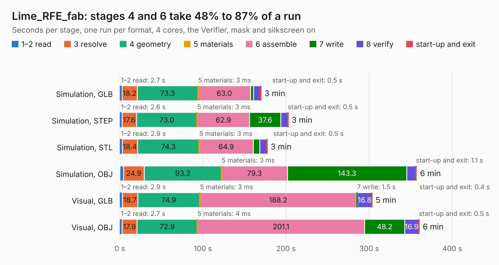

# 1694. Lime_RFE_fab

Board 1,694 of the 3,107 of [Corpus Testing](../Corpus-Testing.md), on [Corpus Page 16](../CorpusTestingPages/Corpus-Testing-16.md#1694-lime_rfe_fab).

| Mode and format | 1–2 read | 3 resolve | 4 geometry | 5 materials | 6 assemble | 7 write | 8 verify | start-up and exit | Total |
|---|---:|---:|---:|---:|---:|---:|---:|---:|---:|
| Simulation, GLB | 2.7 | 18.2 | 73.3 | 3&nbsp;ms | 63.0 | 3.8 | 8.2 | 0.5 | 169.8 |
| Simulation, STEP | 2.6 | 17.6 | 73.0 | 3&nbsp;ms | 62.9 | 37.6 | 8.2 | 0.5 | 202.5 |
| Simulation, STL | 2.9 | 18.4 | 74.3 | 3&nbsp;ms | 64.9 | 7.8 | 8.4 | 0.5 | 177.3 |
| Simulation, OBJ | 4.4 | 24.9 | 93.2 | 3&nbsp;ms | 79.3 | 143.3 | 10.8 | 1.1 | 357.0 |
| Visual, GLB | 2.9 | 18.7 | 74.9 | 3&nbsp;ms | 188.2 | 1.5 | 16.8 | 0.4 | 303.4 |
| Visual, OBJ | 2.7 | 17.9 | 72.9 | 4&nbsp;ms | 201.1 | 48.2 | 16.9 | 0.5 | 360.2 |

<table align="center"><tr><td valign="top">

| Board | Repo: [myriadrf/LimeRFE](https://github.com/myriadrf/LimeRFE) Board: `Lime_RFE_fab.kicad_pcb` |
|---|---|
| Folder | archived / 0v3 / hardware / KiCad |
| Complexity | 325&nbsp;/&nbsp;1000 (size&nbsp;270, features&nbsp;55) |
| KESE&nbsp;features | through vias, slotted holes, rounded, trapezoid or chamfered pads, filled zones |
| Tested | 9th November 2026 to 10th November 2026 |
| Copper&nbsp;layers | 6 |
| File&nbsp;format | KiCad 4 (4) |
| Parts,&nbsp;tracks,&nbsp;vias | 986, 8,840, 623 |
| Triangles,&nbsp;simulation | 18,079,684 in 810 parts |
| Verifier | PASS in all six runs |
| Run&nbsp;again | Simulation, OBJ: failed in the corpus run, run again with the memory cap raised from 11 GB to 14.5 GB, and passed |

</td><td valign="top">

<table>
<tr><th>File type</th><th>File size</th><th>Peak memory used</th></tr>
<tr><th colspan="3" align="left">Simulation</th></tr>
<tr><td>GLB</td><td align="right">668&nbsp;MB</td><td align="right">4.9&nbsp;GB</td></tr>
<tr><td>STEP</td><td align="right">2.6&nbsp;GB</td><td align="right">5.8&nbsp;GB</td></tr>
<tr><td>STL</td><td align="right">904&nbsp;MB</td><td align="right">4.8&nbsp;GB</td></tr>
<tr><td>OBJ</td><td align="right">2.1&nbsp;GB</td><td align="right">12&nbsp;GB</td></tr>
<tr><th colspan="3" align="left">Visual</th></tr>
<tr><td>GLB</td><td align="right">320&nbsp;MB</td><td align="right">4.9&nbsp;GB</td></tr>
<tr><td>OBJ</td><td align="right">1.0&nbsp;GB</td><td align="right">6.4&nbsp;GB</td></tr>
</table>

</td></tr></table>

| Previous | Next |
|:---|---:|
| [1693. Lime_RFE](b1693b_LimeRFE_archived-0v3-hardware-KiCad_Lime-RFE.md) | [1695. Lime_RFE](b1695b_LimeRFE_archived-1v0-hardware-KiCAD_Lime-RFE.md) |
