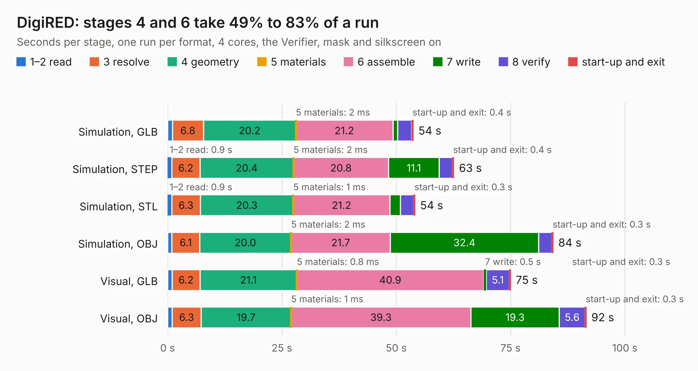

# 1697. DigiRED

Board 1,697 of the 3,100 of [Corpus Testing](../Corpus-Testing.md), on [Corpus Page 16](../CorpusTestingPages/Corpus-Testing-16.md#1697-digired).

| Mode and format | 1–2 read | 3 resolve | 4 geometry | 5 materials | 6 assemble | 7 write | 8 verify | start-up and exit | Total |
|---|---:|---:|---:|---:|---:|---:|---:|---:|---:|
| Simulation, GLB | 1.0 | 6.8 | 20.2 | 2&nbsp;ms | 21.2 | 1.0 | 3.1 | 0.4 | 53.7 |
| Simulation, STEP | 0.9 | 6.2 | 20.4 | 2&nbsp;ms | 20.8 | 11.1 | 2.9 | 0.4 | 62.6 |
| Simulation, STL | 0.9 | 6.3 | 20.3 | 1&nbsp;ms | 21.2 | 2.3 | 2.9 | 0.3 | 54.1 |
| Simulation, OBJ | 1.0 | 6.1 | 20.0 | 2&nbsp;ms | 21.7 | 32.4 | 2.9 | 0.3 | 84.3 |
| Visual, GLB | 1.0 | 6.2 | 21.1 | 0.8&nbsp;ms | 40.9 | 0.5 | 5.1 | 0.3 | 75.0 |
| Visual, OBJ | 1.0 | 6.3 | 19.7 | 1&nbsp;ms | 39.3 | 19.3 | 5.6 | 0.3 | 91.6 |

<table align="center"><tr><td valign="top">

| Board | Repo: [myriadrf/RASDR](https://github.com/myriadrf/RASDR) Board: `DigiRED.kicad_pcb` |
|---|---|
| Folder | DigiRED / hardware / v2 / KiCAD |
| Complexity | 347&nbsp;/&nbsp;1000 (size&nbsp;302, features&nbsp;45) |
| KESE&nbsp;features | through vias, slotted holes, filled zones |
| Tested | 9th November 2026 |
| Copper&nbsp;layers | 6 |
| File&nbsp;format | KiCad 3 (3) |
| Parts,&nbsp;tracks,&nbsp;vias | 239, 3,701, 600 |
| Triangles,&nbsp;simulation | 5,592,164 in 262 parts |
| Verifier | PASS in all six runs |

</td><td valign="top">

<table>
<tr><th>File type</th><th>File size</th><th>Peak memory used</th></tr>
<tr><th colspan="3" align="left">Simulation</th></tr>
<tr><td>GLB</td><td align="right">191&nbsp;MB</td><td align="right">1.5&nbsp;GB</td></tr>
<tr><td>STEP</td><td align="right">634&nbsp;MB</td><td align="right">1.9&nbsp;GB</td></tr>
<tr><td>STL</td><td align="right">280&nbsp;MB</td><td align="right">1.4&nbsp;GB</td></tr>
<tr><td>OBJ</td><td align="right">595&nbsp;MB</td><td align="right">3.5&nbsp;GB</td></tr>
<tr><th colspan="3" align="left">Visual</th></tr>
<tr><td>GLB</td><td align="right">105&nbsp;MB</td><td align="right">1.7&nbsp;GB</td></tr>
<tr><td>OBJ</td><td align="right">339&nbsp;MB</td><td align="right">2.2&nbsp;GB</td></tr>
</table>

</td></tr></table>

| Previous | Next |
|:---|---:|
| [1696. DigiRED_v1.0](b1696b_RASDR_DigiRED-v1-0.md) | [1698. LMS8001_Companion](b1698b_reference-development-kit_LMS8001-Companion.md) |
