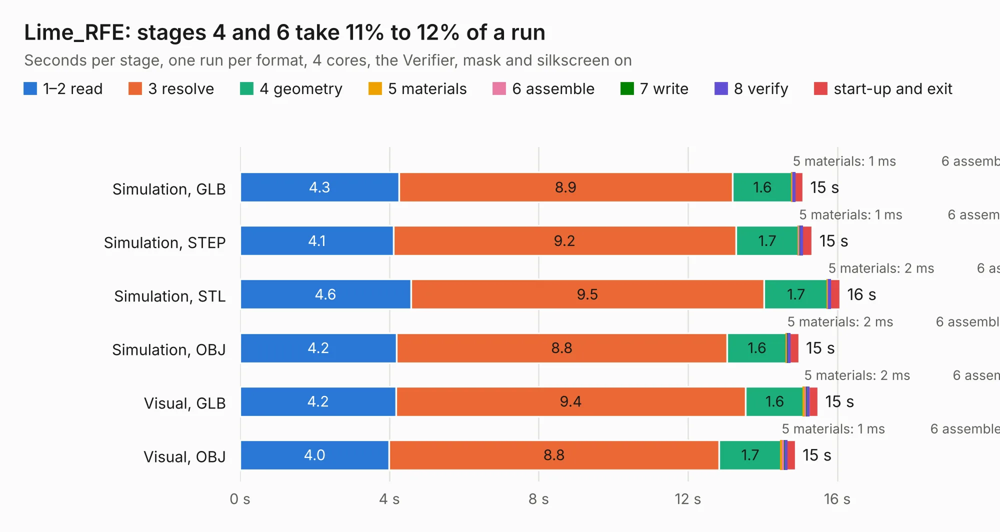

# 1698. Lime_RFE

Board 1,698 of the 3,109 of [Corpus Testing](../Corpus-Testing.md), on [Corpus Page 16](../CorpusTestingPages/Corpus-Testing-16.md#1698-lime_rfe).

| Mode and format | 1–2 read | 3 resolve | 4 geometry | 5 materials | 6 assemble | 7 write | 8 verify | start-up and exit | Total |
|---|---:|---:|---:|---:|---:|---:|---:|---:|---:|
| Simulation, GLB | 4.3 | 8.9 | 1.6 | 1&nbsp;ms | 31&nbsp;ms | 2&nbsp;ms | 5&nbsp;ms | 0.2 | 15.1 |
| Simulation, STEP | 4.1 | 9.2 | 1.7 | 1&nbsp;ms | 31&nbsp;ms | 34&nbsp;ms | 7&nbsp;ms | 0.3 | 15.3 |
| Simulation, STL | 4.6 | 9.5 | 1.7 | 2&nbsp;ms | 31&nbsp;ms | 2&nbsp;ms | 5&nbsp;ms | 0.3 | 16.1 |
| Simulation, OBJ | 4.2 | 8.8 | 1.6 | 2&nbsp;ms | 33&nbsp;ms | 14&nbsp;ms | 5&nbsp;ms | 0.3 | 15.0 |
| Visual, GLB | 4.2 | 9.4 | 1.6 | 2&nbsp;ms | 96&nbsp;ms | 2&nbsp;ms | 14&nbsp;ms | 0.3 | 15.5 |
| Visual, OBJ | 4.0 | 8.8 | 1.7 | 1&nbsp;ms | 95&nbsp;ms | 12&nbsp;ms | 12&nbsp;ms | 0.3 | 14.9 |

<table align="center"><tr><td valign="top">

| Board | Repo: [myriadrf/LimeRFE](https://github.com/myriadrf/LimeRFE) Board: `Lime_RFE.kicad_pcb` |
|---|---|
| Folder | archived / 1v2 / hardware / KiCAD |
| Complexity | 340&nbsp;/&nbsp;1000 (size&nbsp;275, features&nbsp;65) |
| KESE&nbsp;features | through vias, slotted holes, rounded, trapezoid or chamfered pads, filled zones, curved board outline |
| Tested | 9th November 2026 |
| Copper&nbsp;layers | 6 |
| File&nbsp;format | KiCad 4 (4) |
| Parts,&nbsp;tracks,&nbsp;vias | 1,295, 10,180, 591 |
| Triangles,&nbsp;simulation | 2,136 in 8 parts |
| Verifier | PASS in all six runs |

</td><td valign="top">

<table>
<tr><th>File type</th><th>File size</th><th>Peak memory used</th></tr>
<tr><th colspan="3" align="left">Simulation</th></tr>
<tr><td>GLB</td><td align="right">63&nbsp;kB</td><td align="right">542&nbsp;MB</td></tr>
<tr><td>STEP</td><td align="right">381&nbsp;kB</td><td align="right">542&nbsp;MB</td></tr>
<tr><td>STL</td><td align="right">107&nbsp;kB</td><td align="right">542&nbsp;MB</td></tr>
<tr><td>OBJ</td><td align="right">216&nbsp;kB</td><td align="right">542&nbsp;MB</td></tr>
<tr><th colspan="3" align="left">Visual</th></tr>
<tr><td>GLB</td><td align="right">75&nbsp;kB</td><td align="right">542&nbsp;MB</td></tr>
<tr><td>OBJ</td><td align="right">194&nbsp;kB</td><td align="right">542&nbsp;MB</td></tr>
</table>

</td></tr></table>

| Previous | Next |
|:---|---:|
| [1697. Lime_RFE](b1697b_LimeRFE_archived-1v0-hardware-KiCAD_Lime-RFE.md) | [1699. Lime_RFE](b1699b_LimeRFE_hardware-1v31-KiCAD_Lime-RFE.md) |
