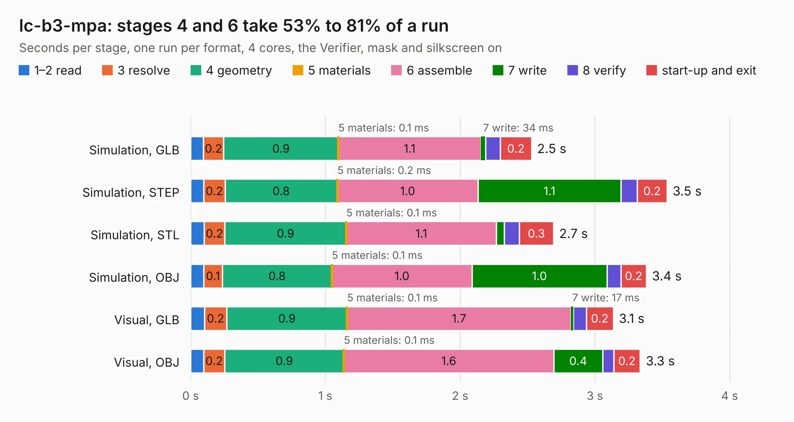

# 1700. lc-b3-mpa

Board 1,700 of the 3,128 of [Corpus Testing](../Corpus-Testing.md), on [Corpus Page 16](../CorpusTestingPages/Corpus-Testing-16.md#1700-lc-b3-mpa).

| Mode and format | 1–2 read | 3 resolve | 4 geometry | 5 materials | 6 assemble | 7 write | 8 verify | start-up and exit | Total |
|---|---:|---:|---:|---:|---:|---:|---:|---:|---:|
| Simulation, GLB | 95&nbsp;ms | 0.2 | 0.9 | 0.1&nbsp;ms | 1.1 | 34&nbsp;ms | 0.1 | 0.2 | 2.5 |
| Simulation, STEP | 97&nbsp;ms | 0.2 | 0.8 | 0.2&nbsp;ms | 1.0 | 1.1 | 0.1 | 0.2 | 3.5 |
| Simulation, STL | 0.1 | 0.2 | 0.9 | 0.1&nbsp;ms | 1.1 | 57&nbsp;ms | 0.1 | 0.3 | 2.7 |
| Simulation, OBJ | 96&nbsp;ms | 0.1 | 0.8 | 0.1&nbsp;ms | 1.0 | 1.0 | 0.1 | 0.2 | 3.4 |
| Visual, GLB | 0.1 | 0.2 | 0.9 | 0.1&nbsp;ms | 1.7 | 17&nbsp;ms | 97&nbsp;ms | 0.2 | 3.1 |
| Visual, OBJ | 97&nbsp;ms | 0.2 | 0.9 | 0.1&nbsp;ms | 1.6 | 0.4 | 81&nbsp;ms | 0.2 | 3.3 |

<table align="center"><tr><td valign="top">

| Board | Repo: [myriadrf/lc-b3-mpa](https://github.com/myriadrf/lc-b3-mpa) Board: `lc-b3-mpa.kicad_pcb` |
|---|---|
| Folder | hardware / 0v1 |
| Complexity | 219&nbsp;/&nbsp;1000 (size&nbsp;149, features&nbsp;70) |
| KESE&nbsp;features | through vias, rounded, trapezoid or chamfered pads, drill offsets, arc tracks, filled zones |
| Tested | 9th November 2026 |
| Copper&nbsp;layers | 4 |
| File&nbsp;format | KiCad 6 (20201220) |
| Parts,&nbsp;tracks,&nbsp;vias | 15, 8, 57 |
| Triangles,&nbsp;simulation | 213,914 in 19 parts |
| Verifier | PASS in all six runs |

</td><td valign="top">

<table>
<tr><th>File type</th><th>File size</th><th>Peak memory used</th></tr>
<tr><th colspan="3" align="left">Simulation</th></tr>
<tr><td>GLB</td><td align="right">7.0&nbsp;MB</td><td align="right">210&nbsp;MB</td></tr>
<tr><td>STEP</td><td align="right">22&nbsp;MB</td><td align="right">236&nbsp;MB</td></tr>
<tr><td>STL</td><td align="right">11&nbsp;MB</td><td align="right">214&nbsp;MB</td></tr>
<tr><td>OBJ</td><td align="right">21&nbsp;MB</td><td align="right">232&nbsp;MB</td></tr>
<tr><th colspan="3" align="left">Visual</th></tr>
<tr><td>GLB</td><td align="right">2.8&nbsp;MB</td><td align="right">168&nbsp;MB</td></tr>
<tr><td>OBJ</td><td align="right">7.9&nbsp;MB</td><td align="right">168&nbsp;MB</td></tr>
</table>

</td></tr></table>

| Previous | Next |
|:---|---:|
| [1699. LimeSDR_Sony](b1699b_front-end-modules_LimeSDR-Sony.md) | [1701. lc-b3-mpa](b1701b_lc-b3-mpa_hardware-1v0_lc-b3-mpa.md) |
