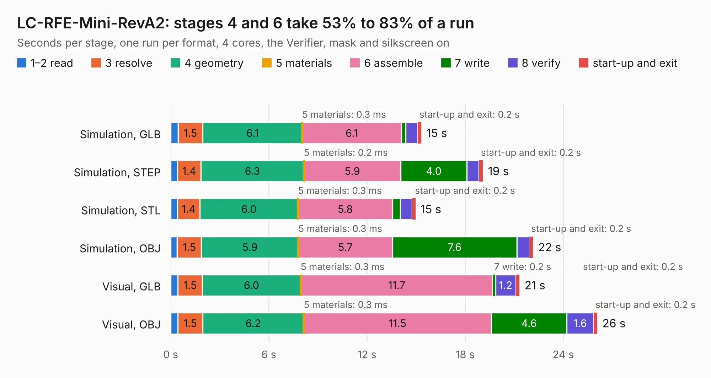

# 1701. LC-RFE-Mini-RevA2

Board 1,701 of the 3,117 of [Corpus Testing](../Corpus-Testing.md), on [Corpus Page 16](../CorpusTestingPages/Corpus-Testing-16.md#1701-lc-rfe-mini-reva2).

| Mode and format | 1–2 read | 3 resolve | 4 geometry | 5 materials | 6 assemble | 7 write | 8 verify | start-up and exit | Total |
|---|---:|---:|---:|---:|---:|---:|---:|---:|---:|
| Simulation, GLB | 0.5 | 1.5 | 6.1 | 0.3&nbsp;ms | 6.1 | 0.3 | 0.7 | 0.2 | 15.3 |
| Simulation, STEP | 0.4 | 1.4 | 6.3 | 0.2&nbsp;ms | 5.9 | 4.0 | 0.7 | 0.2 | 19.1 |
| Simulation, STL | 0.4 | 1.4 | 6.0 | 0.3&nbsp;ms | 5.8 | 0.5 | 0.7 | 0.2 | 15.0 |
| Simulation, OBJ | 0.4 | 1.5 | 5.9 | 0.3&nbsp;ms | 5.7 | 7.6 | 0.8 | 0.2 | 22.2 |
| Visual, GLB | 0.4 | 1.5 | 6.0 | 0.3&nbsp;ms | 11.7 | 0.2 | 1.2 | 0.2 | 21.3 |
| Visual, OBJ | 0.4 | 1.5 | 6.2 | 0.3&nbsp;ms | 11.5 | 4.6 | 1.6 | 0.2 | 26.1 |

<table align="center"><tr><td valign="top">

| Board | Repo: [myriadrf/lc-rfe-mini](https://github.com/myriadrf/lc-rfe-mini) Board: `LC-RFE-Mini-RevA2.kicad_pcb` |
|---|---|
| Folder | revisions / LC-RFE-Mini-RevA2 |
| Complexity | 355&nbsp;/&nbsp;1000 (size&nbsp;240, features&nbsp;115) |
| KESE&nbsp;features | through vias, rounded, trapezoid or chamfered pads, arc tracks, filled zones, curved board outline, stack-up, dielectric εr and tanδ, copper finish |
| Tested | 9th November 2026 |
| Copper&nbsp;layers | 4 |
| File&nbsp;format | KiCad 9 (20241229) |
| Parts,&nbsp;tracks,&nbsp;vias | 95, 396, 289 |
| Triangles,&nbsp;simulation | 1,923,076 in 108 parts |
| Verifier | PASS in all six runs |

</td><td valign="top">

<table>
<tr><th>File type</th><th>File size</th><th>Peak memory used</th></tr>
<tr><th colspan="3" align="left">Simulation</th></tr>
<tr><td>GLB</td><td align="right">65&nbsp;MB</td><td align="right">717&nbsp;MB</td></tr>
<tr><td>STEP</td><td align="right">244&nbsp;MB</td><td align="right">821&nbsp;MB</td></tr>
<tr><td>STL</td><td align="right">96&nbsp;MB</td><td align="right">835&nbsp;MB</td></tr>
<tr><td>OBJ</td><td align="right">199&nbsp;MB</td><td align="right">1.3&nbsp;GB</td></tr>
<tr><th colspan="3" align="left">Visual</th></tr>
<tr><td>GLB</td><td align="right">38&nbsp;MB</td><td align="right">764&nbsp;MB</td></tr>
<tr><td>OBJ</td><td align="right">116&nbsp;MB</td><td align="right">866&nbsp;MB</td></tr>
</table>

</td></tr></table>

| Previous | Next |
|:---|---:|
| [1700. LC-RFE-Mini-RevA1](b1700b_lc-rfe-mini_LC-RFE-Mini-RevA1.md) | [1702. Lime_RFE](b1702b_LimeRFE_archived-0v3-hardware-KiCad_Lime-RFE.md) |
