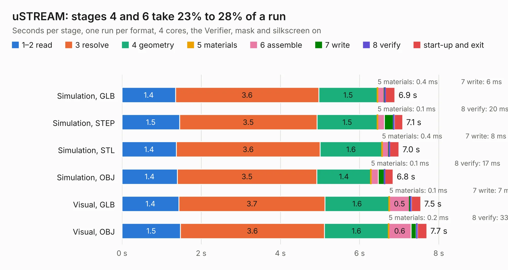

# 1704. uSTREAM

Board 1,704 of the 3,100 of [Corpus Testing](../Corpus-Testing.md), on [Corpus Page 16](../CorpusTestingPages/Corpus-Testing-16.md#1704-ustream).

| Mode and format | 1–2 read | 3 resolve | 4 geometry | 5 materials | 6 assemble | 7 write | 8 verify | start-up and exit | Total |
|---|---:|---:|---:|---:|---:|---:|---:|---:|---:|
| Simulation, GLB | 1.4 | 3.6 | 1.5 | 0.4&nbsp;ms | 0.2 | 6&nbsp;ms | 14&nbsp;ms | 0.2 | 6.9 |
| Simulation, STEP | 1.5 | 3.5 | 1.5 | 0.1&nbsp;ms | 0.2 | 0.2 | 20&nbsp;ms | 0.2 | 7.1 |
| Simulation, STL | 1.4 | 3.6 | 1.6 | 0.4&nbsp;ms | 0.2 | 8&nbsp;ms | 16&nbsp;ms | 0.2 | 7.0 |
| Simulation, OBJ | 1.4 | 3.5 | 1.4 | 0.1&nbsp;ms | 0.2 | 0.2 | 17&nbsp;ms | 0.2 | 6.8 |
| Visual, GLB | 1.4 | 3.7 | 1.6 | 0.1&nbsp;ms | 0.5 | 7&nbsp;ms | 32&nbsp;ms | 0.2 | 7.5 |
| Visual, OBJ | 1.5 | 3.6 | 1.6 | 0.2&nbsp;ms | 0.6 | 0.1 | 33&nbsp;ms | 0.2 | 7.7 |

<table align="center"><tr><td valign="top">

| Board | Repo: [myriadrf/STREAM](https://github.com/myriadrf/STREAM) Board: `uSTREAM.kicad_pcb` |
|---|---|
| Folder | hardware / uSTREAM / v2 / KiCAD |
| Complexity | 379&nbsp;/&nbsp;1000 (size&nbsp;334, features&nbsp;45) |
| KESE&nbsp;features | through vias, slotted holes, filled zones |
| Tested | 9th November 2026 |
| Copper&nbsp;layers | 12 |
| File&nbsp;format | KiCad 3 (3) |
| Parts,&nbsp;tracks,&nbsp;vias | 346, 5,344, 992 |
| Triangles,&nbsp;simulation | 28,340 in 20 parts |
| Verifier | PASS in all six runs |

</td><td valign="top">

<table>
<tr><th>File type</th><th>File size</th><th>Peak memory used</th></tr>
<tr><th colspan="3" align="left">Simulation</th></tr>
<tr><td>GLB</td><td align="right">832&nbsp;kB</td><td align="right">282&nbsp;MB</td></tr>
<tr><td>STEP</td><td align="right">3.5&nbsp;MB</td><td align="right">281&nbsp;MB</td></tr>
<tr><td>STL</td><td align="right">1.4&nbsp;MB</td><td align="right">282&nbsp;MB</td></tr>
<tr><td>OBJ</td><td align="right">2.9&nbsp;MB</td><td align="right">282&nbsp;MB</td></tr>
<tr><th colspan="3" align="left">Visual</th></tr>
<tr><td>GLB</td><td align="right">755&nbsp;kB</td><td align="right">281&nbsp;MB</td></tr>
<tr><td>OBJ</td><td align="right">2.3&nbsp;MB</td><td align="right">281&nbsp;MB</td></tr>
</table>

</td></tr></table>

| Previous | Next |
|:---|---:|
| [1703. Stream](b1703b_STREAM_Stream.md) | [1705. Vivaldi](b1705b_vivaldi-antenna_Vivaldi.md) |
