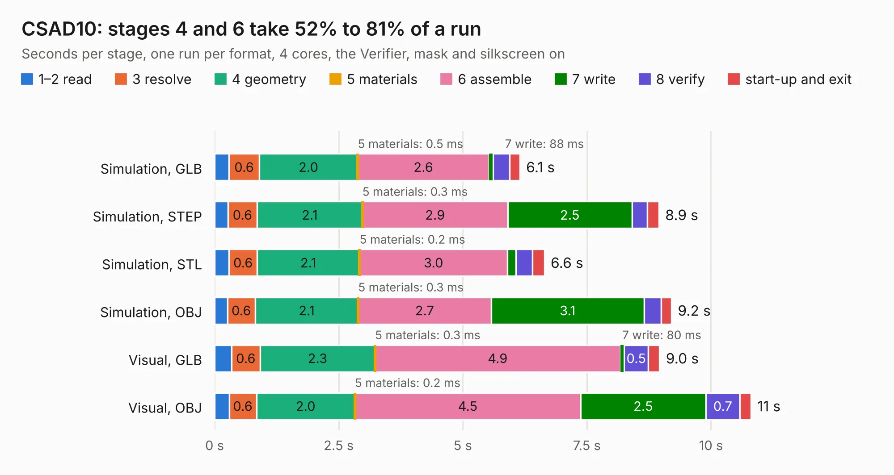

# 1704. CSAD10

Board 1,704 of the 3,130 of [Corpus Testing](../Corpus-Testing.md), on [Corpus Page 16](../CorpusTestingPages/Corpus-Testing-16.md#1704-csad10).

| Mode and format | 1–2 read | 3 resolve | 4 geometry | 5 materials | 6 assemble | 7 write | 8 verify | start-up and exit | Total |
|---|---:|---:|---:|---:|---:|---:|---:|---:|---:|
| Simulation, GLB | 0.3 | 0.6 | 2.0 | 0.5&nbsp;ms | 2.6 | 88&nbsp;ms | 0.3 | 0.2 | 6.1 |
| Simulation, STEP | 0.3 | 0.6 | 2.1 | 0.3&nbsp;ms | 2.9 | 2.5 | 0.3 | 0.2 | 8.9 |
| Simulation, STL | 0.3 | 0.6 | 2.1 | 0.2&nbsp;ms | 3.0 | 0.2 | 0.3 | 0.2 | 6.6 |
| Simulation, OBJ | 0.3 | 0.6 | 2.1 | 0.3&nbsp;ms | 2.7 | 3.1 | 0.3 | 0.2 | 9.2 |
| Visual, GLB | 0.3 | 0.6 | 2.3 | 0.3&nbsp;ms | 4.9 | 80&nbsp;ms | 0.5 | 0.2 | 9.0 |
| Visual, OBJ | 0.3 | 0.6 | 2.0 | 0.2&nbsp;ms | 4.5 | 2.5 | 0.7 | 0.2 | 10.8 |

<table align="center"><tr><td valign="top">

| Board | Repo: [myriadrf/lc-clock](https://github.com/myriadrf/lc-clock) Board: `CSAD10.kicad_pcb` |
|---|---|
| Folder | csad10 |
| Complexity | 340&nbsp;/&nbsp;1000 (size&nbsp;225, features&nbsp;115) |
| KESE&nbsp;features | through vias, custom pads, rounded, trapezoid or chamfered pads, arc tracks, filled zones, copper drawings, stack-up, dielectric εr and tanδ |
| Tested | 9th November 2026 |
| Copper&nbsp;layers | 4 |
| File&nbsp;format | KiCad 7 (20221018) |
| Parts,&nbsp;tracks,&nbsp;vias | 60, 440, 81 |
| Triangles,&nbsp;simulation | 595,804 in 67 parts |
| Verifier | PASS in all six runs |

</td><td valign="top">

<table>
<tr><th>File type</th><th>File size</th><th>Peak memory used</th></tr>
<tr><th colspan="3" align="left">Simulation</th></tr>
<tr><td>GLB</td><td align="right">20&nbsp;MB</td><td align="right">355&nbsp;MB</td></tr>
<tr><td>STEP</td><td align="right">91&nbsp;MB</td><td align="right">415&nbsp;MB</td></tr>
<tr><td>STL</td><td align="right">30&nbsp;MB</td><td align="right">357&nbsp;MB</td></tr>
<tr><td>OBJ</td><td align="right">60&nbsp;MB</td><td align="right">415&nbsp;MB</td></tr>
<tr><th colspan="3" align="left">Visual</th></tr>
<tr><td>GLB</td><td align="right">16&nbsp;MB</td><td align="right">424&nbsp;MB</td></tr>
<tr><td>OBJ</td><td align="right">48&nbsp;MB</td><td align="right">480&nbsp;MB</td></tr>
</table>

</td></tr></table>

| Previous | Next |
|:---|---:|
| [1703. lc-b3-mpa](b1703b_lc-b3-mpa_hardware-1v0_lc-b3-mpa.md) | [1705. CSAD2](b1705b_lc-clock_CSAD2.md) |
