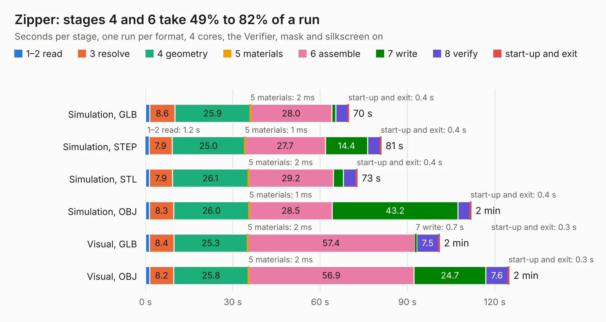

# 1706. Zipper

Board 1,706 of the 3,104 of [Corpus Testing](../Corpus-Testing.md), on [Corpus Page 16](../CorpusTestingPages/Corpus-Testing-16.md#1706-zipper).

| Mode and format | 1–2 read | 3 resolve | 4 geometry | 5 materials | 6 assemble | 7 write | 8 verify | start-up and exit | Total |
|---|---:|---:|---:|---:|---:|---:|---:|---:|---:|
| Simulation, GLB | 1.5 | 8.6 | 25.9 | 2&nbsp;ms | 28.0 | 1.3 | 4.2 | 0.4 | 69.9 |
| Simulation, STEP | 1.2 | 7.9 | 25.0 | 1&nbsp;ms | 27.7 | 14.4 | 4.4 | 0.4 | 81.0 |
| Simulation, STL | 1.3 | 7.9 | 26.1 | 2&nbsp;ms | 29.2 | 3.4 | 4.4 | 0.4 | 72.8 |
| Simulation, OBJ | 1.4 | 8.3 | 26.0 | 1&nbsp;ms | 28.5 | 43.2 | 4.1 | 0.4 | 111.9 |
| Visual, GLB | 1.3 | 8.4 | 25.3 | 2&nbsp;ms | 57.4 | 0.7 | 7.5 | 0.3 | 101.1 |
| Visual, OBJ | 1.4 | 8.2 | 25.8 | 2&nbsp;ms | 56.9 | 24.7 | 7.6 | 0.3 | 124.9 |

<table align="center"><tr><td valign="top">

| Board | Repo: [myriadrf/reference-development-kit](https://github.com/myriadrf/reference-development-kit) Board: `Zipper.kicad_pcb` |
|---|---|
| Folder | zipper / hardware / v2 / KiCAD |
| Complexity | 350&nbsp;/&nbsp;1000 (size&nbsp;295, features&nbsp;55) |
| KESE&nbsp;features | through vias, filled zones, copper text, curved board outline |
| Tested | 9th November 2026 |
| Copper&nbsp;layers | 6 |
| File&nbsp;format | KiCad 3 (3) |
| Parts,&nbsp;tracks,&nbsp;vias | 173, 3,620, 614 |
| Triangles,&nbsp;simulation | 7,391,440 in 297 parts |
| Verifier | PASS in all six runs |

</td><td valign="top">

<table>
<tr><th>File type</th><th>File size</th><th>Peak memory used</th></tr>
<tr><th colspan="3" align="left">Simulation</th></tr>
<tr><td>GLB</td><td align="right">251&nbsp;MB</td><td align="right">2.3&nbsp;GB</td></tr>
<tr><td>STEP</td><td align="right">764&nbsp;MB</td><td align="right">2.7&nbsp;GB</td></tr>
<tr><td>STL</td><td align="right">370&nbsp;MB</td><td align="right">2.2&nbsp;GB</td></tr>
<tr><td>OBJ</td><td align="right">786&nbsp;MB</td><td align="right">4.6&nbsp;GB</td></tr>
<tr><th colspan="3" align="left">Visual</th></tr>
<tr><td>GLB</td><td align="right">137&nbsp;MB</td><td align="right">2.3&nbsp;GB</td></tr>
<tr><td>OBJ</td><td align="right">446&nbsp;MB</td><td align="right">2.9&nbsp;GB</td></tr>
</table>

</td></tr></table>

| Previous | Next |
|:---|---:|
| [1705. uMyriad7002](b1705b_reference-development-kit_uMyriad7002.md) | [1707. Stream](b1707b_STREAM_Stream.md) |
