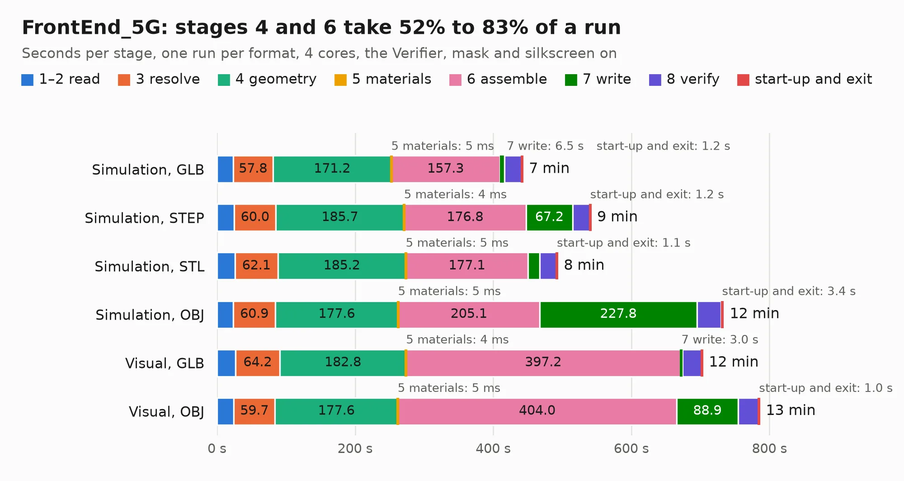

# 1707. FrontEnd_5G

Board 1,707 of the 3,117 of [Corpus Testing](../Corpus-Testing.md), on [Corpus Page 16](../CorpusTestingPages/Corpus-Testing-16.md#1707-frontend_5g).

| Mode and format | 1–2 read | 3 resolve | 4 geometry | 5 materials | 6 assemble | 7 write | 8 verify | start-up and exit | Total |
|---|---:|---:|---:|---:|---:|---:|---:|---:|---:|
| Simulation, GLB | 23.3 | 57.8 | 171.2 | 5&nbsp;ms | 157.3 | 6.5 | 25.0 | 1.2 | 442.2 |
| Simulation, STEP | 25.1 | 60.0 | 185.7 | 4&nbsp;ms | 176.8 | 67.2 | 25.0 | 1.2 | 541.0 |
| Simulation, STL | 26.0 | 62.1 | 185.2 | 5&nbsp;ms | 177.1 | 17.1 | 24.2 | 1.1 | 492.8 |
| Simulation, OBJ | 23.6 | 60.9 | 177.6 | 5&nbsp;ms | 205.1 | 227.8 | 34.6 | 3.4 | 733.0 |
| Visual, GLB | 26.7 | 64.2 | 182.8 | 4&nbsp;ms | 397.2 | 3.0 | 28.0 | 0.9 | 702.8 |
| Visual, OBJ | 24.3 | 59.7 | 177.6 | 5&nbsp;ms | 404.0 | 88.9 | 29.9 | 1.0 | 785.3 |

<table align="center"><tr><td valign="top">

| Board | Repo: [myriadrf/LimeRFE-8001P](https://github.com/myriadrf/LimeRFE-8001P) Board: `FrontEnd_5G.kicad_pcb` |
|---|---|
| Folder | hardware / 1v0 / KiCAD |
| Complexity | 376&nbsp;/&nbsp;1000 (size&nbsp;291, features&nbsp;85) |
| KESE&nbsp;features | through vias, blind and buried vias, rounded, trapezoid or chamfered pads, filled zones |
| Tested | 9th November 2026 to 11th November 2026 |
| Copper&nbsp;layers | 6 |
| File&nbsp;format | KiCad 4 (4) |
| Parts,&nbsp;tracks,&nbsp;vias | 1,605, 23,739, 1,538 |
| Triangles,&nbsp;simulation | 30,808,402 in 1307 parts |
| Verifier | PASS in all six runs |
| Run&nbsp;again | Visual, OBJ: failed in the corpus run, run again with the memory cap raised from 11 GB to 14.5 GB, and passed |
| Run&nbsp;again | Simulation, OBJ: failed in the corpus run, run again with no memory cap and no time limit (swap added to a 16 GB machine), and passed |

</td><td valign="top">

<table>
<tr><th>File type</th><th>File size</th><th>Peak memory used</th></tr>
<tr><th colspan="3" align="left">Simulation</th></tr>
<tr><td>GLB</td><td align="right">1.0&nbsp;GB</td><td align="right">8.7&nbsp;GB</td></tr>
<tr><td>STEP</td><td align="right">2.9&nbsp;GB</td><td align="right">10&nbsp;GB</td></tr>
<tr><td>STL</td><td align="right">1.5&nbsp;GB</td><td align="right">8.6&nbsp;GB</td></tr>
<tr><td>OBJ</td><td align="right">3.4&nbsp;GB</td><td align="right">20&nbsp;GB</td></tr>
<tr><th colspan="3" align="left">Visual</th></tr>
<tr><td>GLB</td><td align="right">535&nbsp;MB</td><td align="right">8.9&nbsp;GB</td></tr>
<tr><td>OBJ</td><td align="right">1.8&nbsp;GB</td><td align="right">11&nbsp;GB</td></tr>
</table>

</td></tr></table>

| Previous | Next |
|:---|---:|
| [1706. Lime_RFE](b1706b_LimeRFE_hardware-1v31-KiCAD_Lime-RFE.md) | [1708. LimeSDR_Breakout](b1708b_LimeSDR-GPIO-Board_LimeSDR-Breakout.md) |
