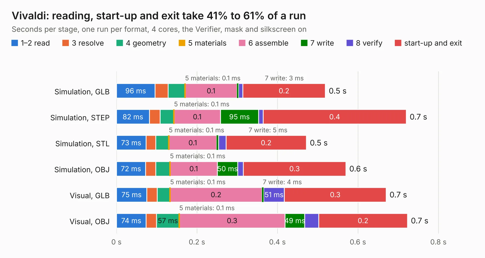

# 1708. Vivaldi

Board 1,708 of the 3,103 of [Corpus Testing](../Corpus-Testing.md), on [Corpus Page 16](../CorpusTestingPages/Corpus-Testing-16.md#1708-vivaldi).

| Mode and format | 1–2 read | 3 resolve | 4 geometry | 5 materials | 6 assemble | 7 write | 8 verify | start-up and exit | Total |
|---|---:|---:|---:|---:|---:|---:|---:|---:|---:|
| Simulation, GLB | 96&nbsp;ms | 33&nbsp;ms | 42&nbsp;ms | 0.1&nbsp;ms | 0.1 | 3&nbsp;ms | 11&nbsp;ms | 0.2 | 0.5 |
| Simulation, STEP | 82&nbsp;ms | 27&nbsp;ms | 34&nbsp;ms | 0.1&nbsp;ms | 0.1 | 95&nbsp;ms | 11&nbsp;ms | 0.4 | 0.7 |
| Simulation, STL | 73&nbsp;ms | 24&nbsp;ms | 32&nbsp;ms | 0.1&nbsp;ms | 0.1 | 5&nbsp;ms | 18&nbsp;ms | 0.2 | 0.5 |
| Simulation, OBJ | 72&nbsp;ms | 25&nbsp;ms | 35&nbsp;ms | 0.1&nbsp;ms | 0.1 | 50&nbsp;ms | 14&nbsp;ms | 0.3 | 0.6 |
| Visual, GLB | 75&nbsp;ms | 26&nbsp;ms | 32&nbsp;ms | 0.1&nbsp;ms | 0.2 | 4&nbsp;ms | 51&nbsp;ms | 0.3 | 0.7 |
| Visual, OBJ | 74&nbsp;ms | 26&nbsp;ms | 57&nbsp;ms | 0.1&nbsp;ms | 0.3 | 49&nbsp;ms | 35&nbsp;ms | 0.2 | 0.7 |

<table align="center"><tr><td valign="top">

| Board | Repo: [myriadrf/vivaldi-antenna](https://github.com/myriadrf/vivaldi-antenna) Board: `Vivaldi.kicad_pcb` |
|---|---|
| Folder | hardware / KiCAD |
| Complexity | 98&nbsp;/&nbsp;1000 (size&nbsp;63, features&nbsp;35) |
| KESE&nbsp;features | through vias, filled zones |
| Tested | 9th November 2026 |
| Copper&nbsp;layers | 2 |
| File&nbsp;format | KiCad 3 (3) |
| Parts,&nbsp;tracks,&nbsp;vias | 1, 4, 2 |
| Triangles,&nbsp;simulation | 9,304 in 10 parts |
| Verifier | PASS in all six runs |

</td><td valign="top">

<table>
<tr><th>File type</th><th>File size</th><th>Peak memory used</th></tr>
<tr><th colspan="3" align="left">Simulation</th></tr>
<tr><td>GLB</td><td align="right">331&nbsp;kB</td><td align="right">62&nbsp;MB</td></tr>
<tr><td>STEP</td><td align="right">2.0&nbsp;MB</td><td align="right">62&nbsp;MB</td></tr>
<tr><td>STL</td><td align="right">466&nbsp;kB</td><td align="right">62&nbsp;MB</td></tr>
<tr><td>OBJ</td><td align="right">845&nbsp;kB</td><td align="right">62&nbsp;MB</td></tr>
<tr><th colspan="3" align="left">Visual</th></tr>
<tr><td>GLB</td><td align="right">302&nbsp;kB</td><td align="right">83&nbsp;MB</td></tr>
<tr><td>OBJ</td><td align="right">772&nbsp;kB</td><td align="right">84&nbsp;MB</td></tr>
</table>

</td></tr></table>

| Previous | Next |
|:---|---:|
| [1707. uSTREAM](b1707b_STREAM_uSTREAM.md) | [1709. Yellow](b1709b_yellow_Yellow.md) |
