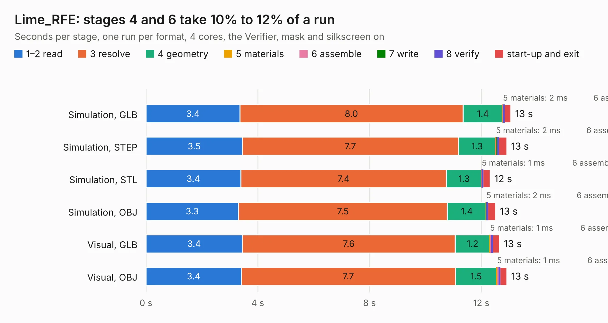

# 1709. Lime_RFE

Board 1,709 of the 3,120 of [Corpus Testing](../Corpus-Testing.md), on [Corpus Page 16](../CorpusTestingPages/Corpus-Testing-16.md#1709-lime_rfe).

| Mode and format | 1–2 read | 3 resolve | 4 geometry | 5 materials | 6 assemble | 7 write | 8 verify | start-up and exit | Total |
|---|---:|---:|---:|---:|---:|---:|---:|---:|---:|
| Simulation, GLB | 3.4 | 8.0 | 1.4 | 2&nbsp;ms | 27&nbsp;ms | 1&nbsp;ms | 6&nbsp;ms | 0.2 | 13.1 |
| Simulation, STEP | 3.5 | 7.7 | 1.3 | 2&nbsp;ms | 27&nbsp;ms | 49&nbsp;ms | 6&nbsp;ms | 0.3 | 12.9 |
| Simulation, STL | 3.4 | 7.4 | 1.3 | 1&nbsp;ms | 24&nbsp;ms | 1&nbsp;ms | 5&nbsp;ms | 0.3 | 12.3 |
| Simulation, OBJ | 3.3 | 7.5 | 1.4 | 2&nbsp;ms | 25&nbsp;ms | 8&nbsp;ms | 6&nbsp;ms | 0.3 | 12.5 |
| Visual, GLB | 3.4 | 7.6 | 1.2 | 1&nbsp;ms | 74&nbsp;ms | 2&nbsp;ms | 9&nbsp;ms | 0.3 | 12.7 |
| Visual, OBJ | 3.4 | 7.7 | 1.5 | 1&nbsp;ms | 83&nbsp;ms | 7&nbsp;ms | 9&nbsp;ms | 0.3 | 12.9 |

<table align="center"><tr><td valign="top">

| Board | Repo: [myriadrf/LimeRFE](https://github.com/myriadrf/LimeRFE) Board: `Lime_RFE.kicad_pcb` |
|---|---|
| Folder | hardware / 1v31 / KiCAD |
| Complexity | 341&nbsp;/&nbsp;1000 (size&nbsp;276, features&nbsp;65) |
| KESE&nbsp;features | through vias, slotted holes, rounded, trapezoid or chamfered pads, filled zones, curved board outline |
| Tested | 9th November 2026 |
| Copper&nbsp;layers | 6 |
| File&nbsp;format | KiCad 4 (4) |
| Parts,&nbsp;tracks,&nbsp;vias | 1,317, 10,728, 612 |
| Triangles,&nbsp;simulation | 1,736 in 8 parts |
| Verifier | PASS in all six runs |

</td><td valign="top">

<table>
<tr><th>File type</th><th>File size</th><th>Peak memory used</th></tr>
<tr><th colspan="3" align="left">Simulation</th></tr>
<tr><td>GLB</td><td align="right">51&nbsp;kB</td><td align="right">545&nbsp;MB</td></tr>
<tr><td>STEP</td><td align="right">240&nbsp;kB</td><td align="right">546&nbsp;MB</td></tr>
<tr><td>STL</td><td align="right">87&nbsp;kB</td><td align="right">544&nbsp;MB</td></tr>
<tr><td>OBJ</td><td align="right">169&nbsp;kB</td><td align="right">548&nbsp;MB</td></tr>
<tr><th colspan="3" align="left">Visual</th></tr>
<tr><td>GLB</td><td align="right">52&nbsp;kB</td><td align="right">545&nbsp;MB</td></tr>
<tr><td>OBJ</td><td align="right">133&nbsp;kB</td><td align="right">545&nbsp;MB</td></tr>
</table>

</td></tr></table>

| Previous | Next |
|:---|---:|
| [1708. Lime_RFE](b1708b_LimeRFE_archived-1v2-hardware-KiCAD_Lime-RFE.md) | [1710. FrontEnd_5G](b1710b_LimeRFE-8001P_hardware-1v0-KiCAD_FrontEnd-5G.md) |
