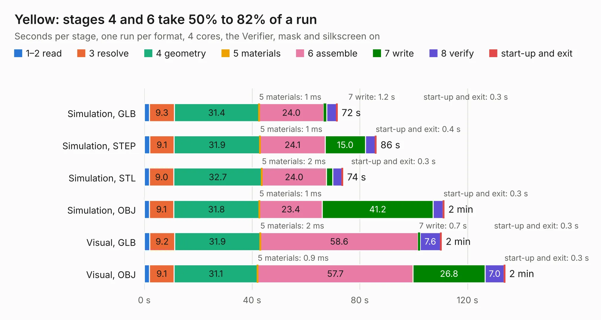

# 1709. Yellow

Board 1,709 of the 3,103 of [Corpus Testing](../Corpus-Testing.md), on [Corpus Page 16](../CorpusTestingPages/Corpus-Testing-16.md#1709-yellow).

| Mode and format | 1–2 read | 3 resolve | 4 geometry | 5 materials | 6 assemble | 7 write | 8 verify | start-up and exit | Total |
|---|---:|---:|---:|---:|---:|---:|---:|---:|---:|
| Simulation, GLB | 1.9 | 9.3 | 31.4 | 1&nbsp;ms | 24.0 | 1.2 | 3.6 | 0.3 | 71.7 |
| Simulation, STEP | 2.0 | 9.1 | 31.9 | 1&nbsp;ms | 24.1 | 15.0 | 3.6 | 0.4 | 86.1 |
| Simulation, STL | 2.0 | 9.0 | 32.7 | 2&nbsp;ms | 24.0 | 2.3 | 3.4 | 0.3 | 73.7 |
| Simulation, OBJ | 1.9 | 9.1 | 31.8 | 1&nbsp;ms | 23.4 | 41.2 | 3.7 | 0.3 | 111.3 |
| Visual, GLB | 2.1 | 9.2 | 31.9 | 2&nbsp;ms | 58.6 | 0.7 | 7.6 | 0.3 | 110.3 |
| Visual, OBJ | 1.9 | 9.1 | 31.1 | 0.9&nbsp;ms | 57.7 | 26.8 | 7.0 | 0.3 | 133.9 |

<table align="center"><tr><td valign="top">

| Board | Repo: [NabuCasa/yellow](https://github.com/NabuCasa/yellow) Board: `Yellow.kicad_pcb` |
|---|---|
| Complexity | 441&nbsp;/&nbsp;1000 (size&nbsp;291, features&nbsp;150) |
| KESE&nbsp;features | through vias, slotted holes, custom pads, rounded, trapezoid or chamfered pads, arc tracks, filled zones, copper drawings, curved board outline, stack-up, dielectric εr and tanδ, copper finish |
| Tested | 9th November 2026 |
| Copper&nbsp;layers | 4 |
| File&nbsp;format | KiCad 7 (20221018) |
| Parts,&nbsp;tracks,&nbsp;vias | 280, 3,463, 1,961 |
| Triangles,&nbsp;simulation | 6,590,014 in 390 parts |
| Verifier | PASS in all six runs |

</td><td valign="top">

<table>
<tr><th>File type</th><th>File size</th><th>Peak memory used</th></tr>
<tr><th colspan="3" align="left">Simulation</th></tr>
<tr><td>GLB</td><td align="right">222&nbsp;MB</td><td align="right">2.2&nbsp;GB</td></tr>
<tr><td>STEP</td><td align="right">788&nbsp;MB</td><td align="right">2.6&nbsp;GB</td></tr>
<tr><td>STL</td><td align="right">330&nbsp;MB</td><td align="right">2.4&nbsp;GB</td></tr>
<tr><td>OBJ</td><td align="right">695&nbsp;MB</td><td align="right">4.2&nbsp;GB</td></tr>
<tr><th colspan="3" align="left">Visual</th></tr>
<tr><td>GLB</td><td align="right">159&nbsp;MB</td><td align="right">2.5&nbsp;GB</td></tr>
<tr><td>OBJ</td><td align="right">511&nbsp;MB</td><td align="right">3.4&nbsp;GB</td></tr>
</table>

</td></tr></table>

| Previous | Next |
|:---|---:|
| [1708. Vivaldi](b1708b_vivaldi-antenna_Vivaldi.md) | [1710. keyboard_system](b1710b_vohm_keyboard-system.md) |
