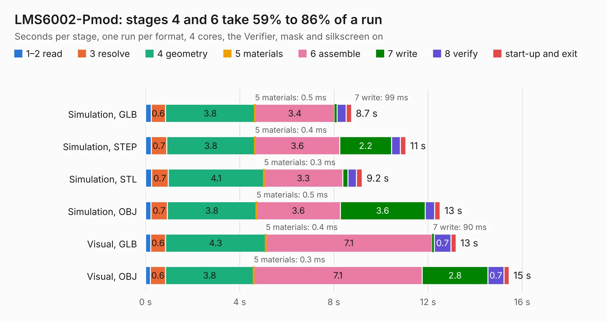

# 1711. LMS6002-Pmod

Board 1,711 of the 3,119 of [Corpus Testing](../Corpus-Testing.md), on [Corpus Page 16](../CorpusTestingPages/Corpus-Testing-16.md#1711-lms6002-pmod).

| Mode and format | 1–2 read | 3 resolve | 4 geometry | 5 materials | 6 assemble | 7 write | 8 verify | start-up and exit | Total |
|---|---:|---:|---:|---:|---:|---:|---:|---:|---:|
| Simulation, GLB | 0.2 | 0.6 | 3.8 | 0.5&nbsp;ms | 3.4 | 99&nbsp;ms | 0.4 | 0.2 | 8.7 |
| Simulation, STEP | 0.2 | 0.7 | 3.8 | 0.4&nbsp;ms | 3.6 | 2.2 | 0.4 | 0.2 | 11.1 |
| Simulation, STL | 0.3 | 0.7 | 4.1 | 0.3&nbsp;ms | 3.3 | 0.2 | 0.4 | 0.2 | 9.2 |
| Simulation, OBJ | 0.2 | 0.7 | 3.8 | 0.5&nbsp;ms | 3.6 | 3.6 | 0.4 | 0.2 | 12.5 |
| Visual, GLB | 0.2 | 0.6 | 4.3 | 0.4&nbsp;ms | 7.1 | 90&nbsp;ms | 0.7 | 0.2 | 13.2 |
| Visual, OBJ | 0.2 | 0.6 | 3.8 | 0.3&nbsp;ms | 7.1 | 2.8 | 0.7 | 0.2 | 15.4 |

<table align="center"><tr><td valign="top">

| Board | Repo: [myriadrf/LMS6002-Pmod](https://github.com/myriadrf/LMS6002-Pmod) Board: `LMS6002-Pmod.kicad_pcb` |
|---|---|
| Folder | board / KiCad |
| Complexity | 270&nbsp;/&nbsp;1000 (size&nbsp;215, features&nbsp;55) |
| KESE&nbsp;features | through vias, slotted holes, drill offsets, filled zones |
| Tested | 9th November 2026 |
| Copper&nbsp;layers | 2 |
| File&nbsp;format | KiCad 4 (4) |
| Parts,&nbsp;tracks,&nbsp;vias | 55, 891, 65 |
| Triangles,&nbsp;simulation | 724,500 in 95 parts |
| Verifier | PASS in all six runs |

</td><td valign="top">

<table>
<tr><th>File type</th><th>File size</th><th>Peak memory used</th></tr>
<tr><th colspan="3" align="left">Simulation</th></tr>
<tr><td>GLB</td><td align="right">26&nbsp;MB</td><td align="right">370&nbsp;MB</td></tr>
<tr><td>STEP</td><td align="right">139&nbsp;MB</td><td align="right">450&nbsp;MB</td></tr>
<tr><td>STL</td><td align="right">36&nbsp;MB</td><td align="right">391&nbsp;MB</td></tr>
<tr><td>OBJ</td><td align="right">77&nbsp;MB</td><td align="right">545&nbsp;MB</td></tr>
<tr><th colspan="3" align="left">Visual</th></tr>
<tr><td>GLB</td><td align="right">20&nbsp;MB</td><td align="right">512&nbsp;MB</td></tr>
<tr><td>OBJ</td><td align="right">60&nbsp;MB</td><td align="right">487&nbsp;MB</td></tr>
</table>

</td></tr></table>

| Previous | Next |
|:---|---:|
| [1710. LimeSDR_Breakout](b1710b_LimeSDR-GPIO-Board_LimeSDR-Breakout.md) | [1712. LMS8001_Companion](b1712b_LMS8001-Companion_hardware-2v1-KiCAD_LMS8001-Companion.md) |
