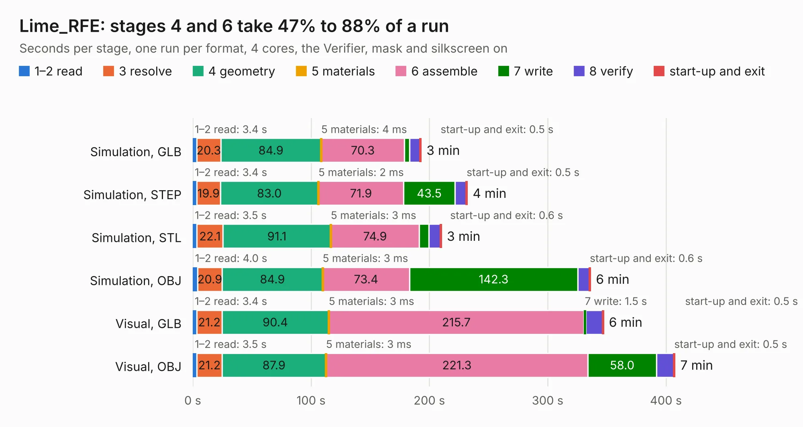

# 1713. Lime_RFE

Board 1,713 of the 3,132 of [Corpus Testing](../Corpus-Testing.md), on [Corpus Page 16](../CorpusTestingPages/Corpus-Testing-16.md#1713-lime_rfe).

| Mode and format | 1–2 read | 3 resolve | 4 geometry | 5 materials | 6 assemble | 7 write | 8 verify | start-up and exit | Total |
|---|---:|---:|---:|---:|---:|---:|---:|---:|---:|
| Simulation, GLB | 3.4 | 20.3 | 84.9 | 4&nbsp;ms | 70.3 | 4.4 | 8.9 | 0.5 | 192.7 |
| Simulation, STEP | 3.4 | 19.9 | 83.0 | 2&nbsp;ms | 71.9 | 43.5 | 9.6 | 0.5 | 231.8 |
| Simulation, STL | 3.5 | 22.1 | 91.1 | 3&nbsp;ms | 74.9 | 7.9 | 10.0 | 0.6 | 210.0 |
| Simulation, OBJ | 4.0 | 20.9 | 84.9 | 3&nbsp;ms | 73.4 | 142.3 | 9.9 | 0.6 | 336.0 |
| Visual, GLB | 3.4 | 21.2 | 90.4 | 3&nbsp;ms | 215.7 | 1.5 | 14.3 | 0.5 | 346.9 |
| Visual, OBJ | 3.5 | 21.2 | 87.9 | 3&nbsp;ms | 221.3 | 58.0 | 14.8 | 0.5 | 407.3 |

<table align="center"><tr><td valign="top">

| Board | Repo: [myriadrf/LimeRFE](https://github.com/myriadrf/LimeRFE) Board: `Lime_RFE.kicad_pcb` |
|---|---|
| Folder | archived / 0v3 / hardware / KiCad |
| Complexity | 325&nbsp;/&nbsp;1000 (size&nbsp;270, features&nbsp;55) |
| KESE&nbsp;features | through vias, slotted holes, rounded, trapezoid or chamfered pads, filled zones |
| Tested | 9th November 2026 to 10th November 2026 |
| Copper&nbsp;layers | 6 |
| File&nbsp;format | KiCad 4 (4) |
| Parts,&nbsp;tracks,&nbsp;vias | 986, 8,840, 623 |
| Triangles,&nbsp;simulation | 18,078,138 in 810 parts |
| Verifier | PASS in all six runs |
| Run&nbsp;again | Simulation, OBJ: failed in the corpus run, run again with the memory cap raised from 11 GB to 14.5 GB, and passed |

</td><td valign="top">

<table>
<tr><th>File type</th><th>File size</th><th>Peak memory used</th></tr>
<tr><th colspan="3" align="left">Simulation</th></tr>
<tr><td>GLB</td><td align="right">668&nbsp;MB</td><td align="right">4.5&nbsp;GB</td></tr>
<tr><td>STEP</td><td align="right">2.6&nbsp;GB</td><td align="right">6.1&nbsp;GB</td></tr>
<tr><td>STL</td><td align="right">904&nbsp;MB</td><td align="right">4.6&nbsp;GB</td></tr>
<tr><td>OBJ</td><td align="right">2.1&nbsp;GB</td><td align="right">12&nbsp;GB</td></tr>
<tr><th colspan="3" align="left">Visual</th></tr>
<tr><td>GLB</td><td align="right">320&nbsp;MB</td><td align="right">4.9&nbsp;GB</td></tr>
<tr><td>OBJ</td><td align="right">1.0&nbsp;GB</td><td align="right">6.7&nbsp;GB</td></tr>
</table>

</td></tr></table>

| Previous | Next |
|:---|---:|
| [1712. LC-RFE-Mini-RevA2](b1712b_lc-rfe-mini_LC-RFE-Mini-RevA2.md) | [1714. Lime_RFE_fab](b1714b_LimeRFE_Lime-RFE-fab.md) |
