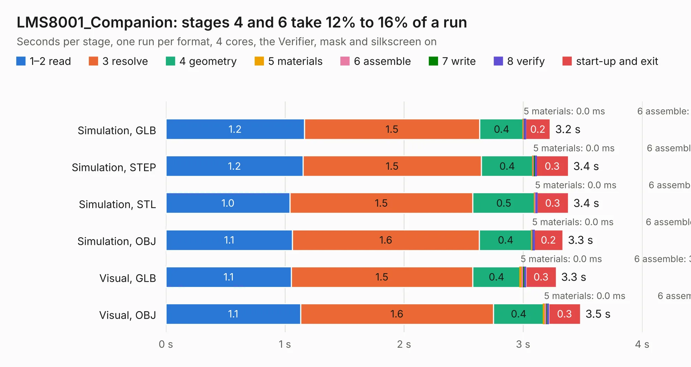

# 1714. LMS8001_Companion

Board 1,714 of the 3,119 of [Corpus Testing](../Corpus-Testing.md), on [Corpus Page 16](../CorpusTestingPages/Corpus-Testing-16.md#1714-lms8001_companion).

| Mode and format | 1–2 read | 3 resolve | 4 geometry | 5 materials | 6 assemble | 7 write | 8 verify | start-up and exit | Total |
|---|---:|---:|---:|---:|---:|---:|---:|---:|---:|
| Simulation, GLB | 1.2 | 1.5 | 0.4 | 0.0&nbsp;ms | 12&nbsp;ms | 1&nbsp;ms | 3&nbsp;ms | 0.2 | 3.2 |
| Simulation, STEP | 1.2 | 1.5 | 0.4 | 0.0&nbsp;ms | 11&nbsp;ms | 8&nbsp;ms | 5&nbsp;ms | 0.3 | 3.4 |
| Simulation, STL | 1.0 | 1.5 | 0.5 | 0.0&nbsp;ms | 12&nbsp;ms | 0.9&nbsp;ms | 3&nbsp;ms | 0.3 | 3.4 |
| Simulation, OBJ | 1.1 | 1.6 | 0.4 | 0.0&nbsp;ms | 11&nbsp;ms | 1&nbsp;ms | 3&nbsp;ms | 0.2 | 3.3 |
| Visual, GLB | 1.1 | 1.5 | 0.4 | 0.0&nbsp;ms | 31&nbsp;ms | 2&nbsp;ms | 13&nbsp;ms | 0.3 | 3.3 |
| Visual, OBJ | 1.1 | 1.6 | 0.4 | 0.0&nbsp;ms | 26&nbsp;ms | 1&nbsp;ms | 11&nbsp;ms | 0.3 | 3.5 |

<table align="center"><tr><td valign="top">

| Board | Repo: [myriadrf/LMS8001-Companion](https://github.com/myriadrf/LMS8001-Companion) Board: `LMS8001_Companion.kicad_pcb` |
|---|---|
| Folder | hardware / 3v2 / KiCAD |
| Complexity | 333&nbsp;/&nbsp;1000 (size&nbsp;268, features&nbsp;65) |
| KESE&nbsp;features | through vias, slotted holes, rounded, trapezoid or chamfered pads, filled zones, curved board outline |
| Tested | 9th November 2026 |
| Copper&nbsp;layers | 4 |
| File&nbsp;format | KiCad 4 (4) |
| Parts,&nbsp;tracks,&nbsp;vias | 352, 2,467, 192 |
| Triangles,&nbsp;simulation | 52 in 3 parts |
| Verifier | PASS in all six runs |

</td><td valign="top">

<table>
<tr><th>File type</th><th>File size</th><th>Peak memory used</th></tr>
<tr><th colspan="3" align="left">Simulation</th></tr>
<tr><td>GLB</td><td align="right">4.6&nbsp;kB</td><td align="right">141&nbsp;MB</td></tr>
<tr><td>STEP</td><td align="right">23&nbsp;kB</td><td align="right">141&nbsp;MB</td></tr>
<tr><td>STL</td><td align="right">2.9&nbsp;kB</td><td align="right">141&nbsp;MB</td></tr>
<tr><td>OBJ</td><td align="right">6.2&nbsp;kB</td><td align="right">141&nbsp;MB</td></tr>
<tr><th colspan="3" align="left">Visual</th></tr>
<tr><td>GLB</td><td align="right">5.0&nbsp;kB</td><td align="right">142&nbsp;MB</td></tr>
<tr><td>OBJ</td><td align="right">5.2&nbsp;kB</td><td align="right">142&nbsp;MB</td></tr>
</table>

</td></tr></table>

| Previous | Next |
|:---|---:|
| [1713. LMS8001_Companion](b1713b_LMS8001-Companion_hardware-3v1-KiCAD_LMS8001-Companion.md) | [1715. DigiRED_v1.0](b1715b_RASDR_DigiRED-v1-0.md) |
