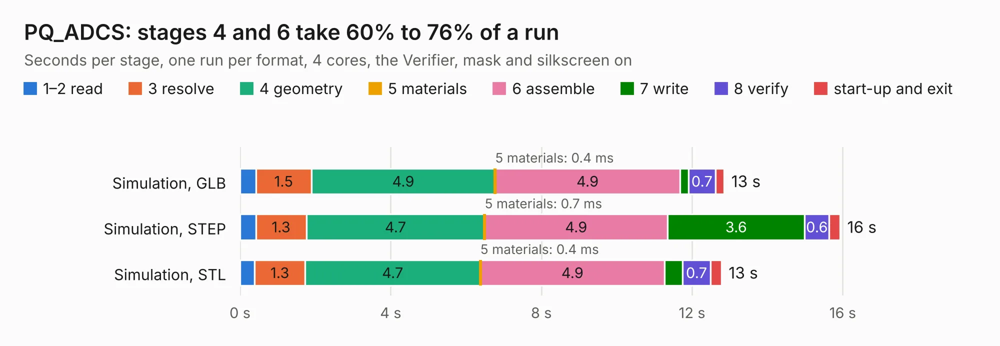

# 1714. PQ_ADCS

Board 1,714 of the 3,102 of [Corpus Testing](../Corpus-Testing.md), on [Corpus Page 16](../CorpusTestingPages/Corpus-Testing-16.md#1714-pq_adcs).

| Mode and format | 1–2 read | 3 resolve | 4 geometry | 5 materials | 6 assemble | 7 write | 8 verify | start-up and exit | Total |
|---|---:|---:|---:|---:|---:|---:|---:|---:|---:|
| Simulation, GLB | 0.4 | 1.5 | 4.9 | 0.4&nbsp;ms | 4.9 | 0.2 | 0.7 | 0.2 | 12.9 |
| Simulation, STEP | 0.4 | 1.3 | 4.7 | 0.7&nbsp;ms | 4.9 | 3.6 | 0.6 | 0.3 | 15.9 |
| Simulation, STL | 0.4 | 1.3 | 4.7 | 0.4&nbsp;ms | 4.9 | 0.5 | 0.7 | 0.3 | 12.8 |
| Simulation, OBJ | 0.4 | 1.4 | 4.7 | 0.4&nbsp;ms | 4.9 | 8.1 | 0.7 | 0.2 | 20.3 |
| Visual, GLB | 0.4 | 1.3 | 4.8 | 0.4&nbsp;ms | 10.2 | 0.2 | 1.0 | 0.3 | 18.2 |
| Visual, OBJ | 0.4 | 1.4 | 4.8 | 0.4&nbsp;ms | 9.7 | 4.7 | 1.2 | 0.2 | 22.5 |

<table align="center"><tr><td valign="top">

| Board | Repo: [nanosatlab/pocat-hw](https://github.com/nanosatlab/pocat-hw) Board: `PQ_ADCS.kicad_pcb` |
|---|---|
| Folder | pq_adcs / PQ_ADCS_HBridge |
| Complexity | 302&nbsp;/&nbsp;1000 (size&nbsp;202, features&nbsp;100) |
| KESE&nbsp;features | through vias, slotted holes, rounded, trapezoid or chamfered pads, filled zones, curved board outline, stack-up, dielectric εr and tanδ, mask and silkscreen colours |
| Tested | 9th November 2026 |
| Copper&nbsp;layers | 6 |
| File&nbsp;format | KiCad 10 (20260206) |
| Parts,&nbsp;tracks,&nbsp;vias | 56, 779, 123 |
| Triangles,&nbsp;simulation | 1,549,468 in 103 parts |
| Verifier | PASS in all six runs |

</td><td valign="top">

<table>
<tr><th>File type</th><th>File size</th><th>Peak memory used</th></tr>
<tr><th colspan="3" align="left">Simulation</th></tr>
<tr><td>GLB</td><td align="right">52&nbsp;MB</td><td align="right">532&nbsp;MB</td></tr>
<tr><td>STEP</td><td align="right">204&nbsp;MB</td><td align="right">653&nbsp;MB</td></tr>
<tr><td>STL</td><td align="right">77&nbsp;MB</td><td align="right">532&nbsp;MB</td></tr>
<tr><td>OBJ</td><td align="right">160&nbsp;MB</td><td align="right">1.1&nbsp;GB</td></tr>
<tr><th colspan="3" align="left">Visual</th></tr>
<tr><td>GLB</td><td align="right">31&nbsp;MB</td><td align="right">674&nbsp;MB</td></tr>
<tr><td>OBJ</td><td align="right">93&nbsp;MB</td><td align="right">724&nbsp;MB</td></tr>
</table>

</td></tr></table>

| Previous | Next |
|:---|---:|
| [1713. PQ_ADCS](b1713b_pocat-hw_pq-adcs-PQ-ADCS_PQ-ADCS.md) | [1715. PQ_BotBoard](b1715b_pocat-hw_PQ-BotBoard.md) |
