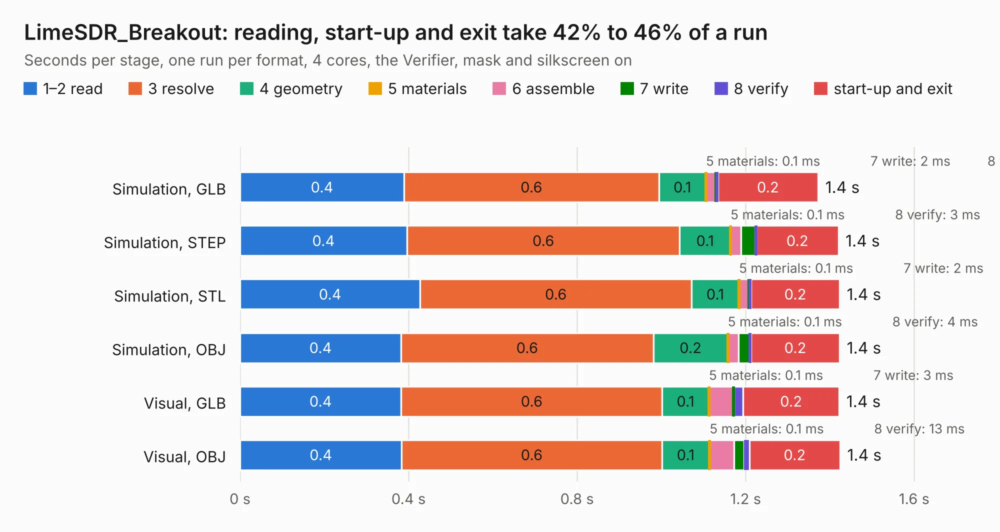

# 1715. LimeSDR_Breakout

Board 1,715 of the 3,125 of [Corpus Testing](../Corpus-Testing.md), on [Corpus Page 16](../CorpusTestingPages/Corpus-Testing-16.md#1715-limesdr_breakout).

| Mode and format | 1–2 read | 3 resolve | 4 geometry | 5 materials | 6 assemble | 7 write | 8 verify | start-up and exit | Total |
|---|---:|---:|---:|---:|---:|---:|---:|---:|---:|
| Simulation, GLB | 0.4 | 0.6 | 0.1 | 0.1&nbsp;ms | 23&nbsp;ms | 2&nbsp;ms | 3&nbsp;ms | 0.2 | 1.4 |
| Simulation, STEP | 0.4 | 0.6 | 0.1 | 0.1&nbsp;ms | 25&nbsp;ms | 34&nbsp;ms | 3&nbsp;ms | 0.2 | 1.4 |
| Simulation, STL | 0.4 | 0.6 | 0.1 | 0.1&nbsp;ms | 23&nbsp;ms | 2&nbsp;ms | 4&nbsp;ms | 0.2 | 1.4 |
| Simulation, OBJ | 0.4 | 0.6 | 0.2 | 0.1&nbsp;ms | 25&nbsp;ms | 26&nbsp;ms | 4&nbsp;ms | 0.2 | 1.4 |
| Visual, GLB | 0.4 | 0.6 | 0.1 | 0.1&nbsp;ms | 57&nbsp;ms | 3&nbsp;ms | 21&nbsp;ms | 0.2 | 1.4 |
| Visual, OBJ | 0.4 | 0.6 | 0.1 | 0.1&nbsp;ms | 57&nbsp;ms | 24&nbsp;ms | 13&nbsp;ms | 0.2 | 1.4 |

<table align="center"><tr><td valign="top">

| Board | Repo: [myriadrf/LimeSDR_GPIO_Board](https://github.com/myriadrf/LimeSDR_GPIO_Board) Board: `LimeSDR_Breakout.kicad_pcb` |
|---|---|
| Folder | hardware / 0402_Variant / CAD2 |
| Complexity | 244&nbsp;/&nbsp;1000 (size&nbsp;199, features&nbsp;45) |
| KESE&nbsp;features | through vias, filled zones, curved board outline |
| Tested | 9th November 2026 |
| Copper&nbsp;layers | 2 |
| File&nbsp;format | KiCad 4 (4) |
| Parts,&nbsp;tracks,&nbsp;vias | 90, 2,265, 397 |
| Triangles,&nbsp;simulation | 5,712 in 3 parts |
| Verifier | PASS in all six runs |

</td><td valign="top">

<table>
<tr><th>File type</th><th>File size</th><th>Peak memory used</th></tr>
<tr><th colspan="3" align="left">Simulation</th></tr>
<tr><td>GLB</td><td align="right">165&nbsp;kB</td><td align="right">90&nbsp;MB</td></tr>
<tr><td>STEP</td><td align="right">74&nbsp;kB</td><td align="right">92&nbsp;MB</td></tr>
<tr><td>STL</td><td align="right">286&nbsp;kB</td><td align="right">90&nbsp;MB</td></tr>
<tr><td>OBJ</td><td align="right">542&nbsp;kB</td><td align="right">90&nbsp;MB</td></tr>
<tr><th colspan="3" align="left">Visual</th></tr>
<tr><td>GLB</td><td align="right">212&nbsp;kB</td><td align="right">90&nbsp;MB</td></tr>
<tr><td>OBJ</td><td align="right">545&nbsp;kB</td><td align="right">90&nbsp;MB</td></tr>
</table>

</td></tr></table>

| Previous | Next |
|:---|---:|
| [1714. FrontEnd_5G](b1714b_LimeRFE-8001P_hardware-1v1-KiCAD_FrontEnd-5G.md) | [1716. LMS6002-Pmod](b1716b_LMS6002-Pmod_LMS6002-Pmod.md) |
