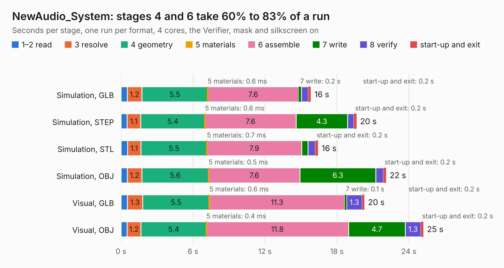

# 1715. NewAudio_System

Board 1,715 of the 3,106 of [Corpus Testing](../Corpus-Testing.md), on [Corpus Page 16](../CorpusTestingPages/Corpus-Testing-16.md#1715-newaudio_system).

| Mode and format | 1–2 read | 3 resolve | 4 geometry | 5 materials | 6 assemble | 7 write | 8 verify | start-up and exit | Total |
|---|---:|---:|---:|---:|---:|---:|---:|---:|---:|
| Simulation, GLB | 0.5 | 1.2 | 5.5 | 0.6&nbsp;ms | 7.6 | 0.2 | 0.6 | 0.2 | 15.8 |
| Simulation, STEP | 0.5 | 1.1 | 5.4 | 0.6&nbsp;ms | 7.6 | 4.3 | 0.5 | 0.2 | 19.6 |
| Simulation, STL | 0.5 | 1.1 | 5.5 | 0.7&nbsp;ms | 7.9 | 0.5 | 0.6 | 0.2 | 16.4 |
| Simulation, OBJ | 0.5 | 1.2 | 5.6 | 0.5&nbsp;ms | 7.6 | 6.3 | 0.6 | 0.2 | 22.1 |
| Visual, GLB | 0.5 | 1.3 | 5.5 | 0.6&nbsp;ms | 11.3 | 0.1 | 1.3 | 0.2 | 20.3 |
| Visual, OBJ | 0.5 | 1.2 | 5.4 | 0.4&nbsp;ms | 11.8 | 4.7 | 1.3 | 0.2 | 25.2 |

<table align="center"><tr><td valign="top">

| Board | Repo: [nalgonda-tiger/vohm](https://github.com/nalgonda-tiger/vohm) Board: `NewAudio_System.kicad_pcb` |
|---|---|
| Folder | NewAudio_System |
| Complexity | 307&nbsp;/&nbsp;1000 (size&nbsp;212, features&nbsp;95) |
| KESE&nbsp;features | through vias, slotted holes, rounded, trapezoid or chamfered pads, filled zones, curved board outline, stack-up, dielectric εr and tanδ |
| Tested | 9th November 2026 |
| Copper&nbsp;layers | 4 |
| File&nbsp;format | KiCad 9 (20241229) |
| Parts,&nbsp;tracks,&nbsp;vias | 198, 1,101, 188 |
| Triangles,&nbsp;simulation | 1,635,412 in 155 parts |
| Verifier | PASS in all six runs |

</td><td valign="top">

<table>
<tr><th>File type</th><th>File size</th><th>Peak memory used</th></tr>
<tr><th colspan="3" align="left">Simulation</th></tr>
<tr><td>GLB</td><td align="right">56&nbsp;MB</td><td align="right">661&nbsp;MB</td></tr>
<tr><td>STEP</td><td align="right">276&nbsp;MB</td><td align="right">792&nbsp;MB</td></tr>
<tr><td>STL</td><td align="right">82&nbsp;MB</td><td align="right">642&nbsp;MB</td></tr>
<tr><td>OBJ</td><td align="right">171&nbsp;MB</td><td align="right">1.1&nbsp;GB</td></tr>
<tr><th colspan="3" align="left">Visual</th></tr>
<tr><td>GLB</td><td align="right">40&nbsp;MB</td><td align="right">734&nbsp;MB</td></tr>
<tr><td>OBJ</td><td align="right">123&nbsp;MB</td><td align="right">878&nbsp;MB</td></tr>
</table>

</td></tr></table>

| Previous | Next |
|:---|---:|
| [1714. LattePandaMu_Motherboard](b1714b_vohm_LattePandaMu-Motherboard.md) | [1716. webcam_microphone_system](b1716b_vohm_webcam-microphone-system.md) |
