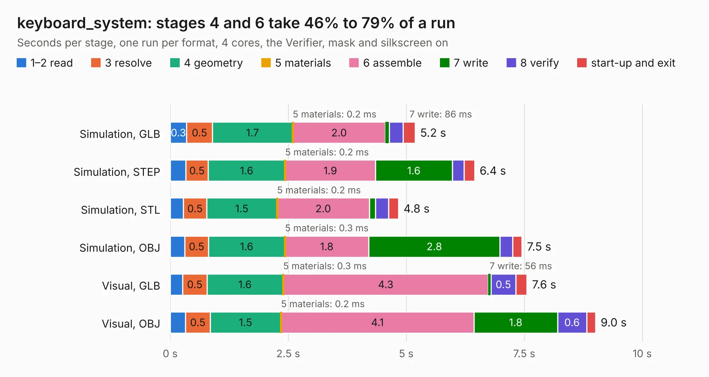

# 1716. keyboard_system

Board 1,716 of the 3,109 of [Corpus Testing](../Corpus-Testing.md), on [Corpus Page 16](../CorpusTestingPages/Corpus-Testing-16.md#1716-keyboard_system).

| Mode and format | 1–2 read | 3 resolve | 4 geometry | 5 materials | 6 assemble | 7 write | 8 verify | start-up and exit | Total |
|---|---:|---:|---:|---:|---:|---:|---:|---:|---:|
| Simulation, GLB | 0.3 | 0.5 | 1.7 | 0.2&nbsp;ms | 2.0 | 86&nbsp;ms | 0.3 | 0.3 | 5.2 |
| Simulation, STEP | 0.3 | 0.5 | 1.6 | 0.2&nbsp;ms | 1.9 | 1.6 | 0.3 | 0.2 | 6.4 |
| Simulation, STL | 0.3 | 0.5 | 1.5 | 0.2&nbsp;ms | 2.0 | 0.1 | 0.3 | 0.2 | 4.8 |
| Simulation, OBJ | 0.3 | 0.5 | 1.6 | 0.3&nbsp;ms | 1.8 | 2.8 | 0.3 | 0.2 | 7.5 |
| Visual, GLB | 0.3 | 0.5 | 1.6 | 0.3&nbsp;ms | 4.3 | 56&nbsp;ms | 0.5 | 0.2 | 7.6 |
| Visual, OBJ | 0.3 | 0.5 | 1.5 | 0.2&nbsp;ms | 4.1 | 1.8 | 0.6 | 0.2 | 9.0 |

<table align="center"><tr><td valign="top">

| Board | Repo: [nalgonda-tiger/vohm](https://github.com/nalgonda-tiger/vohm) Board: `keyboard_system.kicad_pcb` |
|---|---|
| Folder | keyboard_system |
| Complexity | 327&nbsp;/&nbsp;1000 (size&nbsp;217, features&nbsp;110) |
| KESE&nbsp;features | through vias, slotted holes, rounded, trapezoid or chamfered pads, arc tracks, filled zones, curved board outline, stack-up, dielectric εr and tanδ |
| Tested | 9th November 2026 |
| Copper&nbsp;layers | 4 |
| File&nbsp;format | KiCad 9 (20241229) |
| Parts,&nbsp;tracks,&nbsp;vias | 34, 433, 59 |
| Triangles,&nbsp;simulation | 574,658 in 55 parts |
| Verifier | PASS in all six runs |

</td><td valign="top">

<table>
<tr><th>File type</th><th>File size</th><th>Peak memory used</th></tr>
<tr><th colspan="3" align="left">Simulation</th></tr>
<tr><td>GLB</td><td align="right">20&nbsp;MB</td><td align="right">316&nbsp;MB</td></tr>
<tr><td>STEP</td><td align="right">84&nbsp;MB</td><td align="right">393&nbsp;MB</td></tr>
<tr><td>STL</td><td align="right">29&nbsp;MB</td><td align="right">316&nbsp;MB</td></tr>
<tr><td>OBJ</td><td align="right">59&nbsp;MB</td><td align="right">436&nbsp;MB</td></tr>
<tr><th colspan="3" align="left">Visual</th></tr>
<tr><td>GLB</td><td align="right">16&nbsp;MB</td><td align="right">409&nbsp;MB</td></tr>
<tr><td>OBJ</td><td align="right">47&nbsp;MB</td><td align="right">423&nbsp;MB</td></tr>
</table>

</td></tr></table>

| Previous | Next |
|:---|---:|
| [1715. Yellow](b1715b_yellow_Yellow.md) | [1717. LattePandaMu_Motherboard](b1717b_vohm_LattePandaMu-Motherboard.md) |
