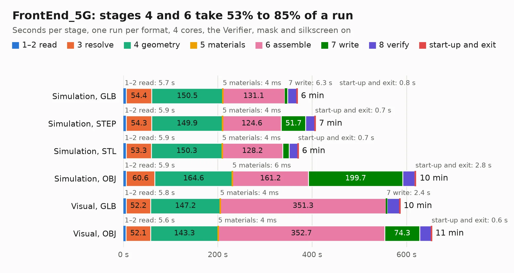

# 1719. FrontEnd_5G

Board 1,719 of the 3,132 of [Corpus Testing](../Corpus-Testing.md), on [Corpus Page 16](../CorpusTestingPages/Corpus-Testing-16.md#1719-frontend_5g).

| Mode and format | 1–2 read | 3 resolve | 4 geometry | 5 materials | 6 assemble | 7 write | 8 verify | start-up and exit | Total |
|---|---:|---:|---:|---:|---:|---:|---:|---:|---:|
| Simulation, GLB | 5.7 | 54.4 | 150.5 | 4&nbsp;ms | 131.1 | 6.3 | 19.7 | 0.8 | 368.5 |
| Simulation, STEP | 5.9 | 54.3 | 149.9 | 4&nbsp;ms | 124.6 | 51.7 | 19.8 | 0.7 | 406.8 |
| Simulation, STL | 5.9 | 53.3 | 150.3 | 4&nbsp;ms | 128.2 | 13.6 | 18.8 | 0.7 | 370.8 |
| Simulation, OBJ | 5.9 | 60.6 | 164.6 | 6&nbsp;ms | 161.2 | 199.7 | 25.5 | 2.8 | 620.3 |
| Visual, GLB | 5.8 | 52.2 | 147.2 | 4&nbsp;ms | 351.3 | 2.4 | 26.8 | 0.5 | 586.1 |
| Visual, OBJ | 5.6 | 52.1 | 143.3 | 4&nbsp;ms | 352.7 | 74.3 | 25.1 | 0.6 | 653.5 |

<table align="center"><tr><td valign="top">

| Board | Repo: [myriadrf/LimeRFE-8001P](https://github.com/myriadrf/LimeRFE-8001P) Board: `FrontEnd_5G.kicad_pcb` |
|---|---|
| Folder | hardware / 1v1 / KiCAD |
| Complexity | 383&nbsp;/&nbsp;1000 (size&nbsp;288, features&nbsp;95) |
| KESE&nbsp;features | through vias, blind and buried vias, slotted holes, rounded, trapezoid or chamfered pads, filled zones |
| Tested | 9th November 2026 to 11th November 2026 |
| Copper&nbsp;layers | 6 |
| File&nbsp;format | KiCad 4 (4) |
| Parts,&nbsp;tracks,&nbsp;vias | 1,461, 20,552, 1,349 |
| Triangles,&nbsp;simulation | 27,133,154 in 1073 parts |
| Verifier | PASS in all six runs |
| Run&nbsp;again | Simulation, OBJ: failed in the corpus run, run again with no memory cap and no time limit (swap added to a 16 GB machine), and passed |

</td><td valign="top">

<table>
<tr><th>File type</th><th>File size</th><th>Peak memory used</th></tr>
<tr><th colspan="3" align="left">Simulation</th></tr>
<tr><td>GLB</td><td align="right">916&nbsp;MB</td><td align="right">7.3&nbsp;GB</td></tr>
<tr><td>STEP</td><td align="right">2.5&nbsp;GB</td><td align="right">8.7&nbsp;GB</td></tr>
<tr><td>STL</td><td align="right">1.4&nbsp;GB</td><td align="right">7.5&nbsp;GB</td></tr>
<tr><td>OBJ</td><td align="right">3.0&nbsp;GB</td><td align="right">17&nbsp;GB</td></tr>
<tr><th colspan="3" align="left">Visual</th></tr>
<tr><td>GLB</td><td align="right">462&nbsp;MB</td><td align="right">7.4&nbsp;GB</td></tr>
<tr><td>OBJ</td><td align="right">1.5&nbsp;GB</td><td align="right">9.7&nbsp;GB</td></tr>
</table>

</td></tr></table>

| Previous | Next |
|:---|---:|
| [1718. FrontEnd_5G](b1718b_LimeRFE-8001P_hardware-1v0-KiCAD_FrontEnd-5G.md) | [1720. LimeSDR_Breakout](b1720b_LimeSDR-GPIO-Board_LimeSDR-Breakout.md) |
