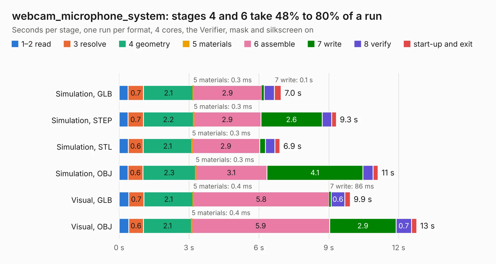

# 1719. webcam_microphone_system

Board 1,719 of the 3,109 of [Corpus Testing](../Corpus-Testing.md), on [Corpus Page 16](../CorpusTestingPages/Corpus-Testing-16.md#1719-webcam_microphone_system).

| Mode and format | 1–2 read | 3 resolve | 4 geometry | 5 materials | 6 assemble | 7 write | 8 verify | start-up and exit | Total |
|---|---:|---:|---:|---:|---:|---:|---:|---:|---:|
| Simulation, GLB | 0.4 | 0.7 | 2.1 | 0.3&nbsp;ms | 2.9 | 0.1 | 0.4 | 0.3 | 7.0 |
| Simulation, STEP | 0.4 | 0.7 | 2.2 | 0.3&nbsp;ms | 2.9 | 2.6 | 0.4 | 0.2 | 9.3 |
| Simulation, STL | 0.4 | 0.6 | 2.1 | 0.3&nbsp;ms | 2.9 | 0.2 | 0.4 | 0.2 | 6.9 |
| Simulation, OBJ | 0.4 | 0.6 | 2.3 | 0.3&nbsp;ms | 3.1 | 4.1 | 0.4 | 0.2 | 11.1 |
| Visual, GLB | 0.4 | 0.7 | 2.1 | 0.4&nbsp;ms | 5.8 | 86&nbsp;ms | 0.6 | 0.2 | 9.9 |
| Visual, OBJ | 0.4 | 0.6 | 2.1 | 0.4&nbsp;ms | 5.9 | 2.9 | 0.7 | 0.2 | 12.8 |

<table align="center"><tr><td valign="top">

| Board | Repo: [nalgonda-tiger/vohm](https://github.com/nalgonda-tiger/vohm) Board: `webcam_microphone_system.kicad_pcb` |
|---|---|
| Folder | webcam_microphone_system |
| Complexity | 353&nbsp;/&nbsp;1000 (size&nbsp;228, features&nbsp;125) |
| KESE&nbsp;features | through vias, slotted holes, rounded, trapezoid or chamfered pads, arc tracks, filled zones, curved board outline, TrueType text, stack-up, dielectric εr and tanδ |
| Tested | 9th November 2026 |
| Copper&nbsp;layers | 4 |
| File&nbsp;format | KiCad 9 (20241229) |
| Parts,&nbsp;tracks,&nbsp;vias | 61, 593, 73 |
| Triangles,&nbsp;simulation | 696,602 in 95 parts |
| Verifier | PASS in all six runs |

</td><td valign="top">

<table>
<tr><th>File type</th><th>File size</th><th>Peak memory used</th></tr>
<tr><th colspan="3" align="left">Simulation</th></tr>
<tr><td>GLB</td><td align="right">24&nbsp;MB</td><td align="right">365&nbsp;MB</td></tr>
<tr><td>STEP</td><td align="right">106&nbsp;MB</td><td align="right">430&nbsp;MB</td></tr>
<tr><td>STL</td><td align="right">35&nbsp;MB</td><td align="right">367&nbsp;MB</td></tr>
<tr><td>OBJ</td><td align="right">71&nbsp;MB</td><td align="right">509&nbsp;MB</td></tr>
<tr><th colspan="3" align="left">Visual</th></tr>
<tr><td>GLB</td><td align="right">17&nbsp;MB</td><td align="right">484&nbsp;MB</td></tr>
<tr><td>OBJ</td><td align="right">52&nbsp;MB</td><td align="right">475&nbsp;MB</td></tr>
</table>

</td></tr></table>

| Previous | Next |
|:---|---:|
| [1718. NewAudio_System](b1718b_vohm_NewAudio-System.md) | [1720. PQ_ADCS](b1720b_pocat-hw_pq-adcs-PQ-ADCS_PQ-ADCS.md) |
