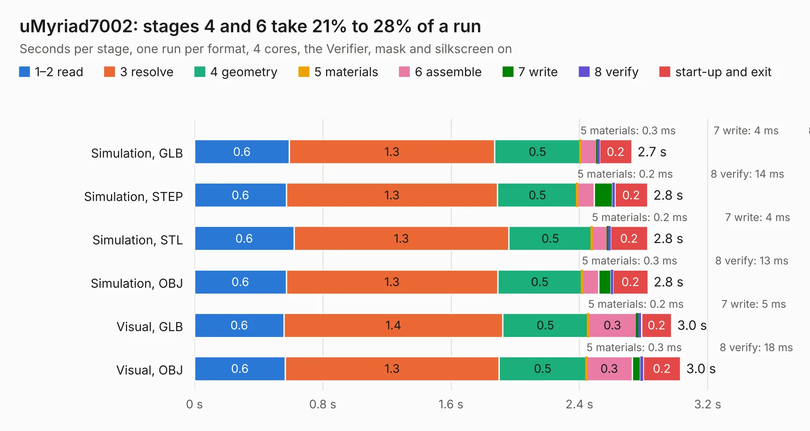

# 1720. uMyriad7002

Board 1,720 of the 3,119 of [Corpus Testing](../Corpus-Testing.md), on [Corpus Page 16](../CorpusTestingPages/Corpus-Testing-16.md#1720-umyriad7002).

| Mode and format | 1–2 read | 3 resolve | 4 geometry | 5 materials | 6 assemble | 7 write | 8 verify | start-up and exit | Total |
|---|---:|---:|---:|---:|---:|---:|---:|---:|---:|
| Simulation, GLB | 0.6 | 1.3 | 0.5 | 0.3&nbsp;ms | 0.1 | 4&nbsp;ms | 12&nbsp;ms | 0.2 | 2.7 |
| Simulation, STEP | 0.6 | 1.3 | 0.5 | 0.2&nbsp;ms | 0.1 | 0.1 | 14&nbsp;ms | 0.2 | 2.8 |
| Simulation, STL | 0.6 | 1.3 | 0.5 | 0.2&nbsp;ms | 99&nbsp;ms | 4&nbsp;ms | 12&nbsp;ms | 0.2 | 2.8 |
| Simulation, OBJ | 0.6 | 1.3 | 0.5 | 0.3&nbsp;ms | 0.1 | 76&nbsp;ms | 13&nbsp;ms | 0.2 | 2.8 |
| Visual, GLB | 0.6 | 1.4 | 0.5 | 0.2&nbsp;ms | 0.3 | 5&nbsp;ms | 27&nbsp;ms | 0.2 | 3.0 |
| Visual, OBJ | 0.6 | 1.3 | 0.5 | 0.3&nbsp;ms | 0.3 | 51&nbsp;ms | 18&nbsp;ms | 0.2 | 3.0 |

<table align="center"><tr><td valign="top">

| Board | Repo: [myriadrf/reference-development-kit](https://github.com/myriadrf/reference-development-kit) Board: `uMyriad7002.kicad_pcb` |
|---|---|
| Folder | umyriadrf-7002 / v2 / KiCAD |
| Complexity | 314&nbsp;/&nbsp;1000 (size&nbsp;279, features&nbsp;35) |
| KESE&nbsp;features | through vias, filled zones |
| Tested | 9th November 2026 |
| Copper&nbsp;layers | 8 |
| File&nbsp;format | KiCad 3 (3) |
| Parts,&nbsp;tracks,&nbsp;vias | 177, 2,058, 436 |
| Triangles,&nbsp;simulation | 11,772 in 16 parts |
| Verifier | PASS in all six runs |

</td><td valign="top">

<table>
<tr><th>File type</th><th>File size</th><th>Peak memory used</th></tr>
<tr><th colspan="3" align="left">Simulation</th></tr>
<tr><td>GLB</td><td align="right">359&nbsp;kB</td><td align="right">104&nbsp;MB</td></tr>
<tr><td>STEP</td><td align="right">1.5&nbsp;MB</td><td align="right">105&nbsp;MB</td></tr>
<tr><td>STL</td><td align="right">590&nbsp;kB</td><td align="right">105&nbsp;MB</td></tr>
<tr><td>OBJ</td><td align="right">1.2&nbsp;MB</td><td align="right">106&nbsp;MB</td></tr>
<tr><th colspan="3" align="left">Visual</th></tr>
<tr><td>GLB</td><td align="right">340&nbsp;kB</td><td align="right">104&nbsp;MB</td></tr>
<tr><td>OBJ</td><td align="right">959&nbsp;kB</td><td align="right">105&nbsp;MB</td></tr>
</table>

</td></tr></table>

| Previous | Next |
|:---|---:|
| [1719. uMyriad7002-append](b1719b_reference-development-kit_uMyriad7002-append.md) | [1721. Zipper](b1721b_reference-development-kit_Zipper.md) |
