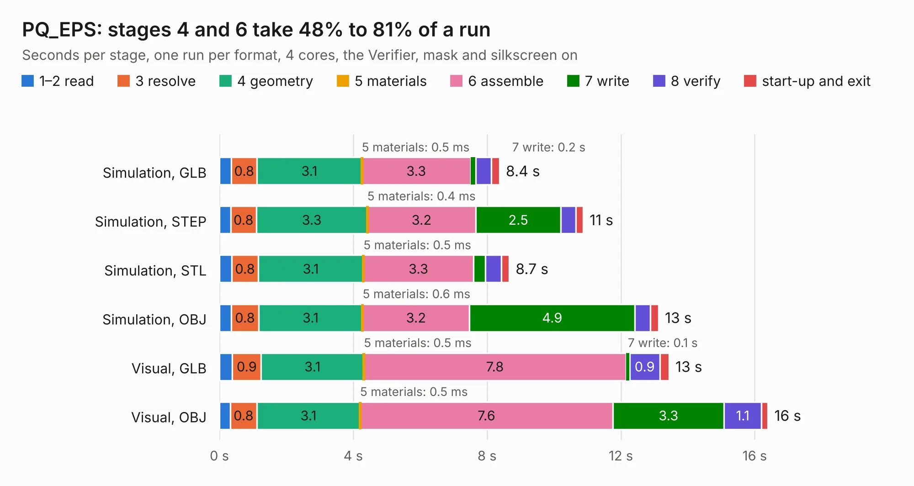

# 1721. PQ_EPS

Board 1,721 of the 3,105 of [Corpus Testing](../Corpus-Testing.md), on [Corpus Page 16](../CorpusTestingPages/Corpus-Testing-16.md#1721-pq_eps).

| Mode and format | 1–2 read | 3 resolve | 4 geometry | 5 materials | 6 assemble | 7 write | 8 verify | start-up and exit | Total |
|---|---:|---:|---:|---:|---:|---:|---:|---:|---:|
| Simulation, GLB | 0.4 | 0.8 | 3.1 | 0.5&nbsp;ms | 3.3 | 0.2 | 0.5 | 0.2 | 8.4 |
| Simulation, STEP | 0.3 | 0.8 | 3.3 | 0.4&nbsp;ms | 3.2 | 2.5 | 0.5 | 0.2 | 10.9 |
| Simulation, STL | 0.4 | 0.8 | 3.1 | 0.5&nbsp;ms | 3.3 | 0.4 | 0.5 | 0.2 | 8.7 |
| Simulation, OBJ | 0.4 | 0.8 | 3.1 | 0.6&nbsp;ms | 3.2 | 4.9 | 0.5 | 0.2 | 13.1 |
| Visual, GLB | 0.4 | 0.9 | 3.1 | 0.5&nbsp;ms | 7.8 | 0.1 | 0.9 | 0.3 | 13.4 |
| Visual, OBJ | 0.3 | 0.8 | 3.1 | 0.5&nbsp;ms | 7.6 | 3.3 | 1.1 | 0.2 | 16.4 |

<table align="center"><tr><td valign="top">

| Board | Repo: [nanosatlab/pocat-hw](https://github.com/nanosatlab/pocat-hw) Board: `PQ_EPS.kicad_pcb` |
|---|---|
| Folder | pq_eps / PQ_EPS |
| Complexity | 280&nbsp;/&nbsp;1000 (size&nbsp;190, features&nbsp;90) |
| KESE&nbsp;features | through vias, rounded, trapezoid or chamfered pads, filled zones, curved board outline, stack-up, dielectric εr and tanδ, mask and silkscreen colours |
| Tested | 9th November 2026 |
| Copper&nbsp;layers | 4 |
| File&nbsp;format | KiCad 10 (20260206) |
| Parts,&nbsp;tracks,&nbsp;vias | 82, 475, 96 |
| Triangles,&nbsp;simulation | 1,126,386 in 91 parts |
| Verifier | PASS in all six runs |

</td><td valign="top">

<table>
<tr><th>File type</th><th>File size</th><th>Peak memory used</th></tr>
<tr><th colspan="3" align="left">Simulation</th></tr>
<tr><td>GLB</td><td align="right">38&nbsp;MB</td><td align="right">538&nbsp;MB</td></tr>
<tr><td>STEP</td><td align="right">167&nbsp;MB</td><td align="right">584&nbsp;MB</td></tr>
<tr><td>STL</td><td align="right">56&nbsp;MB</td><td align="right">508&nbsp;MB</td></tr>
<tr><td>OBJ</td><td align="right">114&nbsp;MB</td><td align="right">807&nbsp;MB</td></tr>
<tr><th colspan="3" align="left">Visual</th></tr>
<tr><td>GLB</td><td align="right">26&nbsp;MB</td><td align="right">658&nbsp;MB</td></tr>
<tr><td>OBJ</td><td align="right">80&nbsp;MB</td><td align="right">661&nbsp;MB</td></tr>
</table>

</td></tr></table>

| Previous | Next |
|:---|---:|
| [1720. EGSE](b1720b_pocat-hw_EGSE.md) | [1722. PQ_Lat_Board](b1722b_pocat-hw_PQ-Lat-Board.md) |
